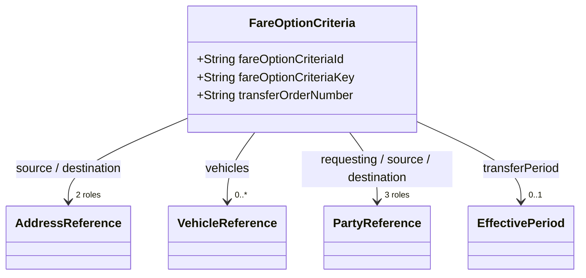
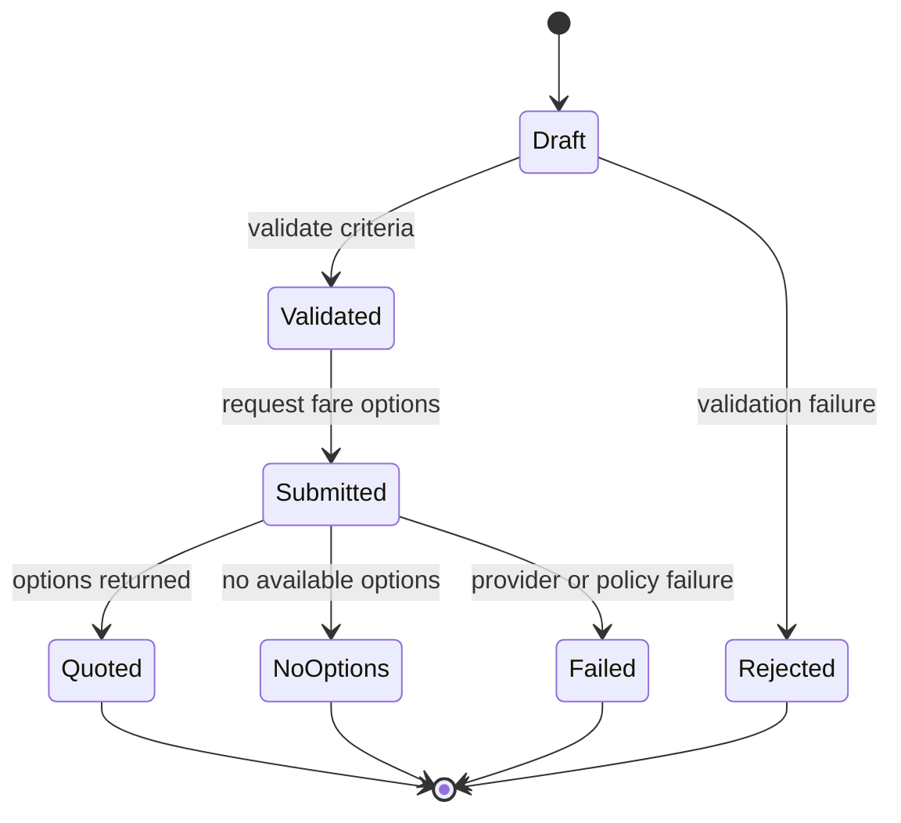

# STAR Domain Documentation — Fare Option Criteria

**Source model:** `fare_option_criteria_clazz.puml`  
**Model type:** `FareOptionCriteria` (candidate aggregate root / request criteria object)  
**Domain:** Vehicle Asset Management / Transportation & Logistics  
**Documentation status:** Model-grounded properties; proposed behavioral and governance guidance  
**JSON naming:** `snake_case`

> **Model fidelity note:** The PlantUML defines `FareOptionCriteria` and its nested references, but does not explicitly designate an aggregate root, declare required fields, define lifecycle statuses, or specify operations. This documentation treats it as the requested documentation subject, not as a proven independent persistence aggregate. Requiredness, invariants, commands, and governance rules are recommendations unless otherwise stated. PlantUML connectors to `ServiceLevelTypes` and `TransportMethodTypes` exist, but the root class does **not** declare corresponding attributes. They are therefore not inserted into example JSON.

## 1. Business Purpose

`FareOptionCriteria` captures the inputs used to **request or evaluate transportation fare options** for moving one or more vehicles from a source to a destination. It provides an origin and destination, vehicles to transport, an optional transfer-order number, parties involved, and the requested transportation period. A fare-shopping service can use these criteria to retrieve and compare carrier offerings; the class itself does not contain fare quotes, rates, carrier selections, or booking confirmation.

### Business capabilities

- Specify a vehicle movement's pickup and delivery locations.
- Identify the vehicle(s) for which transportation options are requested.
- Relate a fare inquiry to a transfer order using `transfer_order_number`.
- Identify requesting, source, and destination parties.
- Express requested scheduling windows through `transfer_period`.
- Provide an auditable, repeatable request payload for external fare services.

### Boundary and responsibilities

**Within this criteria object:** request identifiers, location references, vehicle references, party references, and time-window criteria. **Outside this object:** pricing algorithms, tariff/rate tables, carrier selection, confirmed bookings, shipment execution, and transport-session status. `VehicleTransferOrder` and `VehicleTransportSession` are plausible integration counterparts, but the model does not establish a direct typed relationship to either aggregate.

## 2. Domain Model

### Root and direct relationships

| Property | Model type | Meaning |
|---|---|---|
| `fareOptionCriteriaId` | `String` | External or business-facing criteria identifier. |
| `fareOptionCriteriaKey` | `String` | Internal criteria key. |
| `sourceAddress` | `AddressReference` | Pickup/origin location. |
| `destinationAddress` | `AddressReference` | Delivery/destination location. |
| `vehicles` | `List<VehicleReference>` | Vehicles to be priced for transport. |
| `transferOrderNumber` | `String` | Related transfer-order business number. |
| `requestingParty` | `PartyReference` | Party requesting the fare options. |
| `sourceParty` | `PartyReference` | Party associated with the origin. |
| `destinationParty` | `PartyReference` | Party associated with the destination. |
| `transferPeriod` | `EffectivePeriod` | Requested transfer window or recurrence. |

### Supporting structures

- **`AddressReference`** — address key/id, `addressTypes`, lines 1–5, city, country code, district, label, postal code, state/province, and `authorizationLevels`.
- **`VehicleReference`** — reference key/id, vehicle identifier key, VIN, model year, make/model/trim, display name, stock number, license plate, dealer code, identifiers, tags, body style, trim codes, final assembly points, and fleet codes.
- **`PartyReference`** — party identity, name, party type, authorization/source context, account, role, relationships, snapshot identifier, address references, communication channels, occurrence timestamp, organization indicator, and identifiers.
- **`EffectivePeriod`** — key, active/exclusive indicators, start and complete date/time, duration unit/value, recurrence unit/count/values/criteria/indicator.
- **Nested supporting types** — `Identifier`, `Code`, `PersonName`, `CommunicationChannel`, `AuthorizationLevel`, `PrivacyPolicyRule`, `TimeSlot`, `Locale`, `JurisdictionProfile`.

### Relationship diagram (conceptual)



> Cardinalities in this conceptual diagram are illustrative; the source model does not explicitly specify requiredness or minimum collection sizes.

## 3. Properties and Constraints

### Direct property inventory (complete)

| JSON field | Source type | Required by source? | Recommended validation |
|---|---|---|---|
| `fare_option_criteria_id` | String | Unspecified | Nonblank if assigned; unique within issuing system. |
| `fare_option_criteria_key` | String | Unspecified | Stable opaque key if persisted. |
| `source_address` | AddressReference | Unspecified | Require resolvable pickup location for actionable quote. |
| `destination_address` | AddressReference | Unspecified | Require resolvable delivery location. |
| `vehicles` | Array of VehicleReference | Unspecified | Require at least one vehicle for actionable quote. |
| `transfer_order_number` | String | Unspecified | Resolve against transfer-order registry if provided. |
| `requesting_party` | PartyReference | Unspecified | Require authorized requesting party for priced inquiries. |
| `source_party` | PartyReference | Unspecified | Resolve party if required by fulfillment policy. |
| `destination_party` | PartyReference | Unspecified | Resolve party if required by fulfillment policy. |
| `transfer_period` | EffectivePeriod | Unspecified | Ensure coherent start/end and recurrence rules. |

**Important:** `fare_option_criteria_id` and `fare_option_criteria_key` are separate identifiers. Do not assume they are interchangeable. No `status`, `fare_amount`, `currency`, `carrier`, `service_level`, or `transport_method` field is declared on this root.

### Selected nested property inventories

**AddressReference:** `address_reference_key: String`, `address_reference_id: String`, `address_types: List<AddressTypes>`, `address_line1`–`address_line5: String`, `city: String`, `country_code: String`, `district: String`, `label: String`, `postal_code: String`, `state_province: String`, `authorization_levels: List<AuthorizationLevel>`.

**VehicleReference:** `vehicle_reference_key: String`, `vehicle_reference_id: String`, `vehicle_identifier_key: String`, `vin: String`, `model_year: String`, `make: String`, `model: String`, `trim: String`, `display_name: String`, `stock_number: String`, `license_plate: String`, `dealer_code: String`, `identifiers: List<Identifier>`, `tags: List<Code>`, `body_style: String`, `trim_codes: List<Code>`, `trim_dd_codes: List<Code>`, `final_assembly_point: List<Code>`, `fleet_codes: List<Code>`.

**PartyReference:** `party_reference_id: String`, `party_reference_key: String`, `party_key: String`, `party_name: String`, `individual_name: PersonName`, `party_type: PartyTypes`, `authorization_code: String`, `source_system_code: String`, `context: String`, `account_number: String`, `party_label: String`, `party_description: String`, `primary_role_name: String`, `party_relationship_types: List<PartyRelationshipTypes>`, `snapshot_detail: Identifier`, `address_references: List<AddressReference>`, `communication_channels: List<CommunicationChannel>`, `occurrence_date_time: Date`, `org_indicator: Boolean`, `identifiers: List<Identifier>`.

**EffectivePeriod:** `effective_period_key: String`, `active_indicator: Boolean`, `exclusive_indicator: Boolean`, `start_date_time: Date`, `complete_date_time: Date`, `duration_uom_type: DurationUomTypes`, `duration_value: String`, `recur_uom_type: DurationUomTypes`, `recur_count: String`, `recur_values: List<Code>`, `recur_criteria: String`, `recur_indicator: Boolean`.

### Enumerations from the source model

The following enums are **directly reachable** through root attributes or their nested structures:

- **`AddressTypes`**: `ARCHIVE`, `AR_ADDRESS`, `BILLING`, `BUSINESS`, `CONTRACT`, `CONVOY`, `CURRENT`, `DEALER`, `DELIVERY`, `DESTINATION`, `EMERGENCY`, `GARAGE`, `HOME`, `HUB`, `INSURANCE`, `LEGAL`, `MAILING`, `OFFICE`, `ORIGINAL`, `OTHER`, `PORT`, `POSTAL`, `PO_BOX`, `PREVIOUS`, `PRODUCT`, `RAIL`, `RAMP`, `REBATE`, `RECIPIENT`, `RESIDENCE`, `SERVICE`, `SERVICE_CONTRACT`, `SHIPPING`, `TEMPORARY`, `VACATION`, `WORK`.
- **`PartyTypes`**: `CONTRACTOR`, `CUSTOMER`, `DEALER`, `DEVICE`, `DRIVER`, `EMPLOYEE`, `FINANCE`, `FLEET`, `GOVERNMENT`, `GROUP`, `ORGANIZATION`, `PARTNER`, `PERSON`, `PROSPECT`, `PUBLIC`, `RENTAL`, `RESALE`, `SERVICE`, `SHIP_THROUGH`, `SHIP_TO`, `SOLD_TO`, `SUPPLIER`, `TAX`, `VENDOR`.
- **`DurationUomTypes`**: `BI_WEEKS`, `CUSTOM`, `DAYS`, `DAY_OF_MONTH`, `HOURS`, `MINUTES`, `MONTHS`, `MULTI_YEARS`, `NONE`, `OCCURRENCE`, `OTHER`, `QUARTERS`, `SEMI_MONTHS`, `SEMI_YEARS`, `UNLIMITED`, `WEEKS`, `YEARS`.
- **`CommunicationChannelTypes`**: `APP`, `BROADCAST`, `CELL`, `DIRECT_MAIL`, `EMAIL`, `OTHER`, `PDA`, `PHONE`, `SMS`, `SOCIAL_MEDIA`, `URL`, `VIDEO`, `VOICE`.
- **`CommunicationStatusTypes`**: `BOUNCED`, `CANCELLED`, `DELIVERED`, `EXPIRED`, `FAILED`, `IN_PROGRESS`, `OPTED_OUT`, `PENDING`, `READ`, `REJECTED`, `SCHEDULED`, `SENT`, `SUPPRESSED`, `UNKNOWN`.
- **`TimeSlotStatusTypes`**: `CONFIRMED`, `RELEASED`, `RESERVED`, `TENTATIVE`.
- **`TimeslotDirectiveTypes`**: `AFTER`, `ANYTIME`, `BEFORE`, `BETWEEN`, `BLOCK`, `EXACT`, `FLEXIBLE`, `OTHER`, `PREFERRED`, `REQUIRED`, `RESTRICTED`, `UNKNOWN`.
- **`MaskingStrategyTypes`**: `BLOCK`, `GENERALIZE`, `GENERAL_ANONYMIZE`, `HASH`, `NONE`, `NULLIFY`, `PARTIAL_MASK`, `PERTURB`, `PSEUDONYMIZE`, `REDACT`, `TOKENIZE`, `TRUNCATE`.
- **`PrivacyAdapterTypes`**: `AI_AGENT`, `ALL`, `DATABASE`, `EXTERNAL_API`, `INTERNAL_API`, `LLM`, `MESSAGE_BROKER`.
- **`PrivacyPersonaTypes`**: `CONSUMER`, `DEALER`, `MANUFACTURER`, `REGULATOR`, `THIRD_PARTY`, `UNKNOWN`.
- **`PrivacyTypes`**: includes `GENERAL_BUSINESS`, `GENERAL_CONTACT`, `GENERAL_PERSONAL`, `GEOLOCATION_DATA`, `EMAIL_ADDRESS`, `PHONE_NUMBER`, `HOME_ADDRESS`, `THIRD_PARTY_BUSINESS_DATA`, `THIRD_PARTY_CUSTOMER_DATA`, and other privacy categories defined in the PlantUML source.
- **`PartyRelationshipTypes`**: includes `DEALERSHIP`, `DRIVER`, `OWNER`, `TRANSPORT_PROVIDER`, `SHIP_TO`, `SOLD_TO`, `TRANSACTION_FROM`, `TRANSACTION_TO`, and other relationship values defined in the PlantUML source.

**Unbound enum relationships:** The diagram includes `ServiceLevelTypes` (`FREIGHT`, `GROUND`, `LOCAL_DELIVERY`, `OVERNIGHT`, `PICKUP`, `SAME_DAY`, `TWO_DAY_AIR`) and `TransportMethodTypes` (`AIR`, `COURIER`, `FREIGHT`, `GROUND`, `ROUTE_TRUCK`) connected to `FareOptionCriteria` **without declared properties**. Add explicit attributes if those are intended as request filters; do not assume a JSON property name or cardinality.

### Recommended invariants (not encoded in PlantUML)

1. A quote-ready request has a valid source, destination, and nonempty vehicle list.
2. Vehicle references must not duplicate the same VIN within a single request unless duplicates are explicitly allowed by the business process.
3. A supplied VIN should satisfy VIN formatting and applicable identifier rules; validate against the authoritative VIN policy.
4. If both period endpoints exist, `start_date_time <= complete_date_time`.
5. If `recur_indicator` is true, recurrence parameters must be coherent.
6. Origin and destination should not be identical for a point-to-point transfer unless a special handling scenario is supported.
7. A referenced transfer order must exist and be accessible to the requesting party when lookup is required.
8. Requesting parties must be authorized to receive pricing for the relevant vehicle(s), route, and business context.
9. Address and party snapshots must be treated as references, not authoritative master-data updates.

## 4. JSON Examples

The following are **illustrative, model-aligned payloads**, not schema-validated fixtures. All property names map to declared source properties after camelCase-to-snake_case conversion. The PlantUML does not mark any field required, so “minimal” means smallest useful identification-only representation, not a guaranteed valid quote request.

### 4.1 Minimal — criteria identity

```json
{
  "fare_option_criteria_id": "FOC-10001",
  "fare_option_criteria_key": "FOC-KEY-10001"
}
```

**Expected use:** Draft/reference identity only. **Not quote-ready** under recommended invariants.

### 4.2 Standard — single-vehicle dealer transfer

```json
{
  "fare_option_criteria_id": "FOC-10002",
  "fare_option_criteria_key": "FOC-KEY-10002",
  "transfer_order_number": "VTO-2026-0042",
  "source_address": {
    "address_reference_id": "ADDR-ATL-01",
    "address_types": ["DEALER", "SHIPPING"],
    "address_line1": "100 Example Parkway",
    "city": "Atlanta",
    "state_province": "GA",
    "postal_code": "30301",
    "country_code": "US"
  },
  "destination_address": {
    "address_reference_id": "ADDR-CLT-01",
    "address_types": ["DESTINATION", "DEALER"],
    "address_line1": "200 Sample Avenue",
    "city": "Charlotte",
    "state_province": "NC",
    "postal_code": "28202",
    "country_code": "US"
  },
  "vehicles": [
    {
      "vehicle_reference_id": "VEH-1001",
      "vin": "1HGCM82633A004352",
      "model_year": "2025",
      "make": "Honda",
      "model": "Accord",
      "stock_number": "STK-1001"
    }
  ],
  "requesting_party": {
    "party_reference_id": "PARTY-REQ-01",
    "party_name": "Example Dealer Group",
    "party_type": "DEALER"
  },
  "source_party": {
    "party_reference_id": "PARTY-SRC-01",
    "party_name": "Atlanta Example Dealer",
    "party_type": "DEALER"
  },
  "destination_party": {
    "party_reference_id": "PARTY-DST-01",
    "party_name": "Charlotte Example Dealer",
    "party_type": "DEALER"
  },
  "transfer_period": {
    "effective_period_key": "PERIOD-10002",
    "start_date_time": "2026-11-02T08:00:00Z",
    "complete_date_time": "2026-11-05T18:00:00Z",
    "active_indicator": true
  }
}
```

### 4.3 Advanced — multiple vehicles, recurrence, and contact details

```json
{
  "fare_option_criteria_id": "FOC-10003",
  "fare_option_criteria_key": "FOC-KEY-10003",
  "transfer_order_number": "VTO-2026-0043",
  "source_address": {
    "address_reference_key": "ADDR-SRC-ADV",
    "address_types": ["HUB", "SHIPPING"],
    "address_line1": "300 Logistics Way",
    "city": "Savannah",
    "state_province": "GA",
    "postal_code": "31401",
    "country_code": "US"
  },
  "destination_address": {
    "address_reference_key": "ADDR-DST-ADV",
    "address_types": ["DESTINATION", "DEALER"],
    "address_line1": "400 Distribution Road",
    "city": "Orlando",
    "state_province": "FL",
    "postal_code": "32801",
    "country_code": "US"
  },
  "vehicles": [
    {
      "vehicle_reference_key": "VEH-ADV-01",
      "vin": "1HGCM82633A004352",
      "model_year": "2025",
      "make": "Honda",
      "model": "Accord",
      "stock_number": "SAV-101",
      "tags": [{"code": "PRIORITY", "description": "Priority handling requested"}]
    },
    {
      "vehicle_reference_key": "VEH-ADV-02",
      "vin": "1M8GDM9AXKP042788",
      "model_year": "2024",
      "make": "Example",
      "model": "Fleet Vehicle",
      "stock_number": "SAV-102"
    }
  ],
  "requesting_party": {
    "party_reference_key": "PARTY-REQ-ADV",
    "party_name": "Regional Inventory Operations",
    "party_type": "ORGANIZATION",
    "party_relationship_types": ["RESPONSIBLE"],
    "communication_channels": [
      {
        "communication_channel_type": "EMAIL",
        "value": "logistics@example.org",
        "preferred_indicator": true,
        "verified_indicator": true
      }
    ]
  },
  "source_party": {
    "party_reference_key": "PARTY-SRC-ADV",
    "party_name": "Savannah Vehicle Hub",
    "party_type": "ORGANIZATION"
  },
  "destination_party": {
    "party_reference_key": "PARTY-DST-ADV",
    "party_name": "Orlando Receiving Dealer",
    "party_type": "DEALER"
  },
  "transfer_period": {
    "effective_period_key": "PERIOD-ADV-01",
    "active_indicator": true,
    "start_date_time": "2026-11-09T09:00:00Z",
    "complete_date_time": "2026-11-13T18:00:00Z",
    "recur_indicator": true,
    "recur_uom_type": "WEEKS",
    "recur_count": "2",
    "recur_criteria": "Every week during the stated planning horizon"
  }
}
```

**Example caveats:** Vehicle identities, addresses, parties, and schedule dates are fictional. `recur_count` is modeled as a **String**, not an integer. Recurrence semantics and use of `complete_date_time` as a planning boundary must be confirmed by the domain owner. The model does not declare whether the fare service accepts recurring requests.

## 5. Lifecycle and Behaviors

### Lifecycle interpretation

`FareOptionCriteria` has **no declared status field or lifecycle enumeration**. Therefore, a formal persisted aggregate state machine cannot be derived from the source. A consuming **fare inquiry workflow** may nevertheless have a proposed processing lifecycle:



> These states describe an **external workflow**, not enum values or fields defined on `FareOptionCriteria`.

### Proposed commands and operations

| Command / operation | Input | Responsibility | Output |
|---|---|---|---|
| `CreateFareOptionCriteria` | Locations, vehicles, parties, period | Construct request criteria | Criteria object |
| `ValidateFareOptionCriteria` | Criteria object | Validate shape and business invariants | Validation report |
| `RequestFareOptions` | Valid criteria | Submit request to pricing/transport service | Fare inquiry result / correlation reference |
| `ReviseFareOptionCriteria` | Criteria identifier + changes | Produce updated criteria and revalidate | Updated criteria |
| `CancelFareInquiry` | Inquiry reference | Cancel outstanding inquiry if supported | Cancellation outcome |

### Proposed domain/integration events

- `FareOptionCriteriaCreated`
- `FareOptionCriteriaValidated`
- `FareOptionCriteriaRejected`
- `FareOptionsRequested`
- `FareOptionsReturned`
- `FareOptionsUnavailable`
- `FareInquiryFailed`

These are **proposed names**, not model-defined event classes. A pricing service may own most of them rather than the criteria object itself.

### Business rules

- Never submit an actionable quote request with an empty vehicle list or unresolved route.
- Validate dates and recurrence parameters before requesting fare options.
- A transfer-order reference, when provided, should be checked against the caller's authorized scope.
- Revalidate criteria if a vehicle, pickup/delivery location, or transfer window changes.
- Quote generation should not implicitly create a shipment, dispatch a driver, or commit a carrier booking.
- For multi-vehicle requests, define whether pricing is per vehicle, bundled, or both in the downstream fare response contract.

## 6. Governance

### Authorization model (recommended)

| Operation | Suggested permitted role | Policy considerations |
|---|---|---|
| Create or edit criteria | Authorized dealer / logistics coordinator | Scope to organization, vehicles, and locations. |
| View criteria | Requester, approved carrier integration, authorized operations staff | Minimize party/contact fields. |
| Request fare options | Approved logistics or pricing caller | Validate rate limits, partner agreements, and purpose. |
| Export criteria | Authorized integration/service account | Apply privacy policy, minimization, and retention. |
| View detailed party contacts | Privileged operational users | Restrict personal contact information. |

### Ownership and stewardship

- **Business owner (proposed):** Transportation / logistics operations.
- **Data steward (proposed):** Vehicle logistics domain steward.
- **Authoritative sources:** Vehicle registry for vehicle identity; party master for party identity; address master for locations; transfer-order service for referenced order status.
- **Criteria ownership:** Fare inquiry/quote orchestration service, if this is implemented as a persisted object. Otherwise, the criteria may remain a transient request DTO.

### Data classification

| Data | Suggested classification | Control |
|---|---|---|
| Criteria ID/key, transfer-order number | Internal operational | Access control and traceability |
| VIN, stock number, vehicle identifiers | Internal / business-sensitive | Scoped access; minimize external disclosure |
| Source/destination address | Business-sensitive; potentially personal | Purpose-based access; mask residential locations when unnecessary |
| Party names, emails, phone numbers | Personal or business contact data | Mask, redact, or omit as appropriate |
| Transfer period and route | Operationally sensitive | Restrict disclosure to authorized logistics participants |
| Authorization/privacy metadata | Restricted governance data | Prevent unauthorized alteration or policy bypass |

The source model includes `AuthorizationLevel`, `PrivacyPolicyRule`, `PrivacyTypes`, `PrivacyAdapterTypes`, and `MaskingStrategyTypes` as nested governance-supporting types. Their presence does **not** itself establish enforcement. Runtime policy decisions must be performed by an authorized policy engine.

### Consequences and controls

| Risk | Potential consequence | Recommended mitigation |
|---|---|---|
| Wrong origin/destination | Incorrect quote or vehicle routing | Address resolution and route validation |
| Incorrect VIN / duplicate vehicle | Invalid price or duplicate handling | Vehicle registry validation and deduplication |
| Unauthorized requester | Exposure of route, inventory, or partner pricing | Policy evaluation before submission |
| Incorrect time window | Unavailable service or misleading price | Period consistency validation |
| Personal contact leakage | Privacy incident | Field-level minimization and masking |
| Stale transfer order | Quote unrelated to valid movement | Validate order linkage and business state |

### Audit and evidence

Record, at minimum: correlation ID, criteria ID/key, transfer-order number, actor/service identity, request timestamp, schema/model version, validation result, policy decision, downstream provider invoked, response status, and immutable hash of the canonicalized request where supported. Avoid recording full sensitive payloads in unrestricted logs. Retain evidence according to applicable retention and privacy policies.

For SOMATRIX OS governance, a proposed ledger flow is: `COMMAND_RECEIVED` → `POLICY_EVALUATED` → `RULE_EVALUATED` → `COMMAND_EXECUTED` or `ERROR`, with consequences linked to the request and affected vehicle/transfer-order references.

## 7. Validation and Change Control

### Example test manifest (proposed)

| Test ID | Mutation | Expected result |
|---|---|---|
| `FOC-POS-001` | Standard quote-ready request | Pass schema and recommended domain validation |
| `FOC-NEG-001` | Empty `vehicles` array | Fail `VEHICLE_REQUIRED` business rule |
| `FOC-NEG-002` | `party_type: "NOT_A_TYPE"` | Fail enum validation |
| `FOC-NEG-003` | `start_date_time` later than `complete_date_time` | Fail `INVALID_TRANSFER_PERIOD` |
| `FOC-NEG-004` | Duplicate VIN in vehicle list | Fail `DUPLICATE_VEHICLE` if uniqueness rule adopted |
| `FOC-NEG-005` | Unauthorized requester for order | Fail authorization |
| `FOC-NEG-006` | Add undeclared `transport_method_type` | Fail only if schema enforces `additionalProperties: false` |

### Automated publication pipeline

1. Parse the authoritative PlantUML or, preferably, a machine-readable schema generated from the source model.
2. Generate JSON Schema with explicit requiredness, enums, date formats, and `additionalProperties` policy.
3. Validate positive examples; validate negative examples for the **intended** failure code and path.
4. Run domain rules and policy checks separately from JSON Schema validation.
5. Compare current and previous schema versions and rerun all published examples.
6. Publish documentation only when the example suite and governance checks meet release criteria.

### Model decisions requiring clarification

1. Is `FareOptionCriteria` an independently persisted aggregate root, or a request/value object owned by a fare inquiry or transfer-order workflow?
2. Should `ServiceLevelTypes` and `TransportMethodTypes` be added as explicitly named fields? Their diagram links alone are insufficient to generate JSON.
3. Which fields are mandatory for a valid quote request?
4. Does one criteria request represent one quote for multiple vehicles, or one quote per vehicle?
5. Are recurring transfer periods supported by fare providers?
6. Does `transfer_order_number` uniquely resolve a `VehicleTransferOrder`, or should a transfer-order key/reference also be supplied?

---

**Source fidelity:** Property and enum names were read from `fare_option_criteria_clazz.puml`. Proposed requirements, state names, event names, commands, and governance controls are explicitly identified as recommendations. **Validation status:** Examples were syntax-checked as JSON during documentation generation; they have not been validated against an authoritative executable JSON Schema or production business-rule engine.
