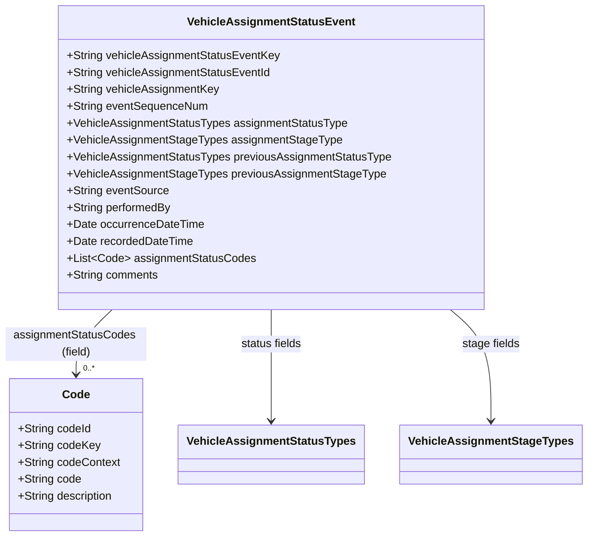
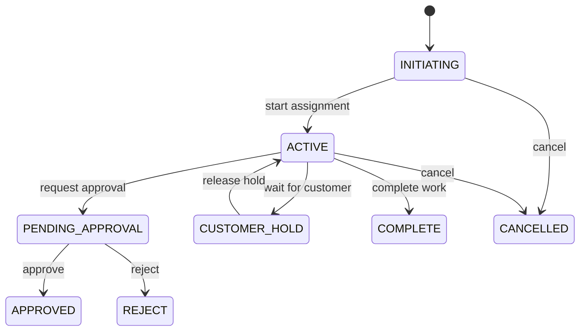

# STAR Domain Documentation — Vehicle Assignment Status Event

**Source model:** `vehicle_assignment_status_event_clazz.puml`  
**Primary class:** `VehicleAssignmentStatusEvent`  
**Model classification:** Status-history/event record; **aggregate-root designation is not established by the source**.  
**Documentation status:** Source-derived schema facts are distinguished from proposed business rules and governance recommendations.

## 1. Business Purpose

`VehicleAssignmentStatusEvent` records a status/stage observation or change associated with a vehicle assignment. The model supports linking an event to a vehicle assignment, identifying the current and previous status and stage, recording event sequence and timing, identifying the source and performer, attaching coded classifications, and storing comments.

**Supported business capabilities (inferred from declared fields):**

- Track assignment status and workflow-stage history.
- Reconstruct ordered assignment events using `eventSequenceNum` and timestamps.
- Record who performed an action and where it originated.
- Associate one or more descriptive codes with an event.
- Support operational investigation, reporting, and audit evidence.

**Boundary note:** The PlantUML does not define a `VehicleAssignment` class, an owning aggregate, persistence rules, or API operations. Treat this as an event/history entity or record unless the wider domain model explicitly establishes it as an independent aggregate root. `vehicleAssignmentKey` is a reference, not proof of aggregate ownership.

## 2. Domain Model

### Source-defined classes

| Class | Role | Notes |
|---|---|---|
| `VehicleAssignmentStatusEvent` | Main event record | Has 14 declared properties. |
| `Code` | Code descriptor | Five string properties. |
| `VehicleAssignmentStatusTypes` | Enumeration | 18 declared values. |
| `VehicleAssignmentStageTypes` | Enumeration | 29 declared values. |

The main class contains `assignmentStatusCodes:List<Code>`. The source draws associations from the two enum classes to the event; no cardinality or composition is declared for these associations. The `Code` class is defined but has no drawn association line; its usage is established by the property type.



**Diagram clarification:** The `0..*` annotation expresses the list representation, not an explicitly specified business cardinality; nullability and minimum size are undefined.

### Relationships and aggregate boundaries

- `vehicleAssignmentKey` identifies the referenced assignment, but no foreign-key enforcement is specified.
- `assignmentStatusType` and `previousAssignmentStatusType` use the same status enum.
- `assignmentStageType` and `previousAssignmentStageType` use the same stage enum.
- `assignmentStatusCodes` holds a list of `Code` objects.
- No link to `VehicleTransferOrder`, `VehicleTransportSession`, or `VehicleTrip` is declared in this file.

## 3. Properties and Constraints

### Main class — exact source fields

| PlantUML property | JSON property | Source type | Required? | Meaning / notes |
|---|---|---|---|---|
| `vehicleAssignmentStatusEventKey` | `vehicle_assignment_status_event_key` | String | Not specified | Event key. |
| `vehicleAssignmentStatusEventId` | `vehicle_assignment_status_event_id` | String | Not specified | Event identifier. |
| `vehicleAssignmentKey` | `vehicle_assignment_key` | String | Not specified | Referenced assignment key. |
| `eventSequenceNum` | `event_sequence_num` | String | Not specified | Sequence identifier; **source type is String**. |
| `assignmentStatusType` | `assignment_status_type` | VehicleAssignmentStatusTypes | Not specified | Current status. |
| `assignmentStageType` | `assignment_stage_type` | VehicleAssignmentStageTypes | Not specified | Current stage. |
| `previousAssignmentStatusType` | `previous_assignment_status_type` | VehicleAssignmentStatusTypes | Not specified | Prior status. |
| `previousAssignmentStageType` | `previous_assignment_stage_type` | VehicleAssignmentStageTypes | Not specified | Prior stage. |
| `eventSource` | `event_source` | String | Not specified | Originating source. |
| `performedBy` | `performed_by` | String | Not specified | Actor identifier/name, semantics unspecified. |
| `occurrenceDateTime` | `occurrence_date_time` | Date | Not specified | Event occurrence date/time. |
| `recordedDateTime` | `recorded_date_time` | Date | Not specified | Event recording date/time. |
| `assignmentStatusCodes` | `assignment_status_codes` | List<Code> | Not specified | Associated code objects. |
| `comments` | `comments` | String | Not specified | Free-form comments. |

**Important:** The source provides no required flags, string lengths, date-time serialization standard, nullability rules, uniqueness constraints, or validation annotations. JSON examples below use ISO 8601 date-time strings as a **proposed serialization convention**, not a requirement established by PlantUML.

### `Code` properties

| PlantUML | JSON | Type | Required? |
|---|---|---|---|
| `codeId` | `code_id` | String | Not specified |
| `codeKey` | `code_key` | String | Not specified |
| `codeContext` | `code_context` | String | Not specified |
| `code` | `code` | String | Not specified |
| `description` | `description` | String | Not specified |

### Enumerations — exact source values

**VehicleAssignmentStatusTypes (18):**

```text
ABANDON, ACTIVE, APPROVED, CANCELLED, COMPLETE, CUSTOMER_HOLD,
DECLINED, FINANCE_HOLD, INACTIVE, INITIATING, INVALID, ON_HOLD,
OTHER, PAYMENT_HOLD, PENDING_APPROVAL, REJECT, SALES_HOLD, UNKNOWN
```

**VehicleAssignmentStageTypes (29):**

```text
ACTIVE, APPOINTMENT, CANCELLED, CHECKIN, CHECKOUT, CLOSE, CLOSED,
COMPLETION, CUSTOMER_AUTHORIZATION, DETAIL, DISASSEMBLE, EVAL,
EVAL_CONSULTATION, EVAL_QUEUE, FOLLOW_UP, INITIATE, INVOICE,
ON_HOLD, OPEN, ORDER_PARTS, OTHER, PROPOSAL_BUILD,
QUALITY_ASSURANCE, REASSEMBLE, REPAIR, RE_OPEN,
VEHICLE_DELIVERY_IN, VEHICLE_DELIVERY_OUT, WORK_IN_PROGRESS
```

### Recommended invariants — **not defined in source**

| ID | Proposed rule | Reason |
|---|---|---|
| VASE-001 | Require `vehicle_assignment_key` for persisted events. | Ensure assignment traceability. |
| VASE-002 | Make `vehicle_assignment_status_event_key` unique and immutable. | Support event identity. |
| VASE-003 | Require a valid enum value whenever status or stage is supplied. | Avoid unrecognized lifecycle values. |
| VASE-004 | Define how to represent the first event when previous status/stage is unknown. | Avoid invented prior states. |
| VASE-005 | Require `occurrence_date_time`; populate `recorded_date_time` when accepted. | Enable temporal audit. |
| VASE-006 | Specify whether `event_sequence_num` must be numeric text and monotonic per assignment. | The source declares it as String. |
| VASE-007 | Reject accidental duplicate event keys; define idempotency for retries. | Prevent repeated history entries. |
| VASE-008 | Decide whether no-op status/stage events are permitted. | Distinguish observation from transition. |
| VASE-009 | Protect and sanitize `comments` and `performed_by`. | Limit sensitive-data leakage. |
| VASE-010 | Define treatment of late-arriving events when occurrence time predates recorded time. | Support asynchronous systems. |

## 4. JSON Examples (snake_case)

These examples use only declared fields, with **illustrative values**. They are not certified against an executable JSON Schema. The minimal example is a *sparse structural illustration*, not a claim about a required-field minimum.

### 4.1 Minimal — event reference and current status

```json
{
  "vehicle_assignment_status_event_key": "VASE-0001",
  "vehicle_assignment_key": "VA-1001",
  "assignment_status_type": "INITIATING",
  "assignment_stage_type": "INITIATE"
}
```

### 4.2 Standard — assignment status change

```json
{
  "vehicle_assignment_status_event_key": "VASE-0002",
  "vehicle_assignment_status_event_id": "EVENT-0002",
  "vehicle_assignment_key": "VA-1001",
  "event_sequence_num": "2",
  "assignment_status_type": "ACTIVE",
  "assignment_stage_type": "WORK_IN_PROGRESS",
  "previous_assignment_status_type": "INITIATING",
  "previous_assignment_stage_type": "INITIATE",
  "event_source": "DEALER_WORKFLOW",
  "performed_by": "USER-248",
  "occurrence_date_time": "2026-10-29T09:15:00Z",
  "recorded_date_time": "2026-10-29T09:15:03Z",
  "assignment_status_codes": [],
  "comments": "Vehicle assignment work started."
}
```

### 4.3 Advanced — hold with coded context

```json
{
  "vehicle_assignment_status_event_key": "VASE-0003",
  "vehicle_assignment_status_event_id": "EVENT-0003",
  "vehicle_assignment_key": "VA-1001",
  "event_sequence_num": "3",
  "assignment_status_type": "CUSTOMER_HOLD",
  "assignment_stage_type": "CUSTOMER_AUTHORIZATION",
  "previous_assignment_status_type": "ACTIVE",
  "previous_assignment_stage_type": "WORK_IN_PROGRESS",
  "event_source": "SERVICE_OPERATIONS",
  "performed_by": "USER-309",
  "occurrence_date_time": "2026-10-29T10:20:00Z",
  "recorded_date_time": "2026-10-29T10:21:10Z",
  "assignment_status_codes": [
    {
      "code_id": "AUTH-01",
      "code_key": "CUSTOMER_AUTHORIZATION_PENDING",
      "code_context": "VEHICLE_ASSIGNMENT",
      "code": "AUTH_PENDING",
      "description": "Awaiting customer authorization"
    },
    {
      "code_id": "OPS-17",
      "code_key": "WORK_PAUSED",
      "code_context": "OPERATIONS",
      "code": "PAUSE",
      "description": "Assignment work paused"
    }
  ],
  "comments": "Work paused pending customer approval."
}
```

The `code_context`, `code_key`, and `code` strings above are **sample business values**, not source-defined controlled vocabularies.

## 5. Lifecycle and Behaviors

### 5.1 Lifecycle interpretation

The source defines *status* and *stage* enumerations, but **does not define a state machine**. Status and stage should be modeled independently: `CUSTOMER_HOLD` is a status, while `CUSTOMER_AUTHORIZATION` is a stage. A valid combination and its permitted successors require domain-owner confirmation.

**Illustrative flow only:**



This diagram shows a subset of the 18 status values, **not** an exhaustive or authoritative transition policy. It does not assert that `REJECT` and `DECLINED` are equivalent, or that `CLOSE` and `CLOSED` stages are interchangeable.

### 5.2 Proposed commands — not in PlantUML

| Command | Intent | Suggested validation |
|---|---|---|
| `RecordAssignmentStatusEvent` | Append an event record. | Assignment reference, enum values, event identity. |
| `ChangeAssignmentStatus` | Request a status transition. | Current state, transition matrix, authorization. |
| `ChangeAssignmentStage` | Move the assignment workflow stage. | Allowed stage progression. |
| `PlaceAssignmentOnHold` | Record a hold condition. | Reason code, role, and policy. |
| `ReleaseAssignmentHold` | Resume processing. | Prior hold and release authority. |
| `CorrectAssignmentEvent` | Amend erroneous history. | Prefer correction event over overwriting history. |

### 5.3 Proposed domain events — not in PlantUML

`VehicleAssignmentStatusChanged`, `VehicleAssignmentStageChanged`, `VehicleAssignmentPlacedOnHold`, `VehicleAssignmentHoldReleased`, `VehicleAssignmentCompleted`, `VehicleAssignmentCancelled`, `VehicleAssignmentEventCorrected`.

**Distinction:** `VehicleAssignmentStatusEvent` is the declared model class. The event names above are proposed integration/domain events and should not be assumed to exist in the source model.

### 5.4 Recommended business rules

1. Evaluate a transition against the **current persisted assignment state**, not only the previous values supplied by a caller.
2. Record both status and stage when either changes, if the domain requires a complete state snapshot.
3. Reject transitions forbidden by an approved transition matrix.
4. Support idempotent ingestion to handle retries and replay.
5. Preserve original occurrence and recorded times, including delayed events.
6. Resolve conflicting concurrent updates with optimistic locking or an equivalent strategy.
7. Decide whether `COMPLETE`, `CANCELLED`, `ABANDON`, `INVALID`, and `REJECT` are terminal states; the source does not specify this.
8. Define whether `RE_OPEN` is a stage that may follow a completed/closed workflow.

## 6. Governance

**All controls in this section are recommendations. The PlantUML declares no governance metadata, security roles, or audit policy.**

### 6.1 Ownership and stewardship

| Role | Recommended responsibility |
|---|---|
| Vehicle assignment domain owner | Approve status/stage semantics and transition matrix. |
| Operational steward | Maintain reason codes and investigate inconsistent histories. |
| Platform/schema steward | Maintain contract, versions, and documentation. |
| Security/governance owner | Approve access, retention, and audit requirements. |

### 6.2 Authorization policy (proposed)

| Operation | Suggested control |
|---|---|
| Read event history | Restrict to authorized assignment readers; scope by organization. |
| Record status/stage event | Require assignment-write permission and valid source identity. |
| Approve / reject | Require an explicit approver role or policy decision. |
| Place / release hold | Check hold-specific authority and reason requirements. |
| Correct history | Restrict to elevated users; preserve evidence of correction. |
| Export event history | Apply least privilege, data minimization, and export logging. |

### 6.3 Data classification (proposed)

| Property group | Suggested classification | Rationale |
|---|---|---|
| Event and assignment keys | Internal | Operational identifiers. |
| Status and stage | Internal | Business workflow state. |
| `performed_by` | Internal / potentially personal data | May identify an employee or user. |
| `comments` | Potentially sensitive free text | May contain customer or employee information. |
| `event_source` | Internal | May reveal system integration details. |
| Timestamps | Internal | May disclose activity patterns. |
| `assignment_status_codes` | Internal; context-dependent | Some codes may imply sensitive business reasons. |

### 6.4 Consequence and risk model (proposed)

| Action | Possible consequence | Suggested safeguard |
|---|---|---|
| Unauthorized approval | Work proceeds without required authorization. | Role/policy evaluation. |
| Incorrect completion | Downstream workflow closes prematurely. | Invariant checks and approval where required. |
| Incorrect hold release | Work resumes despite unresolved dependency. | Hold reason and resolution verification. |
| Event deletion/overwrite | Loss of traceability. | Append-only storage and correction events. |
| Duplicate event ingestion | Misleading event sequence and reporting. | Idempotency and deduplication. |
| Sensitive comments exposed | Privacy or confidentiality incident. | Field-level access and retention controls. |

### 6.5 Audit evidence (proposed)

For each accepted or rejected command, record: correlation/trace ID (external metadata unless added to model), command name, assignment key, event key, actor identity, event source, previous and proposed status/stage, occurrence and recording timestamps, policy/rule decisions, result, error codes, and any emitted downstream events.

**Model gap:** No explicit `correlation_id`, `policy_decision_id`, `rule_evaluation_id`, or `audit_event_key` exists in this PlantUML. These may be captured in an external execution ledger rather than extending this entity.

## 7. Validation and Change Control

### 7.1 Validation strategy

1. Generate an executable JSON Schema from the authoritative model **plus explicit contract decisions** about required fields, dates, and nullability.
2. Parse all published examples as JSON.
3. Validate each example against its target schema version.
4. Run business-rule validation against approved state/stage transition rules.
5. Run authorization/policy tests separately from structural schema tests.
6. Record test results and block publication on unexpected regressions.

### 7.2 Positive and negative test matrix

| Test ID | Scenario | Expected outcome |
|---|---|---|
| VASE-P01 | Known enum values and well-formed payload | Pass *if approved required-field contract is satisfied*. |
| VASE-P02 | Multiple `assignment_status_codes` | Pass if code list permitted. |
| VASE-N01 | `assignment_status_type = "NOT_A_STATUS"` | Reject: invalid enum. |
| VASE-N02 | `assignment_stage_type = "NOT_A_STAGE"` | Reject: invalid enum. |
| VASE-N03 | `assignment_status_codes` supplied as object instead of array | Reject: type mismatch. |
| VASE-N04 | `event_sequence_num` supplied as JSON number | Reject **if** serialized according to the source String type. |
| VASE-N05 | Duplicate event key | Reject **if** uniqueness rule is adopted. |
| VASE-N06 | Unauthorized status transition | Deny **if** policy is adopted. |
| VASE-N07 | Forbidden state transition | Reject **after** transition matrix is approved. |
| VASE-N08 | `recorded_date_time` earlier than `occurrence_date_time` | Review according to approved clock-skew/late-event policy; not inherently invalid in source. |

### 7.3 Change detection

Track modifications to property names, types, list structures, enum values, required-field decisions, transition rules, and governance policy. Revalidate every approved JSON example when a relevant model or rule changes. Generate deterministic negative mutations first; use an LLM to propose additional edge cases, with deterministic validators as the authority.

### 7.4 Source gaps requiring decisions

- Is this record an independent aggregate root or part of a `VehicleAssignment` aggregate?
- Which fields are mandatory for event creation and persistence?
- Is `event_sequence_num` a numeric string, opaque identifier, or sortable sequence?
- What are the legal status/stage combinations and transition paths?
- Which statuses are terminal, and can terminal assignments be reopened?
- Should corrections be appended or should existing events be editable?
- What time-zone and date serialization convention is required?
- Are `Code` values governed by a code registry?
- What are the retention, access, and organizational scoping requirements?

---

## Appendix — Documentation provenance

**Directly defined by the uploaded PlantUML:** Class names, property names and types, enum names and values, the presence of two enum association lines, and the `List<Code>` property.  
**Interpretations:** Business purpose, record classification, and suggested relationships based on field names.  
**Recommendations:** Requiredness, invariants, workflow transitions, commands, emitted domain events, governance controls, serialization conventions, and test policies.  
**Verification performed:** JSON examples parsed successfully and enum/property usage checked against the uploaded model. **Not performed:** Validation against an executable JSON Schema, external code registry, or running business-rule engine.
