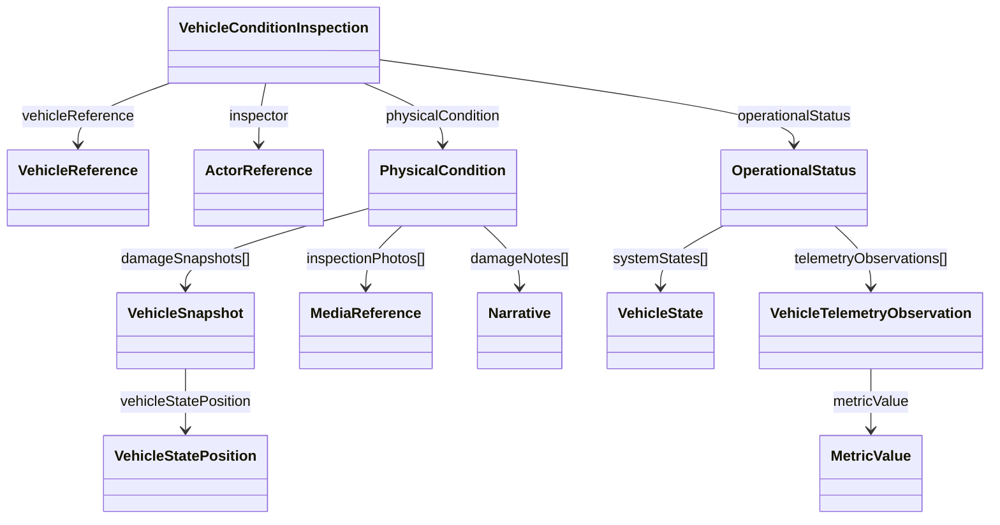

# STAR Domain Documentation — Vehicle Condition Inspection

**Source of truth:** `vehicle_condition_inspection_clazz.puml`  
**Model:** `VehicleConditionInspection`  
**Scope:** Business purpose, domain model, properties, JSON examples, lifecycle, governance, and validation.

> **Source vs. recommendation:** Names, property types, relationships, and enum values below are extracted from the supplied PlantUML. The model does **not** declare required/optional markers, cardinalities, commands, state-transition rules, or authorization policies. Those items are explicitly labeled **proposed**. JSON examples are syntactically valid, but are not certified against an executable JSON Schema.


## 1. Business Purpose

`VehicleConditionInspection` captures a point-in-time inspection of a referenced vehicle, recording its inspection milestone and status, inspector, operability, cosmetic condition, and operational observations. The model supports evidence-backed vehicle handoff, damage reporting, condition comparisons, and downstream transportation or inventory workflows. These uses are architectural interpretations of the fields, not prescribed workflows in the source diagram.

**Boundary:** The inspection owns the recorded inspection assessment (`physical_condition`, `operational_status`) while `vehicle_reference` and `inspector` identify external subjects. It does not itself own the vehicle master record, personnel identity, transport session, or claims processing.


## 2. Domain Model

**Root:** `VehicleConditionInspection`

**Direct object references:** `VehicleReference`, `ActorReference`, `PhysicalCondition`, `OperationalStatus`.

**Notable nested types:** `VehicleSnapshot`, `MediaReference`, `Narrative`, `VehicleState`, `VehicleTelemetryObservation`, `VehicleStatePosition`, `MetricValue`, `Code`, `EffectivePeriod`, `PrivacyPolicyRule`.



The diagram uses directional navigation for readability; it is not a claim of UML composition or required cardinality beyond the source property types.


## 3. Properties and Constraints

### 3.1 Aggregate root — exact source properties

| Java property | JSON property | Declared type | Required? |
|---|---|---|---|

| `vehicleConditionInspectionId` | `vehicle_condition_inspection_id` | `String` | Not specified |

| `vehicleConditionInspectionKey` | `vehicle_condition_inspection_key` | `String` | Not specified |

| `inspectionSequenceNumber` | `inspection_sequence_number` | `String` | Not specified |

| `inspectionCorrelationKey` | `inspection_correlation_key` | `String` | Not specified |

| `vehicleReference` | `vehicle_reference` | `VehicleReference` | Not specified |

| `inspectionMilestoneType` | `inspection_milestone_type` | `ServiceMilestoneTypes` | Not specified |

| `inspectionStatusType` | `inspection_status_type` | `InspectionStatusTypes` | Not specified |

| `inspectionDateTime` | `inspection_date_time` | `String` | Not specified |

| `inspector` | `inspector` | `ActorReference` | Not specified |

| `operableIndicator` | `operable_indicator` | `Boolean` | Not specified |

| `physicalCondition` | `physical_condition` | `PhysicalCondition` | Not specified |

| `operationalStatus` | `operational_status` | `OperationalStatus` | Not specified |


**Declared root enum properties:** `inspection_milestone_type: ServiceMilestoneTypes`; `inspection_status_type: InspectionStatusTypes`. `inspection_date_time` is declared **String**, not `Date`.

### 3.2 Nested class property inventory

The following tables reproduce the declared property types. `List<T>` indicates a collection, but minimum/maximum sizes are not defined.


#### `ActorReference`

| JSON property | Declared type |
|---|---|

| `actor_reference_id` | `String` |

| `actor_reference_key` | `String` |

| `actor_key` | `String` |

| `actor_name` | `String` |

| `actor_type` | `ActorTypes` |

| `privacy_policy_rules` | `List<PrivacyPolicyRule>` |

| `occurrence_date_time` | `Date` |


#### `Address`

| JSON property | Declared type |
|---|---|

| `address_locales` | `List<AddressLocale>` |

| `priority` | `String` |

| `city_code` | `String` |

| `address_key` | `String` |

| `address_id` | `String` |

| `address_input` | `String` |

| `address_line1` | `String` |

| `address_line2` | `String` |

| `address_line3` | `String` |

| `address_line4` | `String` |

| `address_line5` | `String` |

| `address_types` | `List<AddressTypes>` |

| `authorization_levels` | `List<AuthorizationLevel>` |

| `city` | `String` |

| `city_subdivision` | `String` |

| `country` | `String` |

| `country_code` | `String` |

| `county` | `String` |

| `county_code` | `String` |

| `label` | `String` |

| `position` | `Position` |

| `postal_code` | `String` |

| `postal_code_ext` | `String` |

| `preferred_indicator` | `Boolean` |

| `region` | `String` |

| `state` | `String` |


#### `AddressLocale`

| JSON property | Declared type |
|---|---|

| `address_locale_key` | `String` |

| `address_locale_id` | `String` |

| `region_code` | `String` |

| `region_name` | `String` |

| `region_aliases` | `List<Code>` |

| `location_type` | `LocationTypes` |


#### `AuthorizationLevel`

| JSON property | Declared type |
|---|---|

| `update_date_time` | `Date` |

| `authorized_indicator` | `Boolean` |

| `authorization_level_key` | `String` |

| `auth_codes` | `List<Code>` |

| `privacy_policy_rules` | `List<PrivacyPolicyRule>` |


#### `Code`

| JSON property | Declared type |
|---|---|

| `code_id` | `String` |

| `code_key` | `String` |

| `code_context` | `String` |

| `code` | `String` |

| `description` | `String` |


#### `EffectivePeriod`

| JSON property | Declared type |
|---|---|

| `effective_period_key` | `String` |

| `active_indicator` | `Boolean` |

| `exclusive_indicator` | `Boolean` |

| `start_date_time` | `Date` |

| `complete_date_time` | `Date` |

| `duration_uom_type` | `DurationUomTypes` |

| `duration_value` | `String` |

| `recur_uom_type` | `DurationUomTypes` |

| `recur_count` | `String` |

| `recur_values` | `List<Code>` |

| `recur_criteria` | `String` |

| `recur_indicator` | `Boolean` |


#### `Identifier`

| JSON property | Declared type |
|---|---|

| `identifier_id` | `String` |

| `identifier_key` | `String` |

| `context` | `String` |

| `value` | `String` |

| `detail` | `String` |

| `identifier_type` | `String` |

| `system_codes` | `List<Code>` |

| `issuing_authority` | `List<Code>` |


#### `MediaReference`

| JSON property | Declared type |
|---|---|

| `media_key` | `String` |

| `media_id` | `String` |

| `name` | `String` |

| `media_type` | `MediaTypes` |

| `media_format_type` | `MediaFormatTypes` |

| `media_visibility` | `MediaVisibility` |

| `signature` | `String` |

| `media_href` | `String` |

| `capture_stage_type` | `String` |


#### `MediaVisibility`

| JSON property | Declared type |
|---|---|

| `media_visibility_key` | `String` |

| `visibility_key` | `String` |

| `media_privacy_type` | `MediaPrivacyTypes` |

| `externally_hosted_indicator` | `Boolean` |


#### `MetricNameValue`

| JSON property | Declared type |
|---|---|

| `metric_name_value_key` | `String` |

| `metric_name_value_id` | `String` |

| `header_sequence` | `String` |

| `value` | `String` |

| `value_category` | `String` |

| `value_description` | `String` |

| `value_name` | `String` |

| `codes` | `List<Code>` |


#### `MetricValue`

| JSON property | Declared type |
|---|---|

| `metric_value_id` | `String` |

| `metric_value_key` | `String` |

| `value` | `String` |

| `codes` | `List<Code>` |


#### `Narrative`

| JSON property | Declared type |
|---|---|

| `narrative_key` | `String` |

| `narrative_id` | `String` |

| `correlation_id` | `String` |

| `actor` | `ActorReference` |

| `event_actor_role_type` | `StaffRoleTypes` |

| `event_date_time` | `Date` |

| `narrative_group` | `String` |

| `narrative_desc` | `String` |

| `narrative_metrics` | `List<MetricNameValue>` |

| `narrative_type` | `NarrativeTypes` |

| `narrative_name` | `String` |

| `narrative_code` | `String` |

| `narrative_value` | `String` |

| `narrative_uom_type` | `NarrativeUomTypes` |

| `internal_indicator` | `Boolean` |


#### `OperationalStatus`

| JSON property | Declared type |
|---|---|

| `operational_status_id` | `String` |

| `operational_status_key` | `String` |

| `engine_operable_indicator` | `Boolean` |

| `roll_and_brake_indicator` | `Boolean` |

| `keys_present_indicator` | `Boolean` |

| `system_states` | `List<VehicleState>` |

| `telemetry_observations` | `List<VehicleTelemetryObservation>` |

| `codes` | `List<Code>` |

| `inspection_correlation_key` | `String` |


#### `PhysicalCondition`

| JSON property | Declared type |
|---|---|

| `physical_condition_id` | `String` |

| `physical_condition_key` | `String` |

| `overall_cosmetic_grade_type` | `ConditionGradeTypes` |

| `damage_snapshots` | `List<VehicleSnapshot>` |

| `inspection_photos` | `List<MediaReference>` |

| `damage_notes` | `List<Narrative>` |

| `inspection_correlation_key` | `String` |


#### `Position`

| JSON property | Declared type |
|---|---|

| `position_id` | `String` |

| `position_key` | `String` |

| `latitude` | `String` |

| `longitude` | `String` |

| `altitude` | `String` |

| `bearing` | `String` |

| `postal_code` | `String` |

| `county_code` | `String` |


#### `PrivacyPolicyRule`

| JSON property | Declared type |
|---|---|

| `privacy_policy_rule_key` | `String` |

| `privacy_policy_rule_id` | `String` |

| `target_persona_type` | `PrivacyPersonaTypes` |

| `target_data_category_type` | `PrivacyTypes` |

| `adapter_type` | `PrivacyAdapterTypes` |

| `default_strategy_type` | `MaskingStrategyTypes` |

| `active_indicator` | `Boolean` |

| `effective_period` | `EffectivePeriod` |


#### `VehicleReference`

| JSON property | Declared type |
|---|---|

| `vehicle_reference_key` | `String` |

| `vehicle_reference_id` | `String` |

| `vehicle_identifier_key` | `String` |

| `vin` | `String` |

| `model_year` | `String` |

| `make` | `String` |

| `model` | `String` |

| `trim` | `String` |

| `display_name` | `String` |

| `stock_number` | `String` |

| `license_plate` | `String` |

| `dealer_code` | `String` |

| `identifiers` | `List<Identifier>` |

| `tags` | `List<Code>` |

| `body_style` | `String` |

| `trim_codes` | `List<Code>` |

| `trim_dd_codes` | `List<Code>` |

| `final_assembly_point` | `List<Code>` |

| `fleet_codes` | `List<Code>` |


#### `VehicleSnapshot`

| JSON property | Declared type |
|---|---|

| `vehicle_snapshot_key` | `String` |

| `vehicle_snapshot_id` | `String` |

| `snapshot_type` | `String` |

| `snapshot_source` | `String` |

| `parent_entity_key` | `String` |

| `occurrence_date_time` | `Date` |

| `vehicle_state_position` | `VehicleStatePosition` |

| `vehicle_states` | `List<VehicleState>` |

| `narratives` | `List<Narrative>` |

| `media_references` | `List<MediaReference>` |

| `snapshot_codes` | `List<Code>` |

| `service_milestone_types` | `ServiceMilestoneTypes` |


#### `VehicleState`

| JSON property | Declared type |
|---|---|

| `vehicle_state_key` | `String` |

| `vehicle_state_id` | `String` |

| `vehicle_state_name` | `String` |

| `value` | `String` |

| `vehicle_system_type` | `VehicleSystemTypes` |

| `vehicle_resource_type` | `VehicleResourceTypes` |

| `vehicle_value_type` | `VehicleStateUomTypes` |

| `vehicle_state_type` | `VehicleStateTypes` |

| `vehicle_status_type` | `VehicleStatusTypes` |

| `occurrence_date_time` | `Date` |

| `recorded_date_time` | `Date` |

| `vehicle_state_position` | `VehicleStatePosition` |

| `narratives` | `List<Narrative>` |

| `vehicle_state_codes` | `List<Code>` |


#### `VehicleStatePosition`

| JSON property | Declared type |
|---|---|

| `vehicle_state_position_key` | `String` |

| `vehicle_state_position_id` | `String` |

| `position_type` | `String` |

| `position` | `Position` |

| `address` | `Address` |

| `dop` | `String` |

| `altitude` | `MetricValue` |

| `bearing` | `MetricValue` |

| `speed` | `MetricValue` |

| `horizontal_accuracy` | `MetricValue` |

| `vertical_accuracy` | `MetricValue` |

| `occurrence_date_time` | `Date` |

| `recorded_date_time` | `Date` |

| `mask_indicator` | `Boolean` |

| `position_codes` | `List<Code>` |


#### `VehicleTelemetryObservation`

| JSON property | Declared type |
|---|---|

| `vehicle_telemetry_observation_key` | `String` |

| `vehicle_telemetry_observation_id` | `String` |

| `metric_code` | `String` |

| `source_system_code` | `String` |

| `source_device_key` | `String` |

| `sensor_identifier` | `String` |

| `position_reference_key` | `String` |

| `valid_indicator` | `Boolean` |

| `estimated_indicator` | `Boolean` |

| `derived_indicator` | `Boolean` |

| `occurrence_date_time` | `Date` |

| `confidence_score` | `String` |

| `data_quality_score` | `String` |

| `aggregation_type` | `AggregationTypes` |

| `effective_period` | `EffectivePeriod` |

| `observation_codes` | `List<Code>` |

| `metric_type` | `VehicleTelemetryMetricTypes` |

| `service_milestone_types` | `ServiceMilestoneTypes` |

| `correlation_id` | `String` |

| `metric_value` | `MetricValue` |

| `recorded_date_time` | `Date` |

| `source` | `String` |


### 3.3 Enumerations from the source model

The full values are listed to avoid inventing or silently renaming codes.


**`ActorTypes`** (24 values): `AGENT`, `AI_AGENT`, `API`, `APPLICATION`, `CONTRACTOR`, `CUSTOMER`, `DEALER`, `DEVICE`, `EMPLOYEE`, `EVENT_HANDLER`, `GOVERNMENT`, `ORGANIZATION`, `PARTNER`, `PROCESS`, `RULE_ENGINE`, `SCHEDULER`, `SENSOR`, `SERVICE`, `SUPPLIER`, `SYSTEM`, `UNKNOWN`, `USER`, `VENDOR`, `WORKFLOW`.


**`AddressTypes`** (36 values): `ARCHIVE`, `AR_ADDRESS`, `BILLING`, `BUSINESS`, `CONTRACT`, `CONVOY`, `CURRENT`, `DEALER`, `DELIVERY`, `DESTINATION`, `EMERGENCY`, `GARAGE`, `HOME`, `HUB`, `INSURANCE`, `LEGAL`, `MAILING`, `OFFICE`, `ORIGINAL`, `OTHER`, `PORT`, `POSTAL`, `PO_BOX`, `PREVIOUS`, `PRODUCT`, `RAIL`, `RAMP`, `REBATE`, `RECIPIENT`, `RESIDENCE`, `SERVICE`, `SERVICE_CONTRACT`, `SHIPPING`, `TEMPORARY`, `VACATION`, `WORK`.


**`AggregationTypes`** (53 values): `ABSOLUTE_DELTA`, `AVERAGE`, `AVG`, `BOOLEAN_ALL`, `BOOLEAN_ANY`, `CONSENSUS`, `COUNT`, `CUMULATIVE`, `CUSTOM`, `DELTA`, `DISTINCT`, `DISTINCT_COUNT`, `EARLIEST`, `EXPONENTIALLY_WEIGHTED_AVERAGE`, `EXTRAPOLATED`, `FIRST`, `INDEXED`, `INSTANTANEOUS`, `INTERPOLATED`, `ITEM`, `LAST`, `LATEST`, `LIST`, `MAJORITY`, `MAX`, `MAXIMUM`, `MEAN`, `MEDIAN`, `MIN`, `MINIMUM`, `MODE`, `MOVING_AVERAGE`, `MOVING_SUM`, `NONE`, `NORMALIZED`, `OTHER`, `PERCENTILE`, `PERCENT_CHANGE`, `QUANTILE`, `RANGE`, `RATE`, `RATIO`, `ROLLING_MAXIMUM`, `ROLLING_MINIMUM`, `RUNNING_TOTAL`, `STANDARD_DEVIATION`, `SUM`, `TIME_WEIGHTED_AVERAGE`, `TOTAL`, `UNKNOWN`, `VARIANCE`, `WEIGHTED_AVERAGE`, `WINDOWED`.


**`ConditionGradeTypes`** (14 values): `ACCEPTABLE`, `DAMAGED`, `DAMAGED_COSMETIC`, `DAMAGED_MAJOR`, `DAMAGED_MINOR`, `EXCELLENT`, `FAIR`, `GOOD`, `LIKE_NEW`, `OTHER`, `POOR`, `SEVERE_DAMAGE`, `UNGRADED`, `VERY_GOOD`.


**`DurationUomTypes`** (17 values): `BI_WEEKS`, `CUSTOM`, `DAYS`, `DAY_OF_MONTH`, `HOURS`, `MINUTES`, `MONTHS`, `MULTI_YEARS`, `NONE`, `OCCURRENCE`, `OTHER`, `QUARTERS`, `SEMI_MONTHS`, `SEMI_YEARS`, `UNLIMITED`, `WEEKS`, `YEARS`.


**`InspectionStatusTypes`** (7 values): `CANCELLED`, `COMPLETED`, `IN_PROGRESS`, `ON_HOLD`, `PENDING`, `REJECTED`, `STAGED`.


**`LocationTypes`** (22 values): `ADDRESS`, `BOROUGH`, `BOUNDARY`, `CITY`, `COUNTRY`, `COUNTY`, `DISTRICT`, `FEDERAL`, `GPS`, `LOCALITY`, `NO_PREFERENCE`, `PARISH`, `POSTAL`, `PROVINCE`, `REGION`, `STATE`, `STREET`, `SUB_ADMIN_AREA`, `SUB_LOCALITY`, `TELEMATICS`, `VILLAGE`, `WAREHOUSE`.


**`MaskingStrategyTypes`** (12 values): `BLOCK`, `GENERALIZE`, `GENERAL_ANONYMIZE`, `HASH`, `NONE`, `NULLIFY`, `PARTIAL_MASK`, `PERTURB`, `PSEUDONYMIZE`, `REDACT`, `TOKENIZE`, `TRUNCATE`.


**`MediaFormatTypes`** (38 values): `AIFF`, `AVI`, `BMP`, `BZ2`, `CONTAINER`, `CSV`, `DOC`, `DOCX`, `EPUB`, `FLAC`, `FLV`, `GIF`, `GZ`, `HTML`, `ICO`, `JPG`, `JSON`, `MKV`, `MOBI`, `MOV`, `MP4`, `MPG`, `OCTET`, `ODT`, `OTHER`, `PDF`, `PNG`, `PPT`, `PPTX`, `RAR`, `SVG`, `SWF`, `WAV`, `WMV`, `XLS`, `XLSX`, `YAML`, `ZIP`.


**`MediaPrivacyTypes`** (7 values): `ARCHIVED`, `AUTHORIZED`, `DRAFT`, `PRIVATE`, `PUBLIC`, `SCHEDULED`, `UNLISTED`.


**`MediaTypes`** (28 values): `APPLICATION`, `ARCHIVE`, `AUDIO`, `CSS`, `DOCUMENT`, `EXECUTABLE`, `FILE`, `FONT`, `GIF`, `HTML`, `IMAGE`, `JAVASCRIPT`, `JPEG`, `JSON`, `MODEL`, `MP3`, `MP4`, `MPEG`, `OCTET`, `PDF`, `PNG`, `QUICKTIME`, `STREAM`, `SVG`, `TEXT`, `VIDEO`, `WAV`, `XML`.


**`NarrativeTypes`** (62 values): `AGGREGATE`, `AI_RECOMMENDATION`, `ALERT`, `AUDIT`, `BUSINESS_RULE`, `CAPABILITY`, `CASE`, `CAUSE`, `CLAIM`, `COMMUNICATION`, `COMPLAINT`, `COMPLIANCE`, `CONSEQUENCE`, `CORRECTION`, `CUSTOMER_NOTE`, `CUSTOM_ORDER`, `DECISION`, `DELIVERY`, `DENIAL`, `DIAGNOSTIC`, `DIAGNOSTIC_METRICS`, `DIAGNOSTIC_PROCESS`, `DISCLAIMER`, `ERROR`, `ESTIMATE`, `FAILURE`, `FINAL_REPORT`, `FINANCIAL`, `FLEET`, `INFO`, `INSPECTION`, `INSURANCE`, `INTENT`, `INVENTORY`, `INVOICE`, `LABOR`, `LOGISTICS`, `MAINTENANCE`, `OWNERSHIP`, `PART`, `QUALITY`, `RECALL`, `REPORTING_METRICS`, `REQUIREMENT_METRICS`, `RISK`, `SALES`, `SALE_NEW`, `SALE_USED`, `SECURITY`, `SERVICE`, `SERVICE_LIFECYCLE_MILESTONE`, `SERVICE_PLAN`, `SPECIAL`, `SUBLET`, `SYMPTOM`, `TELEMETRY`, `TRANSPORT`, `VEHICLE_LIFECYCLE`, `WARRANTY`, `WARRANTY_APPEAL`, `WARRANTY_APPROVAL`, `WARRANTY_DENIAL`.


**`NarrativeUomTypes`** (82 values): `AMPERE`, `ARRAY`, `BAR`, `BINARY`, `BI_WEEKS`, `BOOLEAN`, `CELSIUS`, `CENTIMETER`, `CODE`, `COUNT`, `CUBIC_METER`, `CURRENCY`, `CUSTOM`, `DATE`, `DATE_TIME`, `DAYS`, `DAY_OF_MONTH`, `DEGREES`, `DESC`, `DOUBLE`, `DURATION`, `FAHRENHEIT`, `FATHOM`, `FEET`, `FLOAT`, `FLUID_OUNCE`, `GALLON`, `GRAMS`, `GROUP`, `G_FORCE`, `HOURS`, `HP`, `INCH`, `INT32`, `INT64`, `INTEGER`, `KELVIN`, `KEY`, `KG`, `KILOWATT_HOUR`, `KM`, `KPA`, `LABEL`, `LB`, `LITER`, `METER`, `MI`, `MILES`, `MILLIMETER`, `MINUTES`, `MONTHS`, `MULTI_YEARS`, `NAUTICAL`, `NONE`, `NUMBER`, `OBJECT`, `OCCURRENCE`, `OHM`, `OTHER`, `OZ`, `PERCENT`, `POINTS`, `PROTECTED_TEXT`, `PSI`, `QUARTERS`, `RANKINE`, `RATIO`, `RPM`, `SCORE`, `SECONDS`, `SEMI_MONTHS`, `SEMI_YEARS`, `STRING`, `TEXT`, `TIME`, `TONS`, `UNLIMITED`, `VOLT`, `WATT`, `WEEKS`, `YARD`, `YEARS`.


**`PrivacyAdapterTypes`** (7 values): `AI_AGENT`, `ALL`, `DATABASE`, `EXTERNAL_API`, `INTERNAL_API`, `LLM`, `MESSAGE_BROKER`.


**`PrivacyPersonaTypes`** (6 values): `CONSUMER`, `DEALER`, `MANUFACTURER`, `REGULATOR`, `THIRD_PARTY`, `UNKNOWN`.


**`PrivacyTypes`** (52 values): `ACCOUNT_CREDENTIALS`, `ALL_DATA`, `BANK_ACCOUNT_NUMBER`, `CREDIT_CARD_NUMBER`, `CRIMINAL_RECORD_HISTORY`, `CRYPTO_WALLET_ADDRESS`, `CUSTOM`, `DATE_OF_BIRTH`, `DEVICE_ID`, `DRIVER_LICENSE_NUMBER`, `EMAIL_ADDRESS`, `EMOTION_RECOGNITION_DATA`, `FACE_SCAN`, `FINGERPRINT`, `GENERAL_BIO`, `GENERAL_BUSINESS`, `GENERAL_CONTACT`, `GENERAL_DATA`, `GENERAL_FINANCIAL`, `GENERAL_MEDICAL`, `GENERAL_OPERATIONAL`, `GENERAL_PERSONAL`, `GENERAL_SOCIAL`, `GENETIC_DATA`, `GEOLOCATION_DATA`, `HEALTH_INSURANCE_ID`, `HOME_ADDRESS`, `IP_ADDRESS`, `MEDICAL_RECORD_NUMBER`, `MOTHER_MAIDEN_NAME`, `NATIONALITY_CITIZENSHIP`, `ONLINE_BEHAVIORAL_DATA`, `PASSPORT_NUMBER`, `PAYPAL_ACCOUNT`, `PHONE_NUMBER`, `POLITICAL_AFFILIATION`, `PRESCRIPTION_DETAILS`, `RACIAL_ETHNIC_ORIGIN`, `RELIGIOUS_PHILOSOPHICAL_BELIEF`, `ROUTING_NUMBER`, `SEXUAL_ORIENTATION`, `SEX_LIFE_HEALTH`, `SOCIAL_MEDIA_HANDLE`, `SOCIAL_MEDIA_PROFILE`, `SOCIAL_SECURITY_NUMBER`, `TAX_ID_NUMBER`, `THIRD_PARTY_BUSINESS_DATA`, `THIRD_PARTY_CUSTOMER_DATA`, `TRADE_UNION_MEMBERSHIP`, `UNION_GOVERNMENT_ID`, `UNKNOWN`, `VOICE_PRINT`.


**`ServiceMilestoneTypes`** (25 values): `ARRIVAL`, `BOOKING`, `CHECK_IN`, `CHECK_OUT`, `DIAGNOSTIC_COMPLETE`, `DIAGNOSTIC_START`, `DROP_OFF`, `ESTIMATE_APPROVED`, `EXPECTED_ARRIVAL`, `INFORMATIONAL`, `MILESTONE`, `PICKUP`, `PRE_INSPECTION`, `QUALITY_CONTROL`, `RELEASE`, `ROAD_TEST`, `SERVICE_COMPLETION`, `SERVICE_PAUSED`, `SERVICE_START`, `STAGED_FOR_PICKUP`, `SUBLET_DISPATCH`, `SUBLET_IN_PROGRESS`, `SUBLET_RETURN`, `UNKNOWN`, `WAYPOINT`.


**`StaffRoleTypes`** (29 values): `ACCOUNTING_MANAGER`, `BUSINESS_DEVELOPMENT_REPRESENTATIVE`, `BUSINESS_MANAGER`, `CLOSING_MANAGER`, `CONTROLLER`, `CUSTOMER_SERVICE_REPRESENTATIVE`, `DEALER_PRINCIPAL`, `DETAIL_MANAGER`, `DETAIL_TECHNICIAN`, `FINANCE_AND_INSURANCE_MANAGER`, `FLEET_MANAGER`, `GENERAL_MANAGER`, `GENERAL_SALES_MANAGER`, `INVENTORY_MANAGER`, `MARKETING_MANAGER`, `OFFICE_MANAGER`, `OTHER`, `PARTS_ADVISOR`, `PARTS_MANAGER`, `PARTS_SPECIALIST`, `RECEPTIONIST`, `SALES_MANAGER`, `SALES_PERSON`, `SERVICE_ADVISOR`, `SERVICE_MANAGER`, `SERVICE_TECHNICIAN`, `SHOP_FOREMAN`, `TITLE_CLERK`, `WARRANTY_ADMINISTRATOR`.


**`VehicleResourceTypes`** (48 values): `AIRBAG`, `AIR_EXT`, `AIR_FILTER`, `AIR_INT`, `AIR_METERING`, `BATTERY`, `BODY`, `BRAKES`, `BRAKE_FLUID`, `BRAKE_PAD`, `CHARGE`, `CHARGER`, `CHARGE_POWER`, `CHARGE_PRIORITY`, `CHASSIS`, `DIAGNOSTIC`, `DOOR`, `DRIVE_CYCLE`, `ELECTRICAL`, `EMISSION`, `ENERGY`, `ENGINE`, `FLUID`, `FUEL`, `GEAR`, `IDLE`, `IDLE_CONTROL`, `IGNITION`, `LAMPS`, `LIGHTS`, `MOTOR`, `NETWORK`, `ODOMETER`, `OIL`, `OTHER`, `PLACARD`, `PLUG`, `POWER_TRAIN`, `RANGE`, `SPEED`, `SPEED_CONTROL`, `STABILITY`, `STARTER`, `SYSTEM_HW`, `SYSTEM_SW`, `TIRE`, `TRANSMISSION`, `WASHER_FLUID`.


**`VehicleStateTypes`** (12 values): `ACTIVE`, `CRASH`, `CRITICAL`, `DEPLOYED`, `HIGH`, `LOW`, `NONE`, `OFF`, `OK`, `ON`, `TEST`, `WARNING`.


**`VehicleStateUomTypes`** (52 values): `ACTIVE`, `ACTUAL`, `AVG`, `CAPACITY`, `CHANGE`, `CLOSE`, `CONSUMPTION`, `COST`, `DAMAGE`, `DEFECTIVE`, `DEPLOYMENT`, `DETECTION`, `DISTANCE`, `ECONOMY`, `EFFICIENCY`, `EVENT`, `EXCESSIVE`, `FAULT`, `FLAT`, `HARD`, `INSTALLED`, `LEAK`, `LEVEL`, `LIFE`, `LIFETIME_HOURS`, `LIMIT`, `MEAN`, `MODE`, `NOMINAL`, `OPEN`, `PERFORMANCE`, `POINTS`, `POSITION`, `POWER`, `PRESSURE`, `QUALITY`, `REPLACEMENT`, `ROTATION`, `STATE`, `STATUS`, `STATUS_ACTUAL`, `TEMPERATURE`, `UPDATING`, `USABLE`, `USAGE`, `USED`, `UTILIZATION`, `VALID`, `VALUE`, `VIBRATION`, `VIOLATION`, `WEAR`.


**`VehicleStatusTypes`** (15 values): `ACTIVE`, `DISPOSED`, `IN_RECEIVING`, `IN_SERVICE`, `IN_STOCK`, `LOST_STOLEN`, `OTHER`, `PENDING_ACQUISITION`, `PENDING_RESERVED`, `PROPOSED`, `RECALL`, `RESERVED`, `RETIRED`, `SOLD`, `UNDER_MAINTENANCE`.


**`VehicleSystemTypes`** (36 values): `ADAS`, `AUTONOMOUS`, `BATTERY`, `BODY`, `BRAKING`, `CAMERA`, `CHARGING`, `CLIMATE_CONTROL`, `COMMUNICATION`, `CONTROL`, `DIAGNOSTICS`, `DRIVETRAIN`, `ELECTRICAL`, `ELECTRIC_POWER`, `ENGINE`, `EXHAUST`, `EXTERIOR`, `FUEL`, `HMI`, `INFOTAINMENT`, `INTERIOR`, `LIGHTING`, `MAPPING`, `NAVIGATION`, `OTHER`, `POWERTRAIN`, `POWER_MANAGEMENT`, `REPORTING`, `SAFETY`, `SECURITY`, `SENSORS`, `STEERING`, `SUSPENSION`, `TELEMATICS`, `TRANSMISSION`, `V2X`.


**`VehicleTelemetryMetricTypes`** (17 values): `ACCELERATION`, `AMBIENT_TEMPERATURE`, `BATTERY_LEVEL`, `BATTERY_SOC`, `BATTERY_STATE_OF_CHARGE`, `BATTERY_VOLTAGE`, `ENGINE_RPM`, `ENGINE_TEMPERATURE`, `FLUID_LEVEL`, `FUEL_LEVEL`, `HEADING`, `ODOMETER`, `OIL_LIFE`, `REMAINING_RANGE`, `SPEED`, `TIRE_PRESSURE`, `UNKNOWN`.


### 3.4 Proposed invariants (not defined in PlantUML)

1. An inspection should identify a vehicle and have a stable inspection key.
2. A completed inspection should have an inspection timestamp, inspector, and at least one substantive condition assessment.
3. `inspection_sequence_number` should be ordered within the relevant inspection correlation or vehicle context; exact scope must be decided.
4. `inspection_correlation_key` should be propagated consistently to condition components when used for reconciliation.
5. Damage evidence should retain immutable capture metadata and enforce privacy/retention policies.
6. `operable_indicator` should be reconciled with operational indicators where business rules require consistency; the source does not establish an automatic derivation.
7. Inspection time strings should use a documented ISO 8601 convention; the model currently declares `String`.


## 4. JSON Examples (snake_case)

**Important:** Example values are illustrative. Optionality and requiredness are not asserted by the source; minimal means a small illustrative payload, not a verified minimal valid contract.


### 4.1 Minimal / pending inspection

```json
{
  "vehicle_condition_inspection_key": "VCI-2026-00041",
  "vehicle_reference": {
    "vin": "1HGCM82633A004352"
  },
  "inspection_status_type": "PENDING"
}
```


### 4.2 Standard / completed inspection

```json
{
  "vehicle_condition_inspection_key": "VCI-2026-00041",
  "vehicle_reference": {
    "vin": "1HGCM82633A004352"
  },
  "inspection_status_type": "COMPLETED",
  "vehicle_condition_inspection_id": "INS-0041",
  "inspection_sequence_number": "1",
  "inspection_correlation_key": "CORR-TRIP-456",
  "inspection_milestone_type": "PICKUP",
  "inspection_date_time": "2026-10-29T09:15:00-04:00",
  "inspector": {
    "actor_key": "USR-INSPECTOR-07",
    "actor_name": "Inspection Technician",
    "actor_type": "EMPLOYEE"
  },
  "operable_indicator": true,
  "physical_condition": {
    "physical_condition_key": "PC-0041",
    "overall_cosmetic_grade_type": "GOOD",
    "damage_notes": [
      {
        "narrative_desc": "Small scratch on rear bumper",
        "event_date_time": "2026-10-29T09:15:00-04:00"
      }
    ]
  },
  "operational_status": {
    "operational_status_key": "OPS-0041",
    "engine_operable_indicator": true,
    "roll_and_brake_indicator": true,
    "keys_present_indicator": true
  }
}
```


### 4.3 Advanced / evidence and telemetry

```json
{
  "vehicle_condition_inspection_key": "VCI-2026-00041",
  "vehicle_reference": {
    "vin": "1HGCM82633A004352",
    "vehicle_reference_key": "VREF-0041",
    "make": "Honda",
    "model": "Accord",
    "model_year": "2024",
    "stock_number": "STK-88"
  },
  "inspection_status_type": "COMPLETED",
  "vehicle_condition_inspection_id": "INS-0041",
  "inspection_sequence_number": "1",
  "inspection_correlation_key": "CORR-TRIP-456",
  "inspection_milestone_type": "PICKUP",
  "inspection_date_time": "2026-10-29T09:15:00-04:00",
  "inspector": {
    "actor_key": "USR-INSPECTOR-07",
    "actor_name": "Inspection Technician",
    "actor_type": "EMPLOYEE"
  },
  "operable_indicator": true,
  "physical_condition": {
    "physical_condition_key": "PC-0041",
    "overall_cosmetic_grade_type": "GOOD",
    "damage_notes": [
      {
        "narrative_desc": "Small scratch on rear bumper",
        "event_date_time": "2026-10-29T09:15:00-04:00"
      }
    ],
    "inspection_correlation_key": "CORR-TRIP-456",
    "damage_snapshots": [
      {
        "vehicle_snapshot_key": "SNAP-01",
        "snapshot_type": "DAMAGE",
        "occurrence_date_time": "2026-10-29T09:12:00-04:00",
        "media_references": [
          {
            "media_key": "PHOTO-01",
            "media_type": "IMAGE",
            "media_format_type": "JPG",
            "media_href": "https://example.invalid/inspection/photo-01.jpg"
          }
        ]
      }
    ],
    "inspection_photos": [
      {
        "media_key": "PHOTO-02",
        "media_format_type": "JPG",
        "media_href": "https://example.invalid/inspection/photo-02.jpg"
      }
    ]
  },
  "operational_status": {
    "operational_status_key": "OPS-0041",
    "engine_operable_indicator": true,
    "roll_and_brake_indicator": true,
    "keys_present_indicator": true,
    "inspection_correlation_key": "CORR-TRIP-456",
    "system_states": [
      {
        "vehicle_state_key": "STATE-01",
        "vehicle_state_name": "battery_condition",
        "value": "NORMAL",
        "vehicle_system_type": "BATTERY"
      }
    ],
    "telemetry_observations": [
      {
        "vehicle_telemetry_observation_key": "OBS-01",
        "metric_type": "ODOMETER",
        "metric_value": {
          "value": "28620"
        },
        "occurrence_date_time": "2026-10-29T09:10:00-04:00"
      }
    ]
  }
}
```


## 5. Lifecycle and Behaviors (proposed)

The model declares these **actual** inspection statuses: `CANCELLED`, `COMPLETED`, `IN_PROGRESS`, `ON_HOLD`, `PENDING`, `REJECTED`, `STAGED`. It does not define transitions.

**Candidate flow (requires business approval):** `PENDING → STAGED → IN_PROGRESS → COMPLETED`, with `ON_HOLD` possible during preparation or execution, and `CANCELLED` / `REJECTED` representing alternative terminal outcomes. These are proposed semantics, not facts from the PlantUML.

| Proposed command | Possible precondition | Outcome / event |
|---|---|---|
| `CreateInspection` | Vehicle identified | `VehicleConditionInspectionCreated` |
| `StageInspection` | Pending | `VehicleConditionInspectionStaged` |
| `StartInspection` | Pending or staged | `VehicleConditionInspectionStarted` |
| `RecordPhysicalCondition` | Inspection active | `VehiclePhysicalConditionRecorded` |
| `RecordOperationalStatus` | Inspection active | `VehicleOperationalStatusRecorded` |
| `AttachInspectionEvidence` | Authorized and evidence valid | `VehicleInspectionEvidenceAttached` |
| `CompleteInspection` | Required assessments satisfied | `VehicleConditionInspectionCompleted` |
| `HoldInspection` | Not terminal | `VehicleConditionInspectionHeld` |
| `CancelInspection` | Policy permits | `VehicleConditionInspectionCancelled` |

**Proposed rules:** prevent unauthorized modification after completion; preserve original evidence on corrections; validate vehicle and actor references; avoid interpreting absence of telemetry as a positive inspection result; and preserve correlation and timestamps for audit.


## 6. Governance (proposed)

### 6.1 Ownership and authorization

**Suggested data owner:** Vehicle operations / logistics domain. **Suggested stewards:** Inspection operations and vehicle quality. **Authorized roles:** inspection technician, supervisor, logistics operator, quality reviewer, and read-only integrator, subject to actual organizational policy.

| Operation | Proposed control |
|---|---|
| Create or start inspection | Authenticated inspector with vehicle/location scope |
| Record condition or telemetry | Authorized source and validated evidence provenance |
| Complete or reject | Supervisor/inspector authority per policy and segregation of duties |
| View images, VIN, location, inspector | Least-privilege access, purpose limitation, redaction where appropriate |
| Correct completed record | Append correction or superseding event; preserve original evidence |

### 6.2 Data classification

- **Vehicle identifiers:** VIN, stock number, license plate — business-sensitive; may become personal data when linked to an individual.
- **Actor information:** inspector identifiers and names — personnel-related data.
- **Location and timestamps:** potentially sensitive operational and personal-location information.
- **Images, narratives, and telemetry:** business evidence with possible privacy, safety, or commercial sensitivity.
- **Privacy controls in model:** `PrivacyPolicyRule`, `MediaVisibility`, and `mask_indicator` provide metadata structures; the model does not itself implement access enforcement.

### 6.3 Consequences and audit evidence

**Potential downstream consequences:** hold a transport handoff, request a reinspection, notify quality assurance, flag damage discrepancies, or initiate a claims review. These are proposed integrations, not declared capabilities.

For every state-changing action, capture: inspection key, vehicle key/VIN reference, actor, source system, timestamp, prior/new state, correlation ID, decision/policy outcome, evidence references, and reason for any correction. Where applicable, integrate with your Agent Execution Ledger and Consequence Graph.


## 7. Validation and Change Control

**Schema tests:** valid enum values, property types, nested objects and arrays, date-time formatting conventions, and unknown-property policy.

**Business tests:** completion without evidence, inconsistent operability assessments, mismatched correlation keys, invalid sequence ordering, and post-completion edits.

**Governance tests:** unauthorized completion, unauthorized image access, insufficient redaction, and missing audit records.

**Change pipeline:** regenerate schema from authoritative definitions → validate every stored positive example → verify negative examples fail for their intended rule → compare schema versions → publish only reviewed examples and a compatibility report.

**Validation status:** The three JSON blocks were parsed successfully during document generation. They were not validated against an executable JSON Schema, and proposed lifecycle/governance rules were not executed.

