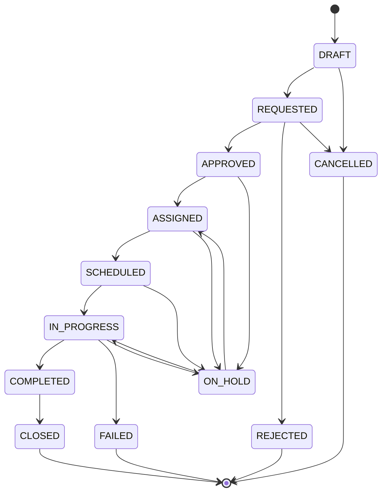

# STAR Domain Reference — Vehicle Transfer Order

> **Aggregate:** `VehicleTransferOrder` · **JSON naming:** `snake_case`  

## 1. Business Purpose

A Vehicle Transfer Order coordinates the request, approval, scheduling, transport, tracking, financial estimation, and completion of moving one or more vehicles between parties or locations. Business contexts include dealer trades, inventory rebalancing, customer sales, distribution, auction movements, repairs, recalls, and fleet assignments.

**Business capabilities:** transfer request and approval; vehicle association; source/destination coordination; carrier assignment and shipment tracking; transport fare comparison; estimated/actual cost recording; operational audit and exception management.

**Boundary:** the transfer order governs the *transfer workflow*. Vehicle, party, carrier, and shipment references do not imply ownership of those master aggregates. Avoid editing vehicle master data or party master data through this aggregate.

## 2. Domain Model

### Root and associated objects

| Object | Model relationship | Role / boundary interpretation |
|---|---|---|
| `VehicleTransferOrder` | Aggregate root | Coordinates transfer state and associated information. |
| `VehicleReference[]` | Composition in diagram | Vehicle snapshots/references within the order, not vehicle master ownership. |
| `Fare[]` → `FareLineItem[]` | Composition | Available transportation quotes and their charge lines. |
| `ShipmentEvent[]` | Composition | Transfer-associated shipment event history. |
| `ShipmentReference[]` | Composition | Links to shipment records and carrier delivery information. |
| `Narrative[]` | Composition | Special handling instructions. |
| `VehicleLogisticsProfile` | Association | Rail, vessel, distribution center, ramp and other logistics detail. |
| `TrackingInformation` | Association | Current tracking snapshot and its shipment events. |
| `PartyReference` | Association | Requesting, source and destination parties. |
| `AddressReference` | Association | Transfer source and destination addresses. |
| `CarrierReference` | Association | Assigned carrier and carrier identifiers. |
| `Price` | Association | Estimated and actual transportation costs. |
| `EffectivePeriod` | Association | Requested, planned and estimated delivery periods. |
| `ActorReference`, `BusinessContext` | Association | Responsible actor, intent and correlation context. |
| `Code[]`, `Identifier[]` | Association | Extensible classification and cross-system identifiers. |

## 3. Properties and Constraints

### Exact aggregate-root property inventory

 
| JSON property | Declared Java/PlantUML type | Recommended requirement / meaning |
|---|---|---|
| `vehicle_transfer_order_key` | `String` | Recommended stable internal identity |
| `vehicle_transfer_order_id` | `String` | Recommended external identity |
| `transfer_order_number` | `String` | Recommended unique business identifier |
| `transport_method_types` | `List<TransportMethodTypes>` | Optional/conditional; see constraints below |
| `service_level_type` | `ServiceLevelTypes` | Optional/conditional; see constraints below |
| `vehicle_references` | `List<VehicleReference>` | Recommended ≥1 for a submitted transfer |
| `transfer_status_type` | `VehicleTransferOrderStatusTypes` | Recommended for lifecycle processing |
| `transfer_reason_type` | `VehicleTransferReasonTypes` | Recommended for submitted transfers |
| `requesting_party` | `PartyReference` | Recommended for submitted transfers |
| `source_party` | `PartyReference` | Recommended for submitted transfers |
| `destination_party` | `PartyReference` | Recommended for submitted transfers |
| `source_address` | `AddressReference` | Optional/conditional; see constraints below |
| `destination_address` | `AddressReference` | Optional/conditional; see constraints below |
| `transfer_period` | `EffectivePeriod` | Optional/conditional; see constraints below |
| `vehicle_logistics_profile` | `VehicleLogisticsProfile` | Optional/conditional; see constraints below |
| `shipment_references` | `List<ShipmentReference>` | Optional/conditional; see constraints below |
| `shipment_events` | `List<ShipmentEvent>` | Optional/conditional; see constraints below |
| `transfer_codes` | `List<Code>` | Optional/conditional; see constraints below |
| `identifiers` | `List<Identifier>` | Optional/conditional; see constraints below |
| `actor` | `ActorReference` | Optional/conditional; see constraints below |
| `business_context` | `BusinessContext` | Optional/conditional; see constraints below |
| `source_system_code` | `String` | Recommended for integration traceability |
| `occurrence_date_time` | `Date` | Recommended creation/business timestamp |
| `carrier_reference` | `CarrierReference` | Optional/conditional; see constraints below |
| `shipment_codes` | `List<Code>` | Optional/conditional; see constraints below |
| `estimated_delivery_period` | `EffectivePeriod` | Optional/conditional; see constraints below |
| `estimated_arrival_date_time` | `Date` | Optional/conditional; see constraints below |
| `actual_arrival_date_time` | `Date` | Optional/conditional; see constraints below |
| `tracking_information` | `TrackingInformation` | Optional/conditional; see constraints below |
| `estimated_transportation_cost` | `Price` | Optional/conditional; see constraints below |
| `actual_transportation_cost` | `Price` | Optional/conditional; see constraints below |
| `requested_transfer_period` | `EffectivePeriod` | Optional/conditional; see constraints below |
| `special_handling_instructions` | `List<Narrative>` | Optional/conditional; see constraints below |
| `available_fares` | `List<Fare>` | Optional/conditional; see constraints below |
| `quote_expiration_date_time` | `Date` | Optional/conditional; see constraints below |
| `quote_indicator` | `Boolean` | Optional/conditional; see constraints below |

### Nested object reference

The following classes are **present in the supplied model**. Field inventories below use their exact declared field names converted to snake_case. For every nested class, check its field constraints independently before publication.

**`VehicleReference`:** `vehicle_reference_key`, `vehicle_reference_id`, `vehicle_identifier_key`, `vin`, `model_year`, `make`, `model`, `trim`, `display_name`, `stock_number`, `license_plate`, `dealer_code`, `identifiers` (`List<Identifier>`), `tags` (`List<Code>`), `body_style`, `trim_codes` (`List<Code>`), `trim_dd_codes` (`List<Code>`), `final_assembly_point` (`List<Code>`), `fleet_codes` (`List<Code>`).

**`PartyReference`:** `party_reference_id`, `party_reference_key`, `party_key`, `party_name`, `individual_name` (`PersonName`), `party_type` (`PartyTypes`), `authorization_code`, `source_system_code`, `context`, `account_number`, `party_label`, `party_description`, `primary_role_name`, `party_relationship_types` (`List<PartyRelationshipTypes>`), `snapshot_detail` (`Identifier`), `address_references` (`List<AddressReference>`), `communication_channels` (`List<CommunicationChannel>`), `occurrence_date_time`, `org_indicator` (`Boolean`), `identifiers` (`List<Identifier>`).

**`AddressReference`:** `address_reference_key`, `address_reference_id`, `address_types` (`List<AddressTypes>`), `address_line1`, `address_line2`, `address_line3`, `address_line4`, `address_line5`, `city`, `country_code`, `district`, `label`, `postal_code`, `state_province`, `authorization_levels` (`List<AuthorizationLevel>`).

**`CarrierReference`:** `carrier_reference_key`, `carrier_reference_id`, `carrier_party` (`PartyReference`), `carrier_code`, `carrier_name`, `carrier_scac_code`, `carrier_pro_number`, `carrier_account_number`, `carrier_tracking_url`, `occurrence_date_time`.

**`EffectivePeriod`:** `effective_period_key`, `active_indicator` (`Boolean`), `exclusive_indicator` (`Boolean`), `start_date_time`, `complete_date_time`, `duration_uom_type` (`DurationUomTypes`), `duration_value`, `recur_uom_type` (`DurationUomTypes`), `recur_count`, `recur_values` (`List<Code>`), `recur_criteria`, `recur_indicator` (`Boolean`).

**`ShipmentReference`:** `shipment_reference_id`, `shipment_reference_key`, `shipment_key`, `tracking_number`, `context`, `system_codes` (`List<Code>`), `carrier_party` (`PartyReference`), `occurrence_date_time`, `unit_of_measures` (`List<UnitOfMeasure>`), `estimated_delivery_period` (`EffectivePeriod`), `shipment_state_type` (`ShipmentStateTypes`), `carrier_name`, `carrier_tracking_url`, `ship_from_party` (`PartyReference`), `ship_to_party` (`PartyReference`), `service_level_type` (`ServiceLevelTypes`).

**`ShipmentEvent`:** `shipment_event_key`, `shipment_event_id`, `event_sequence` (`Integer`), `correlation_id`, `shipment_event_type`, `shipment_state_type` (`ShipmentStateTypes`), `previous_shipment_state_type` (`ShipmentStateTypes`), `location` (`Position`), `occurrence_date_time`, `recorded_date_time`, `effective_date_time`, `event_source`, `description`, `actor` (`ActorReference`), `business_context` (`BusinessContext`), `financial_event_snapshot` (`FinancialEventSnapshot`).

**`TrackingInformation`:** `tracking_information_key`, `tracking_information_id`, `tracking_number`, `tracking_date_time`, `shipment_state_type` (`ShipmentStateTypes`), `status_description`, `current_location` (`Position`), `shipment_events` (`List<ShipmentEvent>`), `notes`, `carrier_name`, `carrier_tracking_url`, `estimated_delivery_date_time`, `actual_delivery_date_time`, `last_updated_date_time`, `delivery_exception_indicator` (`Boolean`), `exception_reason`, `previous_shipment_state_type` (`ShipmentStateTypes`), `event_source`, `event_sequence_num`, `exception_severity_type` (`ExceptionSeverityTypes`), `tracking_information_codes` (`List<Code>`).

**`VehicleLogisticsProfile`:** `vehicle_logistics_profile_key`, `vehicle_logistics_profile_id`, `railcar_number`, `vessel_number`, `voyage_number`, `port_processing_number`, `carrier_reference_number`, `transport_load_number`, `distribution_center_code`, `ramp_code`, `convoy_number`, `logistics_identifiers` (`List<Identifier>`), `shipment_references` (`List<ShipmentReference>`), `logistics_status_type` (`VehicleLogisticsStatusTypes`), `logistics_period` (`EffectivePeriod`), `source_system_code`, `occurrence_date_time`, `shipment_events` (`List<ShipmentEvent>`), `rail_position`, `truck_position`, `deck`, `container_number`, `chock_position`, `tie_down_information`, `load_sequence`.

**`Price`:** `price_id`, `price_key`, `display_amount`, `amount`, `tax_amount`, `taxable_amount`, `non_taxable_amount`, `total_amount`, `total_cost_amount`, `unit_cost_amount`, `price_description`, `tax_included_indicator` (`Boolean`), `currency_code`, `duration` (`EffectivePeriod`), `price_types` (`List<PriceTypes>`), `pay_type` (`PayTypes`), `price_category_types` (`List<PriceCategoryTypes>`), `currency_exchanges` (`List<CurrencyExchange>`).

**`Fare`:** `fare_id`, `fare_key`, `service_level_type` (`ServiceLevelTypes`), `transport_method_type` (`TransportMethodTypes`), `total_transportation_cost` (`Price`), `estimated_transit_days` (`Integer`), `fare_line_items` (`List<FareLineItem>`), `price_summary` (`PriceSummary`).

**`FareLineItem`:** `fare_line_item_id`, `fare_line_item_key`, `financial_category_type` (`FinancialCategoryTypes`), `charge_description` (`List<Narrative>`), `item_cost` (`Price`), `line_number`, `item_codes` (`List<Code>`).

**`Narrative`:** `narrative_key`, `narrative_id`, `correlation_id`, `actor` (`ActorReference`), `event_actor_role_type` (`StaffRoleTypes`), `event_date_time`, `narrative_group`, `narrative_desc`, `narrative_metrics` (`List<MetricNameValue>`), `narrative_type` (`NarrativeTypes`), `narrative_name`, `narrative_code`, `narrative_value`, `narrative_uom_type` (`NarrativeUomTypes`), `internal_indicator` (`Boolean`).

**`ActorReference`:** `actor_reference_id`, `actor_reference_key`, `actor_key`, `actor_name`, `actor_type` (`ActorTypes`), `privacy_policy_rules` (`List<PrivacyPolicyRule>`), `occurrence_date_time`.

**`BusinessContext`:** `intent_code`, `business_action_code`, `correlation_id`, `previous_balance` (`GeneralAmount`), `resulting_balance` (`GeneralAmount`).

**`Identifier`:** `identifier_id`, `identifier_key`, `context`, `value`, `detail`, `identifier_type`, `system_codes` (`List<Code>`), `issuing_authority` (`List<Code>`).

**`Code`:** `code_id`, `code_key`, `code_context`, `code`, `description`.

**`Position`:** `position_id`, `position_key`, `latitude`, `longitude`, `altitude`, `bearing`, `postal_code`, `county_code`.

### Enumerations used by the aggregate root

 
**`VehicleTransferOrderStatusTypes`:** `APPROVED`, `ASSIGNED`, `CANCELLED`, `CLOSED`, `COMPLETED`, `DRAFT`, `FAILED`, `IN_PROGRESS`, `ON_HOLD`, `REJECTED`, `REQUESTED`, `SCHEDULED`, `UNKNOWN`.

**`VehicleTransferReasonTypes`:** `AUCTION`, `CUSTOMER_SALE`, `DEALER_TRADE`, `DEMO_ASSIGNMENT`, `DISPOSAL`, `DISTRIBUTION`, `EXPORT`, `FLEET_ASSIGNMENT`, `IMPORT`, `INVENTORY_REBALANCE`, `OTHER`, `PORT_PROCESSING`, `RECALL`, `RENTAL_ASSIGNMENT`, `REPAIR`, `RETURN_TO_MANUFACTURER`, `SERVICE_LOANER`, `STORAGE`, `UNKNOWN`, `UPFIT`, `WHOLESALE`.

**`TransportMethodTypes`:** `AIR`, `COURIER`, `FREIGHT`, `GROUND`, `ROUTE_TRUCK`.

**`ServiceLevelTypes`:** `FREIGHT`, `GROUND`, `LOCAL_DELIVERY`, `OVERNIGHT`, `PICKUP`, `SAME_DAY`, `TWO_DAY_AIR`.

**`ShipmentStateTypes`:** `ACTIVE`, `DELIVERED`, `LOST_IN_TRANSIT`, `OPEN`, `RETURNED_TO_WAREHOUSE`, `TRACKED`.

**`VehicleLogisticsStatusTypes`:** `AT_DISTRIBUTION_CENTER`, `AT_RAMP`, `CANCELLED`, `CARRIER_ASSIGNED`, `DAMAGED`, `DELAYED`, `DELIVERED`, `IN_TRANSIT`, `LOST`, `ON_HOLD`, `PENDING`, `PORT_PROCESSING`, `RAIL_ASSIGNED`.

### Recommended invariants (not encoded in the diagram)

| Rule | Recommendation | Failure code (proposed) |
|---|---|---|
| Identity | `transfer_order_number` unique per issuing/source system. | `DUPLICATE_TRANSFER_ORDER` |
| Vehicle presence | At least one vehicle before `REQUESTED`; no duplicate VIN within one order. | `VEHICLE_REQUIRED` / `DUPLICATE_VEHICLE` |
| Source/destination | Require both parties for submission; prohibit identical effective source and destination unless explicitly allowed for internal movement. | `INVALID_TRANSFER_ROUTE` |
| Periods | Start must not exceed completion in any `EffectivePeriod` with both timestamps. | `INVALID_PERIOD` |
| Arrival | `actual_arrival_date_time` should not precede physical departure; require proof of receipt before completion. | `INVALID_ARRIVAL` |
| Monetary amounts | Validate `Price.amount` and `currency_code` using a decimal and ISO 4217 rule; model stores amount as `String`. | `INVALID_MONEY` |
| Status | Only approved transitions; terminal orders should be immutable except corrections. | `INVALID_STATUS_TRANSITION` |
| Shipment chronology | Shipment event sequence and timestamps must be consistent; handle late-arriving events without silently rewriting history. | `INVALID_SHIPMENT_EVENT` |
| Carrier selection | Assign a carrier before entering a carrier-dependent execution state. | `CARRIER_REQUIRED` |
| Fare expiration | Reject acceptance of expired quote; `quote_expiration_date_time` is a `Date`. | `QUOTE_EXPIRED` |
| Cross-reference | Shipment references and tracking numbers must resolve to the same authorized transfer context. | `SHIPMENT_MISMATCH` |

### Data representation

- `Date` → ISO 8601 timestamp string in examples (serialization policy must be confirmed).
- `Boolean` → JSON boolean.
- `Integer` → JSON integer.
- `String` monetary values → decimal strings, **not** JSON numbers.
- `List<T>` → JSON arrays; scalar class references → JSON objects.
- `snake_case` is a JSON serialization convention, not a field-naming change to the PlantUML classes.

## 4. JSON Examples

These examples use **only fields and enum members found in the supplied model**. They are illustrative: actual required fields, serialization details, and validation rules must be checked against generated OpenAPI/JSON Schema and business validators.

### A. Minimal draft transfer

```json
{
  "vehicle_transfer_order_id": "VTO-1001",
  "transfer_order_number": "TR-1001",
  "transfer_status_type": "DRAFT",
  "vehicle_references": [
    {
      "vin": "1HGCM82633A004352"
    }
  ]
}
```

### B. Standard requested dealer trade

```json
{
  "vehicle_transfer_order_id": "VTO-1002",
  "transfer_order_number": "TR-1002",
  "transfer_status_type": "REQUESTED",
  "transfer_reason_type": "DEALER_TRADE",
  "transport_method_types": [
    "GROUND"
  ],
  "service_level_type": "GROUND",
  "requesting_party": {
    "party_reference_id": "DEALER-ATL",
    "party_name": "Atlanta Dealer"
  },
  "source_party": {
    "party_reference_id": "DEALER-ATL",
    "party_name": "Atlanta Dealer"
  },
  "destination_party": {
    "party_reference_id": "DEALER-BHM",
    "party_name": "Birmingham Dealer"
  },
  "vehicle_references": [
    {
      "vehicle_reference_id": "VEH-1002",
      "vin": "1HGCM82633A004352",
      "model_year": "2025",
      "make": "Honda",
      "model": "Accord"
    }
  ],
  "requested_transfer_period": {
    "start_date_time": "2026-11-02T09:00:00-05:00",
    "complete_date_time": "2026-11-04T17:00:00-06:00"
  },
  "source_system_code": "STAR-DEALER",
  "occurrence_date_time": "2026-10-29T10:00:00-04:00"
}
```

### C. Advanced in-progress multi-vehicle transfer

```json
{
  "vehicle_transfer_order_id": "VTO-1003",
  "vehicle_transfer_order_key": "VTO-KEY-1003",
  "transfer_order_number": "TR-1003",
  "transfer_status_type": "IN_PROGRESS",
  "transfer_reason_type": "INVENTORY_REBALANCE",
  "transport_method_types": [
    "GROUND"
  ],
  "service_level_type": "GROUND",
  "requesting_party": {
    "party_reference_id": "OEM-01",
    "party_name": "OEM Distribution"
  },
  "source_party": {
    "party_reference_id": "DC-ATL",
    "party_name": "Atlanta Distribution Center"
  },
  "destination_party": {
    "party_reference_id": "DEALER-01",
    "party_name": "Dealer North"
  },
  "source_address": {
    "city": "Atlanta",
    "state_province": "GA",
    "country_code": "US"
  },
  "destination_address": {
    "city": "Charlotte",
    "state_province": "NC",
    "country_code": "US"
  },
  "vehicle_references": [
    {
      "vehicle_reference_id": "VEH-3001",
      "vin": "1HGCM82633A004352",
      "make": "Honda",
      "model": "Accord"
    },
    {
      "vehicle_reference_id": "VEH-3002",
      "vin": "1FAFP404X1F192345",
      "make": "Ford",
      "model": "Mustang"
    }
  ],
  "carrier_reference": {
    "carrier_reference_id": "CARR-44",
    "carrier_name": "Example Logistics",
    "carrier_scac_code": "EXLG"
  },
  "shipment_references": [
    {
      "shipment_reference_id": "SHIP-3001",
      "tracking_number": "TRACK-3001",
      "shipment_state_type": "ACTIVE",
      "carrier_name": "Example Logistics"
    }
  ],
  "shipment_events": [
    {
      "shipment_event_id": "EVT-01",
      "event_sequence": 1,
      "shipment_event_type": "PICKED_UP",
      "shipment_state_type": "ACTIVE",
      "occurrence_date_time": "2026-11-02T09:30:00-05:00",
      "description": "Vehicles collected at source"
    }
  ],
  "vehicle_logistics_profile": {
    "vehicle_logistics_profile_id": "LOG-3001",
    "logistics_status_type": "IN_TRANSIT",
    "transport_load_number": "LOAD-9001"
  },
  "tracking_information": {
    "tracking_number": "TRACK-3001",
    "shipment_state_type": "ACTIVE",
    "status_description": "En route",
    "last_updated_date_time": "2026-11-02T13:00:00-05:00"
  },
  "estimated_transportation_cost": {
    "amount": "650.00",
    "currency_code": "USD"
  },
  "actual_transportation_cost": {
    "amount": "675.00",
    "currency_code": "USD"
  },
  "available_fares": [
    {
      "fare_id": "FARE-01",
      "service_level_type": "GROUND",
      "transport_method_type": "GROUND",
      "estimated_transit_days": 2,
      "total_transportation_cost": {
        "amount": "650.00",
        "currency_code": "USD"
      },
      "fare_line_items": [
        {
          "fare_line_item_id": "LINE-1",
          "line_number": "1",
          "item_cost": {
            "amount": "650.00",
            "currency_code": "USD"
          }
        }
      ]
    }
  ],
  "special_handling_instructions": [
    {
      "narrative_id": "NOTE-1",
      "narrative_desc": "Protect vehicle keys during transit",
      "internal_indicator": true
    }
  ],
  "business_context": {
    "intent_code": "TRANSFER_VEHICLE",
    "business_action_code": "EXECUTE_TRANSFER",
    "correlation_id": "CORR-3001"
  },
  "source_system_code": "STAR-LOGISTICS",
  "occurrence_date_time": "2026-10-29T10:00:00-04:00"
}
```

### Suggested negative examples for automated tests

| Case | Mutation | Expected validator outcome |
|---|---|---|
| `NEG-001` | Change `transfer_status_type` to `SHIPPED` (not a declared enum member). | Schema enum rejection. |
| `NEG-002` | Change `vehicle_references` from array to object. | JSON Schema type rejection. |
| `NEG-003` | Duplicate the same VIN twice. | Proposed business invariant rejection. |
| `NEG-004` | Make requested period completion precede start. | Proposed business invariant rejection. |
| `NEG-005` | Change `estimated_transportation_cost.amount` to JSON number `650.00`. | Schema type rejection (declared String). |
| `NEG-006` | Attempt `CLOSED` → `IN_PROGRESS`. | Proposed state-machine rejection. |

## 5. Lifecycle and Behaviors

### Status values versus permitted transitions

The model declares these statuses, but **does not declare any transition graph**. The following is a **proposed** workflow requiring business approval:



`UNKNOWN` should generally be treated as an integration/data-quality state, not a normal business transition. Recovery paths from `FAILED`, cancellation after scheduling, and partial delivery of multiple vehicles need explicit policy decisions.

### Proposed commands

| Command | Preconditions | Effect / suggested event |
|---|---|---|
| `CreateTransferOrder` | Authorized creator | Creates `DRAFT`; `TransferOrderCreated` |
| `RequestTransfer` | Valid vehicles, source, destination | `REQUESTED`; `TransferRequested` |
| `ApproveTransfer` | Authorized approver; no policy hold | `APPROVED`; `TransferApproved` |
| `RejectTransfer` | Request under review | `REJECTED`; `TransferRejected` |
| `AssignCarrier` | Approved transfer; carrier valid | `ASSIGNED`; `CarrierAssigned` |
| `ScheduleTransfer` | Assigned carrier; valid window | `SCHEDULED`; `TransferScheduled` |
| `StartTransfer` | Pickup/dispatch evidence | `IN_PROGRESS`; `TransferStarted` |
| `RecordShipmentEvent` | Valid shipment association | Appends event; `ShipmentEventRecorded` |
| `PlaceTransferOnHold` | Nonterminal transfer | `ON_HOLD`; `TransferHeld` |
| `CompleteTransfer` | Receipt confirmation for all required vehicles | `COMPLETED`; `TransferCompleted` |
| `CloseTransfer` | Completed and reconciled | `CLOSED`; `TransferClosed` |
| `CancelTransfer` | Cancellation allowed by policy | `CANCELLED`; `TransferCancelled` |

 
### Recommended behavior and consistency rules

- The aggregate should reject unapproved state transitions and concurrent stale updates (optimistic versioning recommended, though no `version` field is defined).
- Track pickup, in-transit, delivery, and exceptions without assuming `ShipmentStateTypes` contains all those lifecycle labels; it currently has `ACTIVE`, `DELIVERED`, `LOST_IN_TRANSIT`, `OPEN`, `RETURNED_TO_WAREHOUSE`, `TRACKED`.
- `ShipmentEvent.shipment_event_type` is a free-form `String`; standardize an event taxonomy separately if interoperable event processing is required.
- For multi-vehicle transfers, decide whether completion requires *all* vehicles delivered or whether partial completion needs a separate child-level status model.
- Treat financial reconciliation, invoice settlement, and vehicle ownership transfer as cross-aggregate processes, not implicit effects of `COMPLETED`.

## 6. Governance

### Responsibility and ownership (recommended)

| Concern | Suggested owner | Policy requirement |
|---|---|---|
| Transfer business process | Vehicle logistics / inventory operations | Defines lifecycle, route, and completion criteria. |
| Aggregate schema | STAR domain model stewardship | Reviews field semantics and version changes. |
| Carrier and shipment integration | Logistics integration team | Controls carrier identity and tracking provenance. |
| Financial values | Finance / transportation cost owner | Authorizes adjustments and reconciliation. |
| Audit and privacy | Security / compliance | Sets retention, access and masking rules. |

### Authorization model (proposed)

| Action | Typical permitted role | Sensitive conditions |
|---|---|---|
| Create/request | Dealer inventory or logistics operator | Must act for an authorized requesting party. |
| Approve/reject | Transfer approver | Segregation of duties may prohibit self-approval. |
| Assign/schedule | Logistics coordinator | Carrier authorization and route constraints. |
| Update shipment events | Trusted carrier integration / logistics operator | Validate event source and correlation. |
| Change cost | Finance-authorized operator | Approval thresholds and immutable change history. |
| Cancel/close | Authorized transfer owner | Extra approval for in-progress cancellation. |
| Read transfer | Authorized dealer/OEM/carrier users | Filter by party, role, and shipment relationship. |

### Data classification (recommended)

| Field family | Suggested classification | Rationale |
|---|---|---|
| VIN, order number, transfer status | Internal business / operational | Commercial asset movement and operational state. |
| Locations, delivery windows, live tracking | Restricted operational | Physical asset movement and theft exposure. |
| Party contacts, personal names, communications | Personal data where identifying individuals | Privacy and minimization obligations. |
| Carrier account number, financial costs | Confidential commercial | Pricing and contractual sensitivity. |
| Actor, authorization and audit trail | Restricted audit | Security accountability and investigation. |

Classification is context- and jurisdiction-dependent; do not assume VINs are always personal data or never personal data. `PrivacyPolicyRule` is present in nested actor/authorization structures, but the diagram does not define an aggregate-wide authorization policy.

### Consequence declarations (proposed SOMATRIX OS integration)

| Trigger | Potential consequence | KPI impact |
|---|---|---|
| Unauthorized transfer approval | Block dispatch; escalate for review | Transfer compliance, asset security |
| Incorrect destination | Hold shipment; request correction | Misdelivery rate, logistics cost |
| Delayed arrival | Notify dealer and customer-facing workflows | On-time delivery, customer satisfaction |
| Lost vehicle | Escalate incident; preserve evidence | Asset loss, insurance exposure |
| Cost exceeds approved quote | Require reconciliation or approval | Transportation cost variance |
| Duplicate order | Quarantine duplicate before dispatch | Duplicate shipment rate |

These are **recommended** consequence policies; no consequence graph or KPI references are declared directly on `VehicleTransferOrder`.

### Audit requirements (recommended)

For every command and state-changing event, capture: transfer order ID, action, previous/new status, actor and role, requesting/source/destination party context, timestamp, correlation ID, source system, policy decision, validation result, changed fields, and relevant shipment reference. Preserve immutable event history and distinguish *event occurrence time* from *recording time*.

Existing model fields useful for this include `actor`, `business_context.correlation_id`, `source_system_code`, `occurrence_date_time`, and `shipment_events` with their actor, event source, sequence, and timestamps. A complete authorization decision/evidence ledger would require additional infrastructure or model extensions.
 