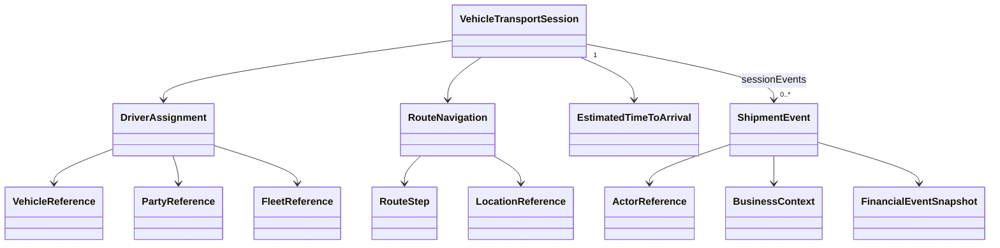
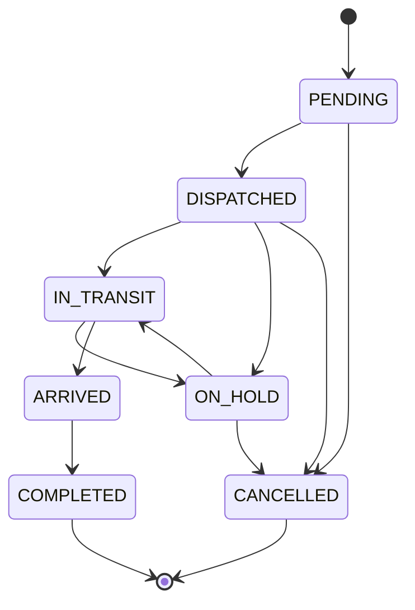

# STAR Domain Documentation — Vehicle Transport Session

> **Source of truth:** `vehicle_transport_session_clazz.puml` (uploaded model).  
> **Status:** Model-grounded reference with separately labeled recommendations.  
> **Naming:** PlantUML camelCase converted mechanically to JSON snake_case.  
> **Important:** PlantUML declares no mandatory attributes, cardinality constraints, or lifecycle transition rules. Example payloads are illustrative and have **not** been executed against a JSON Schema or rules engine.

## 1. Business Purpose

`VehicleTransportSession` represents one operational transport session associated with a vehicle transfer order. It tracks a driver assignment, navigational route, estimated arrival, transport status, and shipment events. A `transfer_order_key` links it to the parent transfer order; the transfer order itself is **not** embedded in this aggregate.

**Supported capabilities:** dispatch and transport tracking, driver/vehicle assignment context, route milestones, ETA reporting, transport event recording, and transfer-order correlation.

**Boundary:** The session owns its operational status and event collection. Driver, vehicle, fleet, party, location, and transfer-order records are represented through references or contextual snapshots; their authoritative master data should remain outside the session boundary. The diagram uses association edges and does not itself establish transactional ownership for every nested object.

## 2. Domain Model



**Model relationships:** `VehicleTransportSession` directly references `DriverAssignment`, `RouteNavigation`, `EstimatedTimeToArrival`, and `List<ShipmentEvent>`. The session has a string `transferOrderKey`, rather than an object reference to `VehicleTransferOrder`. `RouteNavigation` is recursive via `routeNavigations`.

### Model elements by role

| Element | Suggested DDD classification | Notes |
|---|---|---|
| `VehicleTransportSession` | Aggregate root | Transport execution context and session status |
| `DriverAssignment` | Referenced entity / snapshot | Contains driver, fleet, vehicle and period references |
| `RouteNavigation` / `RouteStep` | Route plan / route milestone | Navigation may contain nested route navigations |
| `EstimatedTimeToArrival` | ETA value/snapshot | Timestamp, confidence and delay |
| `ShipmentEvent` | Event record | Source, actor, state, timestamps, optional financial context |
| `VehicleReference`, `PartyReference`, `FleetReference`, `LocationReference` | References | Not master records owned by session |

## 3. Properties and Constraints

### Aggregate root properties (exact model inventory)

| JSON property | PlantUML type | Model requirement |
|---|---|---|
| `vehicle_transport_session_id` | `String` | Not specified |
| `vehicle_transport_session_key` | `String` | Not specified |
| `transfer_order_key` | `String` | Not specified |
| `session_sequence` | `String` | Not specified |
| `vehicle_transport_session_status_types` | `VehicleTransportSessionStatusTypes` | Not specified |
| `driver_assignment` | `DriverAssignment` | Not specified |
| `route_navigation` | `RouteNavigation` | Not specified |
| `estimated_arrival` | `EstimatedTimeToArrival` | Not specified |
| `session_events` | `List<ShipmentEvent>` | Not specified |
| `correlation_id` | `String` | Not specified |

**Important model semantics:** `vehicle_transport_session_status_types` is plural in the source model even though its type is a single `VehicleTransportSessionStatusTypes` value. The JSON examples retain that exact property spelling. `session_sequence`, `planned_distance_miles`, `confidence_score`, monetary amounts, and coordinates are modeled as strings, not numbers.

### Nested type inventories

#### `DriverAssignment`

| JSON property | PlantUML type | Model requirement |
|---|---|---|
| `driver_assignment_key` | `String` | Not specified |
| `driver_assignment_id` | `String` | Not specified |
| `driver_key` | `String` | Not specified |
| `account_key` | `String` | Not specified |
| `fleet_item_key` | `String` | Not specified |
| `fleet_key` | `String` | Not specified |
| `assignment_codes` | `List<Code>` | Not specified |
| `driver_reference` | `PartyReference` | Not specified |
| `account_reference` | `ControlAccountReference` | Not specified |
| `fleet_reference` | `FleetReference` | Not specified |
| `vehicle_reference` | `VehicleReference` | Not specified |
| `assignment_period` | `EffectivePeriod` | Not specified |
| `assignment_stage_type` | `VehicleAssignmentStageTypes` | Not specified |
| `assignment_status_type` | `VehicleAssignmentStatusTypes` | Not specified |
| `assignment_reason` | `String` | Not specified |
| `created_date_time` | `Date` | Not specified |
| `completed_date_time` | `Date` | Not specified |
| `assignment_notes` | `List<Narrative>` | Not specified |

#### `RouteNavigation`

| JSON property | PlantUML type | Model requirement |
|---|---|---|
| `route_navigation_id` | `String` | Not specified |
| `route_navigation_key` | `String` | Not specified |
| `origin_location` | `LocationReference` | Not specified |
| `destination_location` | `LocationReference` | Not specified |
| `planned_distance_miles` | `String` | Not specified |
| `route_steps` | `List<RouteStep>` | Not specified |
| `heading` | `String` | Not specified |
| `route_navigations` | `List<RouteNavigation>` | Not specified |

#### `RouteStep`

| JSON property | PlantUML type | Model requirement |
|---|---|---|
| `route_step_id` | `String` | Not specified |
| `route_step_key` | `String` | Not specified |
| `sequence_number` | `Integer` | Not specified |
| `heading_description` | `String` | Not specified |
| `location_reference` | `LocationReference` | Not specified |
| `service_milestone_type` | `ServiceMilestoneTypes` | Not specified |
| `route_step_status_types` | `RouteStepStatusTypes` | Not specified |
| `estimated_date_time` | `Date` | Not specified |
| `actual_date_time` | `Date` | Not specified |

#### `EstimatedTimeToArrival`

| JSON property | PlantUML type | Model requirement |
|---|---|---|
| `estimated_time_to_arrival_id` | `String` | Not specified |
| `estimated_time_to_arrival_key` | `String` | Not specified |
| `estimated_date_time` | `Date` | Not specified |
| `confidence_score` | `String` | Not specified |
| `traffic_delay_minutes` | `Integer` | Not specified |

#### `ShipmentEvent`

| JSON property | PlantUML type | Model requirement |
|---|---|---|
| `shipment_event_key` | `String` | Not specified |
| `shipment_event_id` | `String` | Not specified |
| `event_sequence` | `Integer` | Not specified |
| `correlation_id` | `String` | Not specified |
| `shipment_event_type` | `String` | Not specified |
| `shipment_state_type` | `ShipmentStateTypes` | Not specified |
| `previous_shipment_state_type` | `ShipmentStateTypes` | Not specified |
| `location` | `Position` | Not specified |
| `occurrence_date_time` | `Date` | Not specified |
| `recorded_date_time` | `Date` | Not specified |
| `effective_date_time` | `Date` | Not specified |
| `event_source` | `String` | Not specified |
| `description` | `String` | Not specified |
| `actor` | `ActorReference` | Not specified |
| `business_context` | `BusinessContext` | Not specified |
| `financial_event_snapshot` | `FinancialEventSnapshot` | Not specified |

#### `LocationReference`

| JSON property | PlantUML type | Model requirement |
|---|---|---|
| `location_reference_id` | `String` | Not specified |
| `location_reference_key` | `String` | Not specified |
| `location_name` | `String` | Not specified |
| `location_code` | `String` | Not specified |
| `address_reference` | `AddressReference` | Not specified |
| `position` | `Position` | Not specified |
| `facility_type` | `FacilityTypes` | Not specified |

#### `Position`

| JSON property | PlantUML type | Model requirement |
|---|---|---|
| `position_id` | `String` | Not specified |
| `position_key` | `String` | Not specified |
| `latitude` | `String` | Not specified |
| `longitude` | `String` | Not specified |
| `altitude` | `String` | Not specified |
| `bearing` | `String` | Not specified |
| `postal_code` | `String` | Not specified |
| `county_code` | `String` | Not specified |

#### `PartyReference`

| JSON property | PlantUML type | Model requirement |
|---|---|---|
| `party_reference_id` | `String` | Not specified |
| `party_reference_key` | `String` | Not specified |
| `party_key` | `String` | Not specified |
| `party_name` | `String` | Not specified |
| `individual_name` | `PersonName` | Not specified |
| `party_type` | `PartyTypes` | Not specified |
| `authorization_code` | `String` | Not specified |
| `source_system_code` | `String` | Not specified |
| `context` | `String` | Not specified |
| `account_number` | `String` | Not specified |
| `party_label` | `String` | Not specified |
| `party_description` | `String` | Not specified |
| `primary_role_name` | `String` | Not specified |
| `party_relationship_types` | `List<PartyRelationshipTypes>` | Not specified |
| `snapshot_detail` | `Identifier` | Not specified |
| `address_references` | `List<AddressReference>` | Not specified |
| `communication_channels` | `List<CommunicationChannel>` | Not specified |
| `occurrence_date_time` | `Date` | Not specified |
| `org_indicator` | `Boolean` | Not specified |
| `identifiers` | `List<Identifier>` | Not specified |

#### `VehicleReference`

| JSON property | PlantUML type | Model requirement |
|---|---|---|
| `vehicle_reference_key` | `String` | Not specified |
| `vehicle_reference_id` | `String` | Not specified |
| `vehicle_identifier_key` | `String` | Not specified |
| `vin` | `String` | Not specified |
| `model_year` | `String` | Not specified |
| `make` | `String` | Not specified |
| `model` | `String` | Not specified |
| `trim` | `String` | Not specified |
| `display_name` | `String` | Not specified |
| `stock_number` | `String` | Not specified |
| `license_plate` | `String` | Not specified |
| `dealer_code` | `String` | Not specified |
| `identifiers` | `List<Identifier>` | Not specified |
| `tags` | `List<Code>` | Not specified |
| `body_style` | `String` | Not specified |
| `trim_codes` | `List<Code>` | Not specified |
| `trim_dd_codes` | `List<Code>` | Not specified |
| `final_assembly_point` | `List<Code>` | Not specified |
| `fleet_codes` | `List<Code>` | Not specified |

#### `FleetReference`

| JSON property | PlantUML type | Model requirement |
|---|---|---|
| `fleet_reference_key` | `String` | Not specified |
| `fleet_key` | `String` | Not specified |
| `fleet_id` | `String` | Not specified |
| `fleet_number` | `String` | Not specified |
| `fleet_name` | `String` | Not specified |
| `parent_fleet_key` | `String` | Not specified |
| `parent_fleet_name` | `String` | Not specified |
| `fleet_types` | `List<PartyTypes>` | Not specified |
| `display_name` | `String` | Not specified |
| `fleet_codes` | `List<Code>` | Not specified |

#### `ControlAccountReference`

| JSON property | PlantUML type | Model requirement |
|---|---|---|
| `control_account_reference_id` | `String` | Not specified |
| `control_account_reference_key` | `String` | Not specified |
| `control_account_key` | `String` | Not specified |
| `context` | `String` | Not specified |
| `system_codes` | `List<Code>` | Not specified |
| `control_account` | `Identifier` | Not specified |
| `occurrence_date_time` | `Date` | Not specified |

#### `EffectivePeriod`

| JSON property | PlantUML type | Model requirement |
|---|---|---|
| `effective_period_key` | `String` | Not specified |
| `active_indicator` | `Boolean` | Not specified |
| `exclusive_indicator` | `Boolean` | Not specified |
| `start_date_time` | `Date` | Not specified |
| `complete_date_time` | `Date` | Not specified |
| `duration_uom_type` | `DurationUomTypes` | Not specified |
| `duration_value` | `String` | Not specified |
| `recur_uom_type` | `DurationUomTypes` | Not specified |
| `recur_count` | `String` | Not specified |
| `recur_values` | `List<Code>` | Not specified |
| `recur_criteria` | `String` | Not specified |
| `recur_indicator` | `Boolean` | Not specified |

#### `ActorReference`

| JSON property | PlantUML type | Model requirement |
|---|---|---|
| `actor_reference_id` | `String` | Not specified |
| `actor_reference_key` | `String` | Not specified |
| `actor_key` | `String` | Not specified |
| `actor_name` | `String` | Not specified |
| `actor_type` | `ActorTypes` | Not specified |
| `privacy_policy_rules` | `List<PrivacyPolicyRule>` | Not specified |
| `occurrence_date_time` | `Date` | Not specified |

#### `BusinessContext`

| JSON property | PlantUML type | Model requirement |
|---|---|---|
| `intent_code` | `String` | Not specified |
| `business_action_code` | `String` | Not specified |
| `correlation_id` | `String` | Not specified |
| `previous_balance` | `GeneralAmount` | Not specified |
| `resulting_balance` | `GeneralAmount` | Not specified |

#### `FinancialEventSnapshot`

| JSON property | PlantUML type | Model requirement |
|---|---|---|
| `financial_event_snapshot_key` | `String` | Not specified |
| `financial_category_type` | `FinancialCategoryTypes` | Not specified |
| `general_ledger_reference` | `GeneralLedgerReference` | Not specified |
| `resulting_balance` | `GeneralAmount` | Not specified |
| `previous_balance` | `GeneralAmount` | Not specified |
| `unit_cost` | `GeneralAmount` | Not specified |

#### `GeneralAmount`

| JSON property | PlantUML type | Model requirement |
|---|---|---|
| `general_amount_key` | `String` | Not specified |
| `currency_code` | `String` | Not specified |
| `amount` | `String` | Not specified |

### Enumerations from the uploaded model

**VehicleTransportSessionStatusTypes:** `PENDING`, `DISPATCHED`, `IN_TRANSIT`, `ON_HOLD`, `ARRIVED`, `COMPLETED`, `CANCELLED`.

**RouteStepStatusTypes:** `CANCELLED`, `COMPLETED`, `DELAYED`, `IN_PROGRESS`, `PENDING`, `SKIPPED`.

**ShipmentStateTypes:** `ACTIVE`, `DELIVERED`, `LOST_IN_TRANSIT`, `OPEN`, `RETURNED_TO_WAREHOUSE`, `TRACKED`.

**ServiceMilestoneTypes:** `ARRIVAL`, `BOOKING`, `CHECK_IN`, `CHECK_OUT`, `DIAGNOSTIC_COMPLETE`, `DIAGNOSTIC_START`, `DROP_OFF`, `ESTIMATE_APPROVED`, `EXPECTED_ARRIVAL`, `INFORMATIONAL`, `MILESTONE`, `PICKUP`, `PRE_INSPECTION`, `QUALITY_CONTROL`, `RELEASE`, `ROAD_TEST`, `SERVICE_COMPLETION`, `SERVICE_PAUSED`, `SERVICE_START`, `STAGED_FOR_PICKUP`, `SUBLET_DISPATCH`, `SUBLET_IN_PROGRESS`, `SUBLET_RETURN`, `UNKNOWN`, `WAYPOINT`.

**VehicleAssignmentStatusTypes:** `ABANDON`, `ACTIVE`, `APPROVED`, `CANCELLED`, `COMPLETE`, `CUSTOMER_HOLD`, `DECLINED`, `FINANCE_HOLD`, `INACTIVE`, `INITIATING`, `INVALID`, `ON_HOLD`, `OTHER`, `PAYMENT_HOLD`, `PENDING_APPROVAL`, `REJECT`, `SALES_HOLD`, `UNKNOWN`.

### Recommended invariants (not declared in PlantUML)

1. `vehicle_transport_session_key` is unique and immutable once published.
2. `transfer_order_key` resolves to an existing transfer order before dispatch.
3. A dispatched session has a usable driver assignment and origin/destination route.
4. Route step `sequence_number` values are unique within each route.
5. Actual milestone times are consistent with the recorded sequence, subject to event correction rules.
6. `COMPLETED` requires proof of handoff/arrival and all mandatory milestones.
7. Events have stable identifiers, ordered sequence numbers, and immutable historical records; corrections append new events.
8. `estimated_arrival.confidence_score` parses to a value between 0 and 1 if that convention is adopted.
9. Validate VIN format and actual vehicle assignment against the transfer order using an authoritative vehicle service.
10. The status of a transport session does not automatically imply completion of the entire transfer order, which may involve multiple sessions.

## 4. JSON Examples

**Validation note:** Examples use exact field names and enum literals from the uploaded model. Illustrative identifiers, locations, dates, and `shipment_event_type` strings are not defined by the model. The `PartyTypes` enumeration must be checked for the chosen driver party type in any executable validation pipeline.

### Minimal — pending session

```json
{
  "vehicle_transport_session_id": "VTS-1001",
  "vehicle_transport_session_key": "vts-1001",
  "transfer_order_key": "vto-2001",
  "session_sequence": "1",
  "vehicle_transport_session_status_types": "PENDING",
  "correlation_id": "corr-vto-2001"
}
```

### Standard — dispatched vehicle in transit

```json
{
  "vehicle_transport_session_id": "VTS-1001",
  "vehicle_transport_session_key": "vts-1001",
  "transfer_order_key": "vto-2001",
  "session_sequence": "1",
  "vehicle_transport_session_status_types": "IN_TRANSIT",
  "correlation_id": "corr-vto-2001",
  "driver_assignment": {
    "driver_assignment_key": "da-001",
    "driver_assignment_id": "DA-001",
    "driver_key": "driver-100",
    "assignment_stage_type": "ACTIVE",
    "assignment_status_type": "ACTIVE",
    "driver_reference": {
      "party_reference_key": "party-driver-100",
      "party_name": "Example Driver",
      "party_type": "PERSON"
    },
    "vehicle_reference": {
      "vehicle_reference_key": "vehicle-100",
      "vin": "1HGCM82633A004352",
      "make": "Example",
      "model": "Sedan"
    },
    "assignment_period": {
      "start_date_time": "2026-10-29T08:00:00-04:00"
    }
  },
  "route_navigation": {
    "route_navigation_key": "route-001",
    "origin_location": {
      "location_reference_key": "loc-a",
      "location_name": "Origin Dealership",
      "facility_type": "DEALERSHIP"
    },
    "destination_location": {
      "location_reference_key": "loc-b",
      "location_name": "Destination Dealership",
      "facility_type": "DEALERSHIP"
    },
    "planned_distance_miles": "145",
    "route_steps": [
      {
        "route_step_key": "step-1",
        "sequence_number": 1,
        "heading_description": "Vehicle pickup",
        "service_milestone_type": "PICKUP",
        "route_step_status_types": "COMPLETED"
      },
      {
        "route_step_key": "step-2",
        "sequence_number": 2,
        "heading_description": "Vehicle drop-off",
        "service_milestone_type": "DROP_OFF",
        "route_step_status_types": "PENDING"
      }
    ]
  },
  "estimated_arrival": {
    "estimated_time_to_arrival_key": "eta-001",
    "estimated_date_time": "2026-10-29T12:00:00-04:00",
    "confidence_score": "0.90",
    "traffic_delay_minutes": 15
  },
  "session_events": [
    {
      "shipment_event_key": "evt-1",
      "event_sequence": 1,
      "shipment_event_type": "DEPARTURE",
      "shipment_state_type": "ACTIVE",
      "occurrence_date_time": "2026-10-29T08:15:00-04:00",
      "event_source": "TRANSPORT_SYSTEM",
      "description": "Vehicle departed origin"
    }
  ]
}
```

### Advanced — arrival, route completion and event provenance

```json
{
  "vehicle_transport_session_id": "VTS-1001",
  "vehicle_transport_session_key": "vts-1001",
  "transfer_order_key": "vto-2001",
  "session_sequence": "2",
  "vehicle_transport_session_status_types": "ARRIVED",
  "correlation_id": "corr-vto-2001",
  "driver_assignment": {
    "driver_assignment_key": "da-001",
    "driver_assignment_id": "DA-001",
    "driver_key": "driver-100",
    "assignment_stage_type": "ACTIVE",
    "assignment_status_type": "ACTIVE",
    "driver_reference": {
      "party_reference_key": "party-driver-100",
      "party_name": "Example Driver",
      "party_type": "PERSON"
    },
    "vehicle_reference": {
      "vehicle_reference_key": "vehicle-100",
      "vin": "1HGCM82633A004352",
      "make": "Example",
      "model": "Sedan"
    },
    "assignment_period": {
      "start_date_time": "2026-10-29T08:00:00-04:00"
    }
  },
  "route_navigation": {
    "route_navigation_key": "route-001",
    "origin_location": {
      "location_reference_key": "loc-a",
      "location_name": "Origin Dealership",
      "facility_type": "DEALERSHIP"
    },
    "destination_location": {
      "location_reference_key": "loc-b",
      "location_name": "Destination Dealership",
      "facility_type": "DEALERSHIP"
    },
    "planned_distance_miles": "145",
    "route_steps": [
      {
        "route_step_key": "step-1",
        "sequence_number": 1,
        "heading_description": "Vehicle pickup",
        "service_milestone_type": "PICKUP",
        "route_step_status_types": "COMPLETED"
      },
      {
        "route_step_key": "step-2",
        "sequence_number": 2,
        "heading_description": "Vehicle drop-off",
        "service_milestone_type": "DROP_OFF",
        "route_step_status_types": "COMPLETED",
        "actual_date_time": "2026-10-29T11:55:00-04:00"
      }
    ]
  },
  "estimated_arrival": {
    "estimated_time_to_arrival_key": "eta-001",
    "estimated_date_time": "2026-10-29T12:00:00-04:00",
    "confidence_score": "0.90",
    "traffic_delay_minutes": 0
  },
  "session_events": [
    {
      "shipment_event_key": "evt-1",
      "event_sequence": 1,
      "shipment_event_type": "DEPARTURE",
      "shipment_state_type": "ACTIVE",
      "occurrence_date_time": "2026-10-29T08:15:00-04:00",
      "event_source": "TRANSPORT_SYSTEM",
      "description": "Vehicle departed origin"
    },
    {
      "shipment_event_key": "evt-2",
      "event_sequence": 2,
      "correlation_id": "corr-vto-2001",
      "shipment_event_type": "ARRIVAL",
      "shipment_state_type": "DELIVERED",
      "previous_shipment_state_type": "ACTIVE",
      "location": {
        "latitude": "34.0754",
        "longitude": "-84.2941"
      },
      "occurrence_date_time": "2026-10-29T11:55:00-04:00",
      "recorded_date_time": "2026-10-29T11:56:00-04:00",
      "event_source": "MOBILE_APP",
      "description": "Vehicle arrived at destination",
      "actor": {
        "actor_reference_key": "actor-1",
        "actor_type": "EMPLOYEE",
        "actor_name": "Receiving staff"
      },
      "business_context": {
        "intent_code": "COMPLETE_VEHICLE_TRANSPORT",
        "business_action_code": "RECORD_ARRIVAL",
        "correlation_id": "corr-vto-2001"
      }
    }
  ]
}
```

## 5. Lifecycle and Behaviors

### Proposed state transitions (not defined by PlantUML)



The diagram is a **recommended** baseline. For example, cancellation after departure might instead require a return workflow, and `ARRIVED` should be distinguished from formally acknowledged `COMPLETED`.

### Proposed commands

| Command | Preconditions | Result |
|---|---|---|
| `CreateTransportSession` | Valid transfer order | Session in `PENDING` |
| `AssignDriver` | Assignment permitted | Driver assignment updated |
| `PlanRoute` | Route endpoints known | Route navigation stored |
| `DispatchSession` | Driver, vehicle, route verified | `DISPATCHED` |
| `RecordDeparture` | Dispatched | `IN_TRANSIT` and event appended |
| `UpdateEstimatedArrival` | Active session | ETA snapshot updated |
| `RecordRouteMilestone` | Active session | Route step/event updated |
| `PlaceSessionOnHold` | Eligible active state | `ON_HOLD` |
| `ResumeSession` | Hold resolved | `IN_TRANSIT` |
| `RecordArrival` | Evidence of arrival | `ARRIVED` |
| `CompleteSession` | Handoff verified | `COMPLETED` |
| `CancelSession` | Cancellation permitted | `CANCELLED` |

### Proposed domain events

`TransportSessionCreated`, `DriverAssigned`, `RoutePlanned`, `TransportSessionDispatched`, `TransportSessionDeparted`, `EstimatedArrivalUpdated`, `RouteMilestoneRecorded`, `TransportSessionPlacedOnHold`, `TransportSessionResumed`, `VehicleArrived`, `TransportSessionCompleted`, `TransportSessionCancelled`. These are proposed semantic event names, **not** existing enum literals; `ShipmentEvent.shipmentEventType` is a free-form `String` in the source model.

### Business rules

- Prevent dispatch without an authorized driver, an eligible vehicle, and a valid destination.
- Avoid accepting a duplicate event using `shipment_event_key` and/or an idempotency key.
- Do not silently replace historical route steps or shipment events after completion.
- Require explicit authorization to change a driver or route while in transit.
- Recalculate or update ETA when route conditions materially change.
- Treat loss-in-transit, delivery, and return-to-warehouse as shipment-state signals that may require separate session-state decisions.

## 6. Governance

### Authorization and ownership (proposed)

| Operation | Proposed owner / authorized actor | Guardrail |
|---|---|---|
| Create / dispatch | Logistics dispatcher | Validate transfer-order authority and driver eligibility |
| Driver reassignment | Fleet or logistics manager | Approval and reason required after dispatch |
| Route change | Dispatcher / authorized transport system | Preserve previous route and reason |
| Record tracking event | Driver app, carrier integration, telematics service | Authenticate source, timestamp and correlation |
| Confirm arrival | Receiving location / authorized staff | Proof of delivery or receiving acknowledgement |
| Complete session | Logistics coordinator | Verify handoff and unresolved exceptions |
| Cancel | Authorized dispatcher / manager | Deny or escalate after departure |

### Data classification

- **Internal operational:** session keys, status, route plans, ETA and milestones.
- **Confidential / potentially personal:** driver identities, party references, contact channels, location history, actor metadata and tracking events.
- **Financially sensitive:** financial event snapshots and general-ledger references carried in shipment events.
- **Controlled security metadata:** authorization levels and privacy policy rules embedded in referenced structures.

### Consequences and audit requirements

For each state-changing command, capture `vehicle_transport_session_key`, `transfer_order_key`, `correlation_id`, actor identity/type, command/intent, old/new status, relevant route or assignment version, authorization decision, event timestamp, source system, result, and any downstream consequences. Preserve denied attempts as audit evidence where policy requires.

Examples of consequence controls: unauthorized dispatch → **block**; route divergence → **alert and reassess ETA**; lost-in-transit event → **escalate**; arrival without receiving evidence → **prevent completion**; duplicate shipment event → **deduplicate and log**. These are recommended controls, not behavior already encoded in the model.

## 7. Validation and Change Control

Treat each example as a test fixture with a schema version, expected validity, expected error code/path, and approval status. Regenerate JSON Schema from the PlantUML-derived model, validate every published example, then run additional business-rule and governance checks.

Suggested negative tests: missing transfer order reference (if required by policy), invalid session status enum, duplicate route sequence number, completion without arrival evidence, unauthorized driver reassignment, duplicate shipment event, and invalid ETA confidence range. Only the enum test is necessarily a structural schema violation unless additional constraints are formalized.

**Publication gate:** Do not label examples “validated” until they pass an executable schema validator and all applicable business-rule tests.
