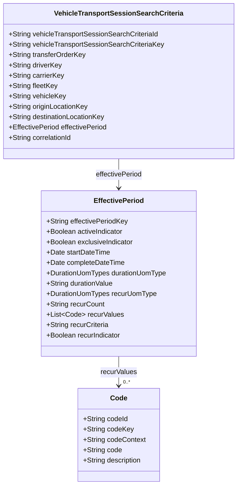

# STAR Domain Documentation — Vehicle Transport Session Search Criteria

**Source model:** `vehicle_transport_session_search_criteria_clazz.puml`  
**Domain:** Vehicle Logistics and Transportation  
**Model type:** Query/search criteria (not an independently lifecycle-managed aggregate root)  
**Primary class:** `VehicleTransportSessionSearchCriteria`  
**Documentation status:** Model-grounded definitions with explicitly labeled recommendations  

> **Accuracy convention:** “Defined” means explicitly declared in the supplied PlantUML. “Recommended” means proposed behavior, constraint, governance control, or extension. The example payloads are syntactically valid JSON and use snake_case mappings of the declared camelCase properties. They are illustrative; no executable schema or search service was supplied for semantic validation.

## 1. Business Purpose

`VehicleTransportSessionSearchCriteria` represents the filters used to find vehicle transport sessions. It supports operational dispatch searches, locating sessions related to a transfer order, identifying work assigned to a driver/carrier/fleet, tracing a vehicle's transportation activity, filtering by origin/destination, and constraining results to an effective period. `correlationId` supports request correlation.

**Business capabilities:** session discovery, transport-order traceability, driver/carrier/fleet workload lookup, vehicle movement lookup, route endpoint filtering, temporal filtering, and correlated query execution.

**Boundary:** The criteria object expresses a read-only request. It does not own or modify `VehicleTransportSession`, `VehicleTransferOrder`, vehicles, drivers, carriers, fleets, or locations. Search execution, result paging, authorization, and indexing belong to the query service/API.

## 2. Domain Model

### 2.1 Defined classes

| Class | Role | Notes |
|---|---|---|
| `VehicleTransportSessionSearchCriteria` | Query model | Eleven declared root properties. |
| `EffectivePeriod` | Nested temporal criteria | Dates, duration, recurrence, and related indicators. |
| `Code` | Nested coded value | Used in `EffectivePeriod.recurValues`. |
| `DurationUomTypes` | Enumeration | Units used by duration and recurrence. |
| `VehicleTransportSessionStatusTypes` | Enumeration | Diagram associates it with search criteria, but **no status property is declared**. |

### 2.2 Relationships and boundary notes

- **Defined:** `EffectivePeriod -- VehicleTransportSessionSearchCriteria` (association; field `effectivePeriod`).
- **Defined:** `DurationUomTypes -- EffectivePeriod` (used by `durationUomType` and `recurUomType`).
- **Defined:** `VehicleTransportSessionStatusTypes *-- VehicleTransportSessionSearchCriteria` (diagram relationship only; not a declared field).
- **Defined by property type:** `EffectivePeriod.recurValues: List<Code>`.
- **Referenced by identifier only:** transfer order, driver, carrier, fleet, vehicle, origin location, and destination location. The diagram does not specify cardinality or referential integrity rules for these external resources.



*Mermaid shows the nested property relationships; multiplicities are illustrative and are not asserted by the original diagram.*

## 3. Properties and Constraints

### 3.1 Root properties (all defined in PlantUML)

| Java property | JSON property | Declared type | Required in source? | Description |
|---|---|---|---|---|
| `vehicleTransportSessionSearchCriteriaId` | `vehicle_transport_session_search_criteria_id` | String | Not specified | Identifier for the search criteria object. |
| `vehicleTransportSessionSearchCriteriaKey` | `vehicle_transport_session_search_criteria_key` | String | Not specified | Key for the search criteria object. |
| `transferOrderKey` | `transfer_order_key` | String | Not specified | Filter by related transfer order. |
| `driverKey` | `driver_key` | String | Not specified | Filter by driver. |
| `carrierKey` | `carrier_key` | String | Not specified | Filter by carrier. |
| `fleetKey` | `fleet_key` | String | Not specified | Filter by fleet. |
| `vehicleKey` | `vehicle_key` | String | Not specified | Filter by vehicle. |
| `originLocationKey` | `origin_location_key` | String | Not specified | Filter by origin location. |
| `destinationLocationKey` | `destination_location_key` | String | Not specified | Filter by destination location. |
| `effectivePeriod` | `effective_period` | EffectivePeriod | Not specified | Temporal criteria object. |
| `correlationId` | `correlation_id` | String | Not specified | Correlation identifier for tracing the request. |

**Important:** The PlantUML does not declare required fields, nullability, defaults, maximum lengths, uniqueness, validation annotations, or matching semantics. Do not treat the proposed rules below as existing STAR constraints.

### 3.2 `EffectivePeriod` properties

| Java property | JSON property | Type |
|---|---|---|
| `effectivePeriodKey` | `effective_period_key` | String |
| `activeIndicator` | `active_indicator` | Boolean |
| `exclusiveIndicator` | `exclusive_indicator` | Boolean |
| `startDateTime` | `start_date_time` | Date |
| `completeDateTime` | `complete_date_time` | Date |
| `durationUomType` | `duration_uom_type` | DurationUomTypes |
| `durationValue` | `duration_value` | String |
| `recurUomType` | `recur_uom_type` | DurationUomTypes |
| `recurCount` | `recur_count` | String |
| `recurValues` | `recur_values` | List<Code> |
| `recurCriteria` | `recur_criteria` | String |
| `recurIndicator` | `recur_indicator` | Boolean |

**Date encoding:** The model declares `Date` but does not specify a wire format. The examples use ISO 8601 UTC date-time strings as a **recommended serialization convention**, not a proven schema requirement.

### 3.3 `Code` properties

| Java property | JSON property | Type |
|---|---|---|
| `codeId` | `code_id` | String |
| `codeKey` | `code_key` | String |
| `codeContext` | `code_context` | String |
| `code` | `code` | String |
| `description` | `description` | String |

### 3.4 Defined enumerations

**`DurationUomTypes`:** `BI_WEEKS`, `CUSTOM`, `DAYS`, `DAY_OF_MONTH`, `HOURS`, `MINUTES`, `MONTHS`, `MULTI_YEARS`, `NONE`, `OCCURRENCE`, `OTHER`, `QUARTERS`, `SEMI_MONTHS`, `SEMI_YEARS`, `UNLIMITED`, `WEEKS`, `YEARS`.

**`VehicleTransportSessionStatusTypes`:** `ARRIVED`, `CANCELLED`, `COMPLETED`, `DISPATCHED`, `IN_TRANSIT`, `ON_HOLD`, `PENDING`.

**Model gap:** `VehicleTransportSessionStatusTypes` is linked in the diagram, but there is no `statusType` or `statusTypes` field. A JSON status filter would therefore be an **extension**, not a valid source-grounded property.

### 3.5 Recommended search invariants (not defined by the diagram)

1. Require at least one meaningful search filter, or explicitly permit bounded broad searches.
2. If both dates are supplied, `start_date_time <= complete_date_time`.
3. Define whether the effective-period endpoints are inclusive or exclusive; do not infer semantics solely from `exclusive_indicator`.
4. Define whether date filtering matches session start, completion, overlap, or event occurrence.
5. Define whether supplied filters are combined with logical AND, and whether any OR grouping is supported.
6. Restrict maximum time-window size, result count, and query complexity.
7. If recurrence is enabled, validate the associated recurrence unit, count, and criteria using a documented grammar.
8. Validate that keys are well-formed, and enforce tenant/party scoping at query time.
9. Specify how unknown identifiers and empty results are handled without leaking unauthorized resource existence.
10. Define whether criteria ID/key are used to retrieve saved search definitions or merely label an individual query.

## 4. JSON Examples (snake_case)

These examples use only declared properties. Values are illustrative.

### 4.1 Minimal — find sessions for a transfer order

```json
{
  "transfer_order_key": "TRANSFER-ORDER-1001"
}
```

**Intended behavior:** Retrieve authorized transport sessions associated with the given transfer order. Whether a single filter is sufficient depends on the search API contract.

### 4.2 Standard — find a vehicle's sessions within a period

```json
{
  "vehicle_transport_session_search_criteria_id": "SEARCH-1002",
  "vehicle_transport_session_search_criteria_key": "SESSION-SEARCH-1002",
  "vehicle_key": "VEHICLE-2048",
  "carrier_key": "CARRIER-015",
  "effective_period": {
    "effective_period_key": "PERIOD-1002",
    "start_date_time": "2026-10-01T00:00:00Z",
    "complete_date_time": "2026-10-31T23:59:59Z",
    "active_indicator": true,
    "exclusive_indicator": false
  },
  "correlation_id": "CORR-20261029-1002"
}
```

**Intended behavior:** Search by vehicle, carrier, and time window. The meaning of `active_indicator` and `exclusive_indicator` must be established in the API contract.

### 4.3 Advanced — operational route and recurring period criteria

```json
{
  "vehicle_transport_session_search_criteria_id": "SEARCH-1003",
  "vehicle_transport_session_search_criteria_key": "SESSION-SEARCH-1003",
  "transfer_order_key": "TRANSFER-ORDER-1003",
  "driver_key": "DRIVER-037",
  "carrier_key": "CARRIER-015",
  "fleet_key": "FLEET-008",
  "vehicle_key": "VEHICLE-2048",
  "origin_location_key": "LOCATION-ATL-01",
  "destination_location_key": "LOCATION-MIA-02",
  "effective_period": {
    "effective_period_key": "PERIOD-1003",
    "active_indicator": true,
    "exclusive_indicator": false,
    "start_date_time": "2026-10-01T00:00:00Z",
    "complete_date_time": "2026-10-31T23:59:59Z",
    "duration_uom_type": "DAYS",
    "duration_value": "7",
    "recur_uom_type": "WEEKS",
    "recur_count": "4",
    "recur_values": [
      {
        "code_id": "DAY-MON",
        "code_key": "MONDAY",
        "code_context": "WEEKDAY",
        "code": "MON",
        "description": "Monday"
      }
    ],
    "recur_criteria": "WEEKLY_ON_MONDAY",
    "recur_indicator": true
  },
  "correlation_id": "CORR-20261029-1003"
}
```

**Important:** `WEEKLY_ON_MONDAY` and `MON` are illustrative string values, not declared enum values or a validated recurrence grammar. Likewise, combining an absolute date window, a duration, and recurrence may require precedence rules. This payload illustrates structural composition, not a confirmed business-valid search.

### 4.4 Recommended extension — status filtering (NOT in the current model)

To support status search, consider adding one of the following properties to the PlantUML class:

```text
statusType:VehicleTransportSessionStatusTypes
```

or, for multi-status searches:

```text
statusTypes:List<VehicleTransportSessionStatusTypes>
```

An example **after** adopting the second extension would be:

```json
{
  "carrier_key": "CARRIER-015",
  "status_types": ["DISPATCHED", "IN_TRANSIT", "ON_HOLD"]
}
```

**Do not publish this last payload as conformant to the current PlantUML model.**

## 5. Lifecycle and Behaviors

### 5.1 Query lifecycle (proposed, not modeled as an enum)

`RECEIVED → AUTHORIZED → VALIDATED → EXECUTED → RESULTS_RETURNED`  
Failure branches: `REJECTED`, `INVALID`, `FAILED`, or `TIMED_OUT`.

These are **query processing stages**, not `VehicleTransportSession` business statuses. Search criteria do not independently progress through the operational transport lifecycle.

### 5.2 Proposed query operations

| Operation | Responsibility | Changes transport session state? |
|---|---|---|
| `searchVehicleTransportSessions` | Apply filters and return matching sessions. | No |
| `countVehicleTransportSessions` | Return a count for authorized criteria. | No |
| `validateSearchCriteria` | Validate syntax and supported search semantics. | No |
| `saveSearchCriteria` | Optionally persist a reusable search definition. | No |
| `getSavedSearchCriteria` | Optionally retrieve a saved definition by ID/key. | No |

The final two operations are proposals only; the model has identifiers but does not establish persistence semantics.

### 5.3 Proposed query events and telemetry

- `VehicleTransportSessionSearchRequested`
- `VehicleTransportSessionSearchValidated`
- `VehicleTransportSessionSearchRejected`
- `VehicleTransportSessionSearchCompleted`
- `VehicleTransportSessionSearchFailed`

These are **proposed observability/audit events**, not domain events declared in the PlantUML. Avoid publishing them as authoritative STAR events without adoption.

### 5.4 Recommended business rules

- Apply access restrictions before revealing results or counts.
- Specify deterministic sort order and pagination for repeatable queries.
- Return zero matches as a successful empty result, not a business exception.
- Define whether searching a vehicle returns sessions where the vehicle is a member of a multi-vehicle load.
- Clarify whether origin/destination match planned or actual locations.
- Clarify which transport session timestamp the effective period filters.
- Prevent expensive unbounded searches and enforce request limits.
- Propagate `correlation_id` through service logs and traces.

## 6. Governance

### 6.1 Ownership and stewardship (recommended)

| Role | Responsibility |
|---|---|
| Transportation operations owner | Defines approved search capabilities and business semantics. |
| Domain architect | Maintains criteria model and aggregate boundary alignment. |
| API/service owner | Maintains filtering, pagination, validation, and query performance. |
| Data steward | Defines identifier meanings, data quality, and retention. |
| Security/privacy owner | Reviews driver, vehicle, and location access policies. |

### 6.2 Authorization (recommended)

- Require an authenticated caller and explicit permission to search transport sessions.
- Enforce organizational/tenant boundaries on **all** results, even when a valid `carrier_key` or `driver_key` is supplied.
- Restrict driver-related and vehicle-location searches by operational role and legitimate purpose.
- Apply row-level and field-level controls to returned records.
- Protect saved-search definitions if they can reveal sensitive operational patterns.

### 6.3 Data classification (proposed)

| Data | Suggested classification | Reason |
|---|---|---|
| Search criteria ID/key | Internal | Request or saved-search identification. |
| Transfer order, carrier, fleet keys | Internal / confidential | Commercial logistics relationships. |
| Driver key | Confidential / potentially personal | May be linkable to an individual. |
| Vehicle key | Internal / potentially sensitive | Can reveal vehicle movement when joined to results. |
| Origin/destination keys | Confidential | May reveal operational routes or facilities. |
| Effective period | Internal / confidential | May reveal transport schedules. |
| Correlation ID | Internal | Trace identifier; avoid embedding secrets or PII. |

Classification is contextual and must be confirmed by the data owner; the PlantUML contains no classifications.

### 6.4 Consequences and risks (recommended)

| Risk | Consequence | Mitigation |
|---|---|---|
| Unauthorized search | Exposure of vehicle or driver movement | Tenant scoping and authorization checks. |
| Broad query | High service load or data overexposure | Time-window, pagination, and rate limits. |
| Ambiguous period interpretation | Missing or unexpected sessions | Document timestamp semantics and inclusive/exclusive boundaries. |
| Incorrect filter combination | False matches or missed sessions | Contract tests and deterministic query logic. |
| Correlation identifier misuse | Trace pollution or sensitive data leakage | Validate length/format and sanitize logs. |

### 6.5 Audit requirements (recommended)

For each search, record: event time, authenticated principal, tenant scope, operation/capability ID, normalized criteria (redacted or hashed as appropriate), correlation ID, policy decision, execution outcome, duration, and returned record count. Apply a defined retention policy and avoid storing full sensitive query/results unless justified.

**Illustrative audit record (not part of the source model):**

```json
{
  "event_type": "VEHICLE_TRANSPORT_SESSION_SEARCH_COMPLETED",
  "capability_id": "com.star.vehicle-logistics.vehicle-transport-session.search",
  "correlation_id": "CORR-20261029-1002",
  "principal_key": "USER-010",
  "authorization_decision": "PERMIT",
  "result_count": 12,
  "duration_ms": 48
}
```

## 7. Validation and Change Control

### 7.1 Deterministic checks

1. Parse all example JSON documents and reject syntax errors.
2. Generate a JSON Schema from the authoritative model plus separately approved serialization and requiredness rules.
3. Check all properties against the declared snake_case field mapping; flag unknown properties.
4. Validate `duration_uom_type` and `recur_uom_type` against the **17 defined values**.
5. Check nested `recur_values` entries against the `Code` structure.
6. Run separate domain checks for date ordering, recurrence rules, identifier scoping, and search limits.
7. Run authorization tests and ensure no unauthorized records or counts leak.
8. Revalidate examples whenever the PlantUML, schema, or search semantics change.

### 7.2 Suggested negative tests

| Test | Mutation | Expected result (if recommended rule adopted) |
|---|---|---|
| `VTS-SEARCH-NEG-001` | `effective_period` as a string | Schema validation failure. |
| `VTS-SEARCH-NEG-002` | `duration_uom_type: "FORTNIGHTS"` | Invalid enum failure. |
| `VTS-SEARCH-NEG-003` | `recur_values` as an object instead of an array | Schema validation failure. |
| `VTS-SEARCH-NEG-004` | Start after completion | Business validation failure. |
| `VTS-SEARCH-NEG-005` | Empty criteria `{}` | Rejected **if** at least one filter is required. |
| `VTS-SEARCH-NEG-006` | Unauthorized `driver_key` | Authorization denial or safely scoped empty result. |
| `VTS-SEARCH-NEG-007` | `status_types` in current schema | Unknown-property failure **if** additional properties are prohibited. |

### 7.3 Change-impact checks

- **Adding `status_types`:** Update PlantUML, generated schema, filter implementation, examples, documentation, and positive/negative tests.
- **Changing period semantics:** Version the query contract and update business-rule tests.
- **Adding required fields:** Evaluate backward compatibility for all published examples and clients.
- **Changing enum values:** Validate all existing examples and consumers for compatibility.
- **Changing search behavior:** Regression-test counts, pagination, permissions, and performance.

## 8. Recommended Architecture Decisions

1. **Keep this as a query DTO/value object**, unless there is an explicit requirement to persist and manage saved search definitions as independent business objects.
2. **Add a status filter explicitly** if users need searches by `PENDING`, `IN_TRANSIT`, etc.; the enum association alone does not make it a field.
3. **Separate filter criteria from execution controls:** pagination, sorting, and field projection can live in a standard search envelope rather than the domain-specific criteria model.
4. **Clarify effective-period semantics:** what timestamps are filtered, how exclusivity works, and whether recurrence is meaningful for historical searches.
5. **Publish executable contract tests:** schema checks, filter semantics, authorization checks, and negative examples.

---

**Source fidelity:** This document is grounded in the supplied 67-line PlantUML definition. The model has 11 root fields, 12 `EffectivePeriod` fields, five `Code` fields, 17 `DurationUomTypes` values, and seven `VehicleTransportSessionStatusTypes` values. All behavior, security policy, requiredness, search semantics, and extension fields beyond those definitions are explicitly recommendations.
