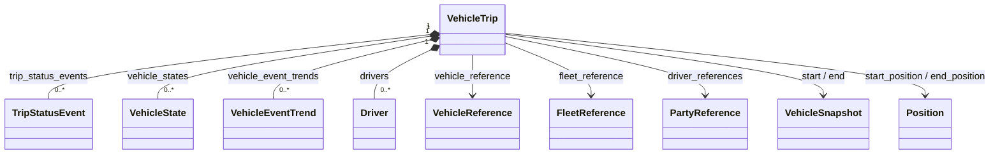
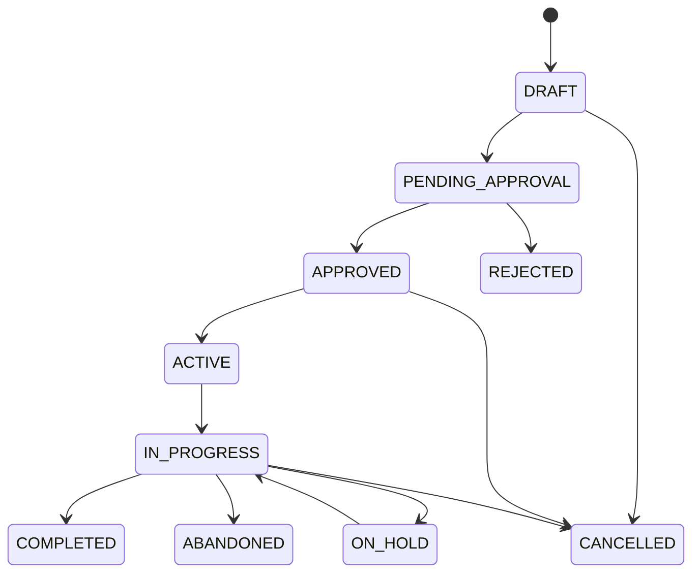

# STAR Domain Documentation — Vehicle Trip

> **Source of truth:** `vehicle_trip_clazz.puml` (uploaded model). **Status:** model-grounded reference with separately labeled recommendations. **JSON naming:** snake_case conversion of PlantUML camelCase. **Validation status:** illustrative examples are not certified against an executable JSON Schema. PlantUML does not establish required fields, numeric formats, state transition permissions, or API endpoints.

## 1. Business Purpose

`VehicleTrip` represents an observed or planned vehicle journey, capturing the vehicle and driver associations, fleet and assignment context, trip start/end snapshots, timing, distance and duration, trip status/stage history, vehicle states, fuel-economy metrics, and trends. It supports fleet utilization, trip traceability, driver performance analysis, telemetry reconciliation, journey reporting, and operational exception handling.

**Boundary:** The trip owns its trip-centric record and nested status-event history, driver records, state records, and trend entries as represented by composition links in the model. It **references** vehicle, fleet, and parties; it does not own the vehicle or fleet master record. `vehicleAssignmentKey`, `scheduleKey`, `accountKey`, and `fleetItemKey` are cross-context identifiers. The PlantUML diagram does not assert an explicit connection to `VehicleTransferOrder` or `VehicleTransportSession`; avoid inventing one.

**Business capabilities:** create/register trips; associate vehicle/driver/fleet; record start/end snapshots and positions; append status events; record driver behavior and vehicle states; capture mileage, duration, and MPG; produce trip and fleet analytics.

## 2. Domain Model

### Aggregate composition and references



**Interpretation:** The diagram's `*--` associations indicate composition, while `--` indicates an association. The cardinalities above are documentation illustrations inferred from singular fields and lists; the PlantUML source does not explicitly declare multiplicity or transactional consistency boundaries. `start` and `end` are `VehicleSnapshot` objects, not location strings. `driverReferences` is a list of `PartyReference`; `drivers` is a separate list of `Driver` with behavior and metrics.

### Related model elements

- **Trip history:** `TripStatusEvent` (previous/current status and stage, actor, positions, odometer, snapshots, timestamps, comments, business/financial context).
- **Vehicle telemetry:** `VehicleState`, `VehicleSnapshot`, `VehicleStatePosition`, `VehicleEventTrend`.
- **Driver analytics:** `Driver`, `DriverBehavior`, `DriverConfig`, `DriverMetric`, `DriverEvent`.
- **Supporting types:** `MetricValue`, `EffectivePeriod`, `Position`, `AccountMetric`, `ActorReference`, `BusinessContext`, `Narrative`, `MediaReference`, `Identifier`, `Code`, `PartyReference`, `FleetReference`.

## 3. Properties and Constraints

### VehicleTrip — exact source properties (camelCase) and types

> JSON examples below use equivalent snake_case keys. **No properties are explicitly required by the uploaded PlantUML.** Do not mistake proposed validations for source-model requirements.

| PlantUML property | Declared type | Constraint status |
|---|---|---|

| `vehicleTripKey` | `String` | Candidate identifier; confirm uniqueness and requiredness. |
| `vehicleTripId` | `String` | Candidate identifier; confirm uniqueness and requiredness. |
| `vehicleAssignmentKey` | `String` | Candidate identifier; confirm uniqueness and requiredness. |
| `accountKey` | `String` | Candidate identifier; confirm uniqueness and requiredness. |
| `fleetKey` | `String` | Candidate identifier; confirm uniqueness and requiredness. |
| `fleetItemKey` | `String` | Candidate identifier; confirm uniqueness and requiredness. |
| `scheduleKey` | `String` | Candidate identifier; confirm uniqueness and requiredness. |
| `vehicleReference` | `VehicleReference` | Optionality and constraints not specified in PlantUML. |
| `driverReferences` | `List<PartyReference>` | Optionality and constraints not specified in PlantUML. |
| `fleetReference` | `FleetReference` | Optionality and constraints not specified in PlantUML. |
| `tripStatusType` | `TripStatusTypes` | Optionality and constraints not specified in PlantUML. |
| `tripStageType` | `TripStageTypes` | Optionality and constraints not specified in PlantUML. |
| `tripStatusEvents` | `List<TripStatusEvent>` | Optionality and constraints not specified in PlantUML. |
| `start` | `VehicleSnapshot` | Optionality and constraints not specified in PlantUML. |
| `end` | `VehicleSnapshot` | Optionality and constraints not specified in PlantUML. |
| `startDateTime` | `Date` | Optionality and constraints not specified in PlantUML. |
| `endDateTime` | `Date` | Optionality and constraints not specified in PlantUML. |
| `startPosition` | `Position` | Optionality and constraints not specified in PlantUML. |
| `endPosition` | `Position` | Optionality and constraints not specified in PlantUML. |
| `vehicleStates` | `List<VehicleState>` | Optionality and constraints not specified in PlantUML. |
| `driverScore` | `String` | Optionality and constraints not specified in PlantUML. |
| `partialIndicator` | `Boolean` | Optionality and constraints not specified in PlantUML. |
| `tripDistance` | `MetricValue` | Optionality and constraints not specified in PlantUML. |
| `tripDuration` | `EffectivePeriod` | Optionality and constraints not specified in PlantUML. |
| `tripPurpose` | `String` | Optionality and constraints not specified in PlantUML. |
| `tripNotes` | `String` | Optionality and constraints not specified in PlantUML. |
| `drivers` | `List<Driver>` | Optionality and constraints not specified in PlantUML. |
| `vehicleTripEventType` | `VehicleTripEventTypes` | Optionality and constraints not specified in PlantUML. |
| `actualMpg` | `MetricValue` | Optionality and constraints not specified in PlantUML. |
| `expectedMpg` | `MetricValue` | Optionality and constraints not specified in PlantUML. |
| `vehicleEventTrends` | `List<VehicleEventTrend>` | Optionality and constraints not specified in PlantUML. |

### Source enumerations directly used by VehicleTrip

**`TripStatusTypes` (17 defined values):** `ABANDONED`, `ACTIVE`, `APPROVED`, `CANCELLED`, `COMPLETED`, `CUSTOMER_HOLD`, `DECLINED`, `DRAFT`, `EXPIRED`, `INVALID`, `IN_PROGRESS`, `ON_HOLD`, `PAYMENT_HOLD`, `PENDING_APPROVAL`, `REJECTED`, `VEHICLE_HOLD`, `WEATHER_HOLD`.

**`TripStageTypes` (30 defined values):** `ACTIVE`, `APPOINTMENT`, `CANCELLED`, `CHECKIN`, `CHECKOUT`, `CLOSE`, `CLOSED`, `COMPLETION`, `CUSTOMER_AUTHORIZATION`, `DETAIL`, `DISASSEMBLE`, `EVAL`, `EVAL_CONSULTATION`, `EVAL_QUEUE`, `FOLLOW_UP`, `INITIATE`, `INVOICE`, `ON_HOLD`, `OPEN`, `ORDER_PARTS`, `OTHER`, `PROPOSAL_BUILD`, `QUALITY_ASSURANCE`, `REASSEMBLE`, `REPAIR`, `RE_OPEN`, `UNKNOWN`, `VEHICLE_DELIVERY_IN`, `VEHICLE_DELIVERY_OUT`, `WORK_IN_PROGRESS`.

**`VehicleTripEventTypes` (4 defined values):** `BUSINESS`, `PERSONAL`, `PRIVATE`, `SERVICE`.

### Recommended invariants (not asserted by PlantUML)

| Rule ID | Proposed validation | Severity |
|---|---|---|
| VT-001 | `vehicle_trip_key` uniquely identifies a trip within its authority scope. | ERROR |
| VT-002 | `vehicle_reference` or a resolvable vehicle association exists before activation. | ERROR |
| VT-003 | `end_date_time` is not before `start_date_time` when both exist. | ERROR |
| VT-004 | `trip_distance` represents a nonnegative quantity with a documented unit convention; `MetricValue` itself has no explicit UOM field. | ERROR |
| VT-005 | `trip_status_events` have unique keys and chronological `event_sequence_num` ordering. | ERROR |
| VT-006 | Every transition records `previous_trip_status_type`, `trip_status_type`, `occurrence_date_time`, and the responsible actor where available. | WARN/ERROR |
| VT-007 | Completed trips normally have an end timestamp and/or end snapshot; define exception handling for partial trips. | ERROR/WARN |
| VT-008 | `actual_mpg` and `expected_mpg` are nonnegative numeric strings if provided; source declares `MetricValue.value` as `String`. | ERROR |
| VT-009 | `driver_references` and `drivers` are reconciled where both are populated. | WARN |
| VT-010 | `partial_indicator=true` is accompanied by an explanation or event when a trip is incomplete. | WARN |

**Type conventions:** PlantUML `Date` should map to an agreed ISO 8601 representation; `String` is not automatically a JSON number, even when semantically numeric (e.g., `driverScore`, `MetricValue.value`). Exact date timezone, precision, currency, distance units, and mandatory field rules require a normative schema or contract profile.

## 4. JSON Examples (snake_case)

The following examples are **illustrative payloads** assembled from declared properties and enum values. They are not claimed to satisfy mandatory-field requirements because none are specified in the diagram. Examples are intentionally progressively richer.

### A. Minimal trip record (draft)

```json
{
  "vehicle_trip_key": "TRIP-0001",
  "trip_status_type": "DRAFT",
  "vehicle_trip_event_type": "BUSINESS"
}
```

### B. Standard completed business trip

```json
{
  "vehicle_trip_key": "TRIP-1002",
  "vehicle_trip_id": "1002",
  "vehicle_assignment_key": "ASSIGN-27",
  "fleet_key": "FLEET-10",
  "vehicle_reference": {
    "vehicle_reference_key": "VEH-111",
    "vin": "1HGCM82633A004352",
    "make": "Honda",
    "model": "Accord",
    "model_year": "2024"
  },
  "driver_references": [
    {"party_reference_key": "PARTY-42", "party_name": "Assigned Driver"}
  ],
  "trip_status_type": "COMPLETED",
  "trip_stage_type": "CLOSED",
  "vehicle_trip_event_type": "BUSINESS",
  "start_date_time": "2026-10-27T09:00:00-04:00",
  "end_date_time": "2026-10-27T10:30:00-04:00",
  "start_position": {"latitude": "34.0754", "longitude": "-84.2941"},
  "end_position": {"latitude": "33.7490", "longitude": "-84.3880"},
  "trip_distance": {"metric_value_key": "DIST-1002", "value": "28.4"},
  "trip_duration": {
    "effective_period_key": "DUR-1002",
    "duration_uom_type": "MINUTES",
    "duration_value": "90"
  },
  "trip_purpose": "Fleet vehicle delivery",
  "partial_indicator": false,
  "trip_notes": "Vehicle delivered without incident"
}
```

**Unit caveat:** `trip_distance` does not itself declare a distance unit. The `MINUTES` duration enum must be checked against the actual `DurationUomTypes` list before publication; the example validation appendix includes this check.

### C. Advanced trip with history, driver behavior and vehicle telemetry

```json
{
  "vehicle_trip_key": "TRIP-2003",
  "account_key": "ACCOUNT-12",
  "fleet_key": "FLEET-10",
  "fleet_item_key": "ITEM-11",
  "schedule_key": "SCHED-22",
  "vehicle_reference": {"vehicle_reference_key": "VEH-111", "vin": "1HGCM82633A004352"},
  "fleet_reference": {"fleet_reference_key": "FREF-10", "fleet_key": "FLEET-10", "fleet_name": "Operations Fleet"},
  "driver_references": [{"party_reference_key": "PARTY-42", "party_name": "Assigned Driver"}],
  "trip_status_type": "IN_PROGRESS",
  "trip_stage_type": "ACTIVE",
  "vehicle_trip_event_type": "SERVICE",
  "start_date_time": "2026-10-28T08:00:00-04:00",
  "start": {
    "vehicle_snapshot_key": "SNAP-START-2003",
    "snapshot_type": "TRIP_START",
    "occurrence_date_time": "2026-10-28T08:00:00-04:00"
  },
  "start_position": {"latitude": "34.0754", "longitude": "-84.2941"},
  "trip_status_events": [
    {
      "trip_status_event_key": "EVT-2003-1",
      "event_sequence_num": "1",
      "trip_status_type": "ACTIVE",
      "previous_trip_status_type": "DRAFT",
      "trip_stage_type": "ACTIVE",
      "event_source": "FLEET_PLATFORM",
      "occurrence_date_time": "2026-10-28T08:00:00-04:00",
      "actor": {"actor_reference_key": "ACTOR-3", "actor_type": "APPLICATION"},
      "comments": "Trip started"
    }
  ],
  "vehicle_states": [
    {
      "vehicle_state_key": "STATE-1",
      "vehicle_state_name": "engine_status",
      "value": "ON",
      "vehicle_system_type": "ENGINE",
      "vehicle_state_type": "ON",
      "occurrence_date_time": "2026-10-28T08:05:00-04:00"
    }
  ],
  "drivers": [
    {
      "driver_key": "DRIVER-42",
      "person": {"party_reference_key": "PARTY-42"},
      "driver_behavior": {
        "driver_behavior_key": "DB-42",
        "driver_key": "DRIVER-42",
        "driver_events": [
          {"driver_event_key": "DE-1", "driver_key": "DRIVER-42", "value": "1", "occurrence_date": "2026-10-28T08:20:00-04:00"}
        ]
      }
    }
  ],
  "actual_mpg": {"metric_value_key": "MPG-1", "value": "27.8"},
  "expected_mpg": {"metric_value_key": "MPG-2", "value": "30.0"},
  "partial_indicator": true,
  "trip_notes": "Trip currently underway"
}
```

## 5. Lifecycle and Behaviors

### Source-model facts

- `tripStatusType` and `tripStageType` are **separate** enumerations; they must not be collapsed into a single state.
- `TripStatusEvent` stores current and previous status/stage, event sequence, actor, location, snapshots, event/record timestamps, delays, and optional financial context.
- The model provides status values but **does not define a transition graph**.

### Proposed lifecycle (requires domain approval)



**Additional defined statuses:** `CUSTOMER_HOLD`, `PAYMENT_HOLD`, `VEHICLE_HOLD`, `WEATHER_HOLD`, `DECLINED`, `EXPIRED`, and `INVALID` require business-specific transitions. `trip_stage_type` values such as `CHECKIN`, `CHECKOUT`, `REPAIR`, and `VEHICLE_DELIVERY_OUT` describe workflow stages, not necessarily physical trip progress.

### Proposed commands and events

| Command | Preconditions (proposed) | Event emitted (proposed) |
|---|---|---|
| `CreateVehicleTrip` | Unique trip key | `VehicleTripCreated` |
| `AssignTripDriver` | Authorized assignment | `TripDriverAssigned` |
| `StartVehicleTrip` | Valid vehicle/driver; permitted state | `VehicleTripStarted` |
| `RecordTripStatus` | Valid transition and event timestamp | `TripStatusRecorded` |
| `RecordVehicleState` | Valid source, timestamp, vehicle association | `TripVehicleStateRecorded` |
| `RecordTripSnapshot` | Authorized snapshot origin | `TripSnapshotRecorded` |
| `PlaceTripOnHold` | Reason supplied | `VehicleTripHeld` |
| `ResumeVehicleTrip` | Hold resolved | `VehicleTripResumed` |
| `CompleteVehicleTrip` | Required end evidence present | `VehicleTripCompleted` |
| `CancelVehicleTrip` | Allowed cancellation state | `VehicleTripCancelled` |

**Idempotency and concurrency recommendations:** require command idempotency keys; optimistic version checking; append-only event history; reject stale or duplicate event sequences; reconcile out-of-order telemetry separately from business status updates.

## 6. Governance

### Authority and ownership (recommended)

| Concern | Suggested owner/authority |
|---|---|
| Aggregate definition and business semantics | STAR domain governance group |
| Trip creation and dispatch | Fleet/transport operations |
| Vehicle/driver identity | Vehicle and party master-data authorities |
| Telematics event ingestion | Approved device/application integrations |
| Trip completion or correction | Authorized operations supervisor |
| Policy enforcement | Enterprise governance/policy service |

### Authorization matrix (proposed)

| Operation | Authorized role examples | Control |
|---|---|---|
| Read own assigned trip | Driver, dispatcher | Role and assignment scope |
| Read fleet-wide trips | Fleet manager, analyst | Tenant/fleet scope |
| Create/assign/start | Dispatcher, fleet manager | RBAC/ABAC + audit |
| Append telemetry | Trusted device/service identity | Source attestation, timestamp and integrity checks |
| Complete/cancel/correct | Authorized operator/supervisor | State-dependent approval and immutable correction history |
| Export location/driver behavior | Privacy-approved analyst | Purpose limitation, minimization, retention controls |

### Data classification and privacy

- **Sensitive operational data:** live/historical positions, routes, trip timestamps, vehicle VIN, fleet identifiers.
- **Potential personal data:** `driver_references`, driver behavior metrics/events, actor identities, communications in nested party references.
- **Potential financial data:** `TripStatusEvent.financialEventSnapshot`, account references and financial context.
- Apply least privilege, tenant isolation, encryption in transit/at rest, and location-data retention limits. `PrivacyPolicyRule`, `AuthorizationLevel`, and `JurisdictionProfile` exist as supporting model types; **their presence does not prove enforcement**.

### Consequence and audit requirements (recommended)

| Decision or failure | Potential consequence | Evidence |
|---|---|---|
| Unauthorized trip completion | False delivery/utilization reporting | Denied command, policy decision, actor, state |
| Tampered location/odometer | Incorrect mileage, billing, safety metrics | Raw vs normalized values, source/device, timestamps |
| Missing or late status event | Incorrect trip lifecycle reporting | Event sequence, ingestion delay, reconciliation action |
| Unauthorized driver tracking | Privacy exposure | Access decision, purpose, masking/retention policy |
| Duplicate completion | Double counting, billing errors | Idempotency key, prior outcome, command correlation |

Recommended audit fields: `event_id`, `aggregate_key`, `aggregate_version`, `command_id`, `correlation_id`, `actor`, `source_system`, `occurred_at`, `recorded_at`, `old_state`, `new_state`, `policy_id`, `decision`, `reason`, `payload_hash`, and `schema_version`. These are **governance envelope fields**, not additional `VehicleTrip` model properties.

## 7. Validation and Change Control

1. Generate a machine-readable JSON Schema from the authoritative model and an approved requiredness/constraint profile.
2. Validate each JSON example against that schema and all referenced enum definitions.
3. Validate domain invariants separately: chronology, trip completion, identity resolution, transition rules, idempotency, and authorization.
4. Maintain positive examples and one-fault negative mutations with expected error codes/paths.
5. On schema change, revalidate all published examples, report changed enum values/fields, and flag migration needs.
6. Publish an example only when it passes the intended schema and domain-policy checks.

**Example test manifest:**

```json
{
  "aggregate_root": "VehicleTrip",
  "example_id": "vehicle-trip-standard",
  "source_model": "vehicle_trip_clazz.puml",
  "expected_schema_valid": true,
  "expected_domain_valid": true,
  "validation_status": "NOT_EXECUTED"
}
```

### Suggested negative tests

| Test ID | Mutation | Expected violation |
|---|---|---|
| VT-NEG-001 | Set `trip_status_type` to `FLYING` | Enum constraint |
| VT-NEG-002 | Set `end_date_time` before `start_date_time` | VT-003 |
| VT-NEG-003 | Set `trip_distance.value` to `-5` | VT-004 |
| VT-NEG-004 | Duplicate a `trip_status_event_key` | VT-005 |
| VT-NEG-005 | Complete without required end evidence | VT-007 (if approved) |
| VT-NEG-006 | Update trip from unauthorized fleet | Authorization policy |

## Appendix A. Nested model property reference

The following tables are extracted from the uploaded PlantUML. Source names remain camelCase; transform to snake_case for JSON. No requiredness is implied.


### `TripStatusEvent`

| Property | Declared type | Constraint status |
|---|---|---|
| `tripStatusEventKey` | `String` | Candidate identifier; confirm uniqueness and requiredness. |
| `tripStatusEventId` | `String` | Candidate identifier; confirm uniqueness and requiredness. |
| `eventSequenceNum` | `String` | Optionality and constraints not specified in PlantUML. |
| `tripStatusType` | `TripStatusTypes` | Optionality and constraints not specified in PlantUML. |
| `tripStageType` | `TripStageTypes` | Optionality and constraints not specified in PlantUML. |
| `previousTripStatusType` | `TripStatusTypes` | Optionality and constraints not specified in PlantUML. |
| `previousTripStageType` | `TripStageTypes` | Optionality and constraints not specified in PlantUML. |
| `eventSource` | `String` | Optionality and constraints not specified in PlantUML. |
| `actor` | `ActorReference` | Optionality and constraints not specified in PlantUML. |
| `position` | `Position` | Optionality and constraints not specified in PlantUML. |
| `odometer` | `MetricValue` | Optionality and constraints not specified in PlantUML. |
| `vehicleSnapshots` | `List<VehicleSnapshot>` | Optionality and constraints not specified in PlantUML. |
| `occurrenceDateTime` | `Date` | Optionality and constraints not specified in PlantUML. |
| `recordedDateTime` | `Date` | Optionality and constraints not specified in PlantUML. |
| `eventDuration` | `EffectivePeriod` | Optionality and constraints not specified in PlantUML. |
| `delayDuration` | `EffectivePeriod` | Optionality and constraints not specified in PlantUML. |
| `tripStatusCodes` | `List<Code>` | Optionality and constraints not specified in PlantUML. |
| `comments` | `String` | Optionality and constraints not specified in PlantUML. |
| `businessContext` | `BusinessContext` | Optionality and constraints not specified in PlantUML. |
| `financialEventSnapshot` | `FinancialEventSnapshot` | Optionality and constraints not specified in PlantUML. |


### `VehicleReference`

| Property | Declared type | Constraint status |
|---|---|---|
| `vehicleReferenceKey` | `String` | Candidate identifier; confirm uniqueness and requiredness. |
| `vehicleReferenceId` | `String` | Candidate identifier; confirm uniqueness and requiredness. |
| `vehicleIdentifierKey` | `String` | Candidate identifier; confirm uniqueness and requiredness. |
| `vin` | `String` | Optionality and constraints not specified in PlantUML. |
| `modelYear` | `String` | Optionality and constraints not specified in PlantUML. |
| `make` | `String` | Optionality and constraints not specified in PlantUML. |
| `model` | `String` | Optionality and constraints not specified in PlantUML. |
| `trim` | `String` | Optionality and constraints not specified in PlantUML. |
| `displayName` | `String` | Optionality and constraints not specified in PlantUML. |
| `stockNumber` | `String` | Optionality and constraints not specified in PlantUML. |
| `licensePlate` | `String` | Optionality and constraints not specified in PlantUML. |
| `dealerCode` | `String` | Optionality and constraints not specified in PlantUML. |
| `identifiers` | `List<Identifier>` | Optionality and constraints not specified in PlantUML. |
| `tags` | `List<Code>` | Optionality and constraints not specified in PlantUML. |
| `bodyStyle` | `String` | Optionality and constraints not specified in PlantUML. |
| `trimCodes` | `List<Code>` | Optionality and constraints not specified in PlantUML. |
| `trimDdCodes` | `List<Code>` | Optionality and constraints not specified in PlantUML. |
| `finalAssemblyPoint` | `List<Code>` | Optionality and constraints not specified in PlantUML. |
| `fleetCodes` | `List<Code>` | Optionality and constraints not specified in PlantUML. |


### `FleetReference`

| Property | Declared type | Constraint status |
|---|---|---|
| `fleetReferenceKey` | `String` | Candidate identifier; confirm uniqueness and requiredness. |
| `fleetKey` | `String` | Candidate identifier; confirm uniqueness and requiredness. |
| `fleetId` | `String` | Candidate identifier; confirm uniqueness and requiredness. |
| `fleetNumber` | `String` | Optionality and constraints not specified in PlantUML. |
| `fleetName` | `String` | Optionality and constraints not specified in PlantUML. |
| `parentFleetKey` | `String` | Candidate identifier; confirm uniqueness and requiredness. |
| `parentFleetName` | `String` | Optionality and constraints not specified in PlantUML. |
| `fleetTypes` | `List<PartyTypes>` | Optionality and constraints not specified in PlantUML. |
| `displayName` | `String` | Optionality and constraints not specified in PlantUML. |
| `fleetCodes` | `List<Code>` | Optionality and constraints not specified in PlantUML. |


### `VehicleSnapshot`

| Property | Declared type | Constraint status |
|---|---|---|
| `vehicleSnapshotKey` | `String` | Candidate identifier; confirm uniqueness and requiredness. |
| `vehicleSnapshotId` | `String` | Candidate identifier; confirm uniqueness and requiredness. |
| `snapshotType` | `String` | Optionality and constraints not specified in PlantUML. |
| `snapshotSource` | `String` | Optionality and constraints not specified in PlantUML. |
| `parentEntityKey` | `String` | Candidate identifier; confirm uniqueness and requiredness. |
| `occurrenceDateTime` | `Date` | Optionality and constraints not specified in PlantUML. |
| `vehicleStatePosition` | `VehicleStatePosition` | Optionality and constraints not specified in PlantUML. |
| `vehicleStates` | `List<VehicleState>` | Optionality and constraints not specified in PlantUML. |
| `narratives` | `List<Narrative>` | Optionality and constraints not specified in PlantUML. |
| `mediaReferences` | `List<MediaReference>` | Optionality and constraints not specified in PlantUML. |
| `snapshotCodes` | `List<Code>` | Optionality and constraints not specified in PlantUML. |
| `serviceMilestoneTypes` | `ServiceMilestoneTypes` | Optionality and constraints not specified in PlantUML. |


### `VehicleState`

| Property | Declared type | Constraint status |
|---|---|---|
| `vehicleStateKey` | `String` | Candidate identifier; confirm uniqueness and requiredness. |
| `vehicleStateId` | `String` | Candidate identifier; confirm uniqueness and requiredness. |
| `vehicleStateName` | `String` | Optionality and constraints not specified in PlantUML. |
| `value` | `String` | Optionality and constraints not specified in PlantUML. |
| `vehicleSystemType` | `VehicleSystemTypes` | Optionality and constraints not specified in PlantUML. |
| `vehicleResourceType` | `VehicleResourceTypes` | Optionality and constraints not specified in PlantUML. |
| `vehicleValueType` | `VehicleStateUomTypes` | Optionality and constraints not specified in PlantUML. |
| `vehicleStateType` | `VehicleStateTypes` | Optionality and constraints not specified in PlantUML. |
| `vehicleStatusType` | `VehicleStatusTypes` | Optionality and constraints not specified in PlantUML. |
| `occurrenceDateTime` | `Date` | Optionality and constraints not specified in PlantUML. |
| `recordedDateTime` | `Date` | Optionality and constraints not specified in PlantUML. |
| `vehicleStatePosition` | `VehicleStatePosition` | Optionality and constraints not specified in PlantUML. |
| `narratives` | `List<Narrative>` | Optionality and constraints not specified in PlantUML. |
| `vehicleStateCodes` | `List<Code>` | Optionality and constraints not specified in PlantUML. |


### `VehicleStatePosition`

| Property | Declared type | Constraint status |
|---|---|---|
| `vehicleStatePositionKey` | `String` | Candidate identifier; confirm uniqueness and requiredness. |
| `vehicleStatePositionId` | `String` | Candidate identifier; confirm uniqueness and requiredness. |
| `positionType` | `String` | Optionality and constraints not specified in PlantUML. |
| `position` | `Position` | Optionality and constraints not specified in PlantUML. |
| `address` | `Address` | Optionality and constraints not specified in PlantUML. |
| `dop` | `String` | Optionality and constraints not specified in PlantUML. |
| `altitude` | `MetricValue` | Optionality and constraints not specified in PlantUML. |
| `bearing` | `MetricValue` | Optionality and constraints not specified in PlantUML. |
| `speed` | `MetricValue` | Optionality and constraints not specified in PlantUML. |
| `horizontalAccuracy` | `MetricValue` | Optionality and constraints not specified in PlantUML. |
| `verticalAccuracy` | `MetricValue` | Optionality and constraints not specified in PlantUML. |
| `occurrenceDateTime` | `Date` | Optionality and constraints not specified in PlantUML. |
| `recordedDateTime` | `Date` | Optionality and constraints not specified in PlantUML. |
| `maskIndicator` | `Boolean` | Optionality and constraints not specified in PlantUML. |
| `positionCodes` | `List<Code>` | Optionality and constraints not specified in PlantUML. |


### `Position`

| Property | Declared type | Constraint status |
|---|---|---|
| `positionId` | `String` | Candidate identifier; confirm uniqueness and requiredness. |
| `positionKey` | `String` | Candidate identifier; confirm uniqueness and requiredness. |
| `latitude` | `String` | Optionality and constraints not specified in PlantUML. |
| `longitude` | `String` | Optionality and constraints not specified in PlantUML. |
| `altitude` | `String` | Optionality and constraints not specified in PlantUML. |
| `bearing` | `String` | Optionality and constraints not specified in PlantUML. |
| `postalCode` | `String` | Optionality and constraints not specified in PlantUML. |
| `countyCode` | `String` | Optionality and constraints not specified in PlantUML. |


### `Driver`

| Property | Declared type | Constraint status |
|---|---|---|
| `driverKey` | `String` | Candidate identifier; confirm uniqueness and requiredness. |
| `driverId` | `String` | Candidate identifier; confirm uniqueness and requiredness. |
| `person` | `PartyReference` | Optionality and constraints not specified in PlantUML. |
| `staffMemberKeys` | `List<Code>` | Optionality and constraints not specified in PlantUML. |
| `lastTripEndTime` | `Date` | Optionality and constraints not specified in PlantUML. |
| `score` | `String` | Optionality and constraints not specified in PlantUML. |
| `driverBehavior` | `DriverBehavior` | Optionality and constraints not specified in PlantUML. |


### `DriverBehavior`

| Property | Declared type | Constraint status |
|---|---|---|
| `driverKey` | `String` | Candidate identifier; confirm uniqueness and requiredness. |
| `driverBehaviorId` | `String` | Candidate identifier; confirm uniqueness and requiredness. |
| `driverBehaviorKey` | `String` | Candidate identifier; confirm uniqueness and requiredness. |
| `driverConfigs` | `List<DriverConfig>` | Optionality and constraints not specified in PlantUML. |
| `driverMetrics` | `List<DriverMetric>` | Optionality and constraints not specified in PlantUML. |
| `driverEvents` | `List<DriverEvent>` | Optionality and constraints not specified in PlantUML. |


### `DriverConfig`

| Property | Declared type | Constraint status |
|---|---|---|
| `driverConfigKey` | `String` | Candidate identifier; confirm uniqueness and requiredness. |
| `driverKey` | `String` | Candidate identifier; confirm uniqueness and requiredness. |
| `resourceKey` | `String` | Candidate identifier; confirm uniqueness and requiredness. |
| `resourceType` | `ResourceTypes` | Optionality and constraints not specified in PlantUML. |
| `occurrenceDate` | `Date` | Optionality and constraints not specified in PlantUML. |
| `value` | `String` | Optionality and constraints not specified in PlantUML. |
| `valueType` | `ValueTypes` | Optionality and constraints not specified in PlantUML. |
| `driverUnitOfMeasureType` | `DriverUnitOfMeasureTypes` | Optionality and constraints not specified in PlantUML. |
| `minThreshold` | `String` | Optionality and constraints not specified in PlantUML. |
| `maxThreshold` | `String` | Optionality and constraints not specified in PlantUML. |
| `codes` | `List<Code>` | Optionality and constraints not specified in PlantUML. |


### `DriverMetric`

| Property | Declared type | Constraint status |
|---|---|---|
| `driverMetricKey` | `String` | Candidate identifier; confirm uniqueness and requiredness. |
| `driverKey` | `String` | Candidate identifier; confirm uniqueness and requiredness. |
| `occurrenceDate` | `Date` | Optionality and constraints not specified in PlantUML. |
| `value` | `String` | Optionality and constraints not specified in PlantUML. |
| `valueType` | `ValueTypes` | Optionality and constraints not specified in PlantUML. |
| `driverUnitOfMeasureType` | `DriverUnitOfMeasureTypes` | Optionality and constraints not specified in PlantUML. |
| `aggregationType` | `AggregationTypes` | Optionality and constraints not specified in PlantUML. |
| `duration` | `EffectivePeriod` | Optionality and constraints not specified in PlantUML. |
| `resourceTypes` | `ResourceTypes` | Optionality and constraints not specified in PlantUML. |
| `identifiers` | `List<Identifier>` | Optionality and constraints not specified in PlantUML. |
| `codes` | `List<Code>` | Optionality and constraints not specified in PlantUML. |


### `DriverEvent`

| Property | Declared type | Constraint status |
|---|---|---|
| `driverEventKey` | `String` | Candidate identifier; confirm uniqueness and requiredness. |
| `driverKey` | `String` | Candidate identifier; confirm uniqueness and requiredness. |
| `occurrenceDate` | `Date` | Optionality and constraints not specified in PlantUML. |
| `value` | `String` | Optionality and constraints not specified in PlantUML. |
| `valueType` | `ValueTypes` | Optionality and constraints not specified in PlantUML. |
| `codes` | `List<Code>` | Optionality and constraints not specified in PlantUML. |
| `identifiers` | `List<Identifier>` | Optionality and constraints not specified in PlantUML. |
| `actor` | `ActorReference` | Optionality and constraints not specified in PlantUML. |
| `businessContext` | `BusinessContext` | Optionality and constraints not specified in PlantUML. |
| `financialEventSnapshot` | `FinancialEventSnapshot` | Optionality and constraints not specified in PlantUML. |


### `VehicleEventTrend`

| Property | Declared type | Constraint status |
|---|---|---|
| `trendKey` | `String` | Candidate identifier; confirm uniqueness and requiredness. |
| `trendId` | `String` | Candidate identifier; confirm uniqueness and requiredness. |
| `occurrenceDate` | `Date` | Optionality and constraints not specified in PlantUML. |
| `duration` | `EffectivePeriod` | Optionality and constraints not specified in PlantUML. |
| `trendMetrics` | `List<AccountMetric>` | Optionality and constraints not specified in PlantUML. |
| `accountKey` | `String` | Candidate identifier; confirm uniqueness and requiredness. |
| `tags` | `List<Code>` | Optionality and constraints not specified in PlantUML. |
| `identifiers` | `List<Identifier>` | Optionality and constraints not specified in PlantUML. |
| `aggregationType` | `AggregationTypes` | Optionality and constraints not specified in PlantUML. |
| `resourceTypes` | `VehicleResourceTypes` | Optionality and constraints not specified in PlantUML. |


### `MetricValue`

| Property | Declared type | Constraint status |
|---|---|---|
| `metricValueId` | `String` | Candidate identifier; confirm uniqueness and requiredness. |
| `metricValueKey` | `String` | Candidate identifier; confirm uniqueness and requiredness. |
| `value` | `String` | Optionality and constraints not specified in PlantUML. |
| `codes` | `List<Code>` | Optionality and constraints not specified in PlantUML. |


### `EffectivePeriod`

| Property | Declared type | Constraint status |
|---|---|---|
| `effectivePeriodKey` | `String` | Candidate identifier; confirm uniqueness and requiredness. |
| `activeIndicator` | `Boolean` | Optionality and constraints not specified in PlantUML. |
| `exclusiveIndicator` | `Boolean` | Optionality and constraints not specified in PlantUML. |
| `startDateTime` | `Date` | Optionality and constraints not specified in PlantUML. |
| `completeDateTime` | `Date` | Optionality and constraints not specified in PlantUML. |
| `durationUomType` | `DurationUomTypes` | Optionality and constraints not specified in PlantUML. |
| `durationValue` | `String` | Optionality and constraints not specified in PlantUML. |
| `recurUomType` | `DurationUomTypes` | Optionality and constraints not specified in PlantUML. |
| `recurCount` | `String` | Optionality and constraints not specified in PlantUML. |
| `recurValues` | `List<Code>` | Optionality and constraints not specified in PlantUML. |
| `recurCriteria` | `String` | Optionality and constraints not specified in PlantUML. |
| `recurIndicator` | `Boolean` | Optionality and constraints not specified in PlantUML. |


### `PartyReference`

| Property | Declared type | Constraint status |
|---|---|---|
| `partyReferenceId` | `String` | Candidate identifier; confirm uniqueness and requiredness. |
| `partyReferenceKey` | `String` | Candidate identifier; confirm uniqueness and requiredness. |
| `partyKey` | `String` | Candidate identifier; confirm uniqueness and requiredness. |
| `partyName` | `String` | Optionality and constraints not specified in PlantUML. |
| `individualName` | `PersonName` | Optionality and constraints not specified in PlantUML. |
| `partyType` | `PartyTypes` | Optionality and constraints not specified in PlantUML. |
| `authorizationCode` | `String` | Optionality and constraints not specified in PlantUML. |
| `sourceSystemCode` | `String` | Optionality and constraints not specified in PlantUML. |
| `context` | `String` | Optionality and constraints not specified in PlantUML. |
| `accountNumber` | `String` | Optionality and constraints not specified in PlantUML. |
| `partyLabel` | `String` | Optionality and constraints not specified in PlantUML. |
| `partyDescription` | `String` | Optionality and constraints not specified in PlantUML. |
| `primaryRoleName` | `String` | Optionality and constraints not specified in PlantUML. |
| `partyRelationshipTypes` | `List<PartyRelationshipTypes>` | Optionality and constraints not specified in PlantUML. |
| `snapshotDetail` | `Identifier` | Optionality and constraints not specified in PlantUML. |
| `addressReferences` | `List<AddressReference>` | Optionality and constraints not specified in PlantUML. |
| `communicationChannels` | `List<CommunicationChannel>` | Optionality and constraints not specified in PlantUML. |
| `occurrenceDateTime` | `Date` | Optionality and constraints not specified in PlantUML. |
| `orgIndicator` | `Boolean` | Optionality and constraints not specified in PlantUML. |
| `identifiers` | `List<Identifier>` | Optionality and constraints not specified in PlantUML. |


### `ActorReference`

| Property | Declared type | Constraint status |
|---|---|---|
| `actorReferenceId` | `String` | Candidate identifier; confirm uniqueness and requiredness. |
| `actorReferenceKey` | `String` | Candidate identifier; confirm uniqueness and requiredness. |
| `actorKey` | `String` | Candidate identifier; confirm uniqueness and requiredness. |
| `actorName` | `String` | Optionality and constraints not specified in PlantUML. |
| `actorType` | `ActorTypes` | Optionality and constraints not specified in PlantUML. |
| `privacyPolicyRules` | `List<PrivacyPolicyRule>` | Optionality and constraints not specified in PlantUML. |
| `occurrenceDateTime` | `Date` | Optionality and constraints not specified in PlantUML. |


### `BusinessContext`

| Property | Declared type | Constraint status |
|---|---|---|
| `intentCode` | `String` | Optionality and constraints not specified in PlantUML. |
| `businessActionCode` | `String` | Optionality and constraints not specified in PlantUML. |
| `correlationId` | `String` | Candidate identifier; confirm uniqueness and requiredness. |
| `previousBalance` | `GeneralAmount` | Optionality and constraints not specified in PlantUML. |
| `resultingBalance` | `GeneralAmount` | Optionality and constraints not specified in PlantUML. |


### `AccountMetric`

| Property | Declared type | Constraint status |
|---|---|---|
| `accountMetricKey` | `String` | Candidate identifier; confirm uniqueness and requiredness. |
| `value` | `String` | Optionality and constraints not specified in PlantUML. |
| `valueType` | `ValueTypes` | Optionality and constraints not specified in PlantUML. |
| `occurrenceDate` | `Date` | Optionality and constraints not specified in PlantUML. |

## Appendix B. Source fidelity notes

- Every `VehicleTrip` field in Section 3 comes directly from the uploaded model.
- Enumerations listed as source-defined are extracted verbatim.
- Proposed commands, events, transitions, invariants, and governance are design recommendations, not PlantUML assertions.
- `Date` serialization and all `MetricValue` units require explicit profile decisions.
- `VehicleTrip` is distinct from `VehicleTransferOrder` and `VehicleTransportSession`; integration relationships require explicit identifiers or contracts.
